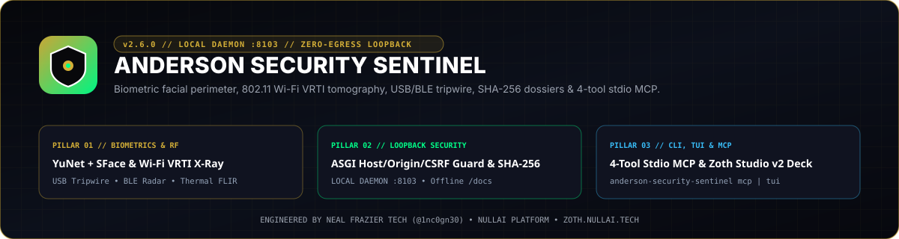

<div align="center">
  
</div>

<br />

<div align="center">
  <a href="https://zoth.nullai.tech/tools/anderson-security-sentinel"></a>
  <a href="http://127.0.0.1:8103"></a>
  <a href="https://buy.stripe.com/3cIfZg27PdKo2D64Ocfw40X"></a>
  <a href="LICENSE"></a>
</div>

# Anderson Security Sentinel (`v2.6.0`)

Local loopback biometric workstation perimeter daemon (`127.0.0.1:8103`) combining OpenCV `YuNet` + `SFace` facial recognition, shoulder-surfing detection, `sysfs` USB BadUSB/HID tripwire protection, BlueZ BLE proximity radar, 802.11 RSSI variance RF tomography (`WifiXrayEngine`), simulated thermal/night-vision optics shaders, SHA-256 chain-of-custody incident dossiers, and a zero-dependency 4-tool JSON-RPC 2.0 stdio MCP server.

## Overview

| Property | Specification |
| :--- | :--- |
| **Tool ID** | `anderson-security-sentinel` |
| **Version** | `2.6.0` |
| **Category** | `Security & OpSec` |
| **Execution Type** | `local-daemon` (`127.0.0.1:8103`) |
| **Loopback Workstation** | `http://127.0.0.1:8103` (`python3 server.py --host 127.0.0.1 --port 8103`) |
| **Offline OpenAPI Docs** | `http://127.0.0.1:8103/docs` (zero CDN egress) |
| **Zoth Studio v2 Dossier** | [`https://zoth.nullai.tech/tools/anderson-security-sentinel`](https://zoth.nullai.tech/tools/anderson-security-sentinel) (`http://127.0.0.1:3000/tools/anderson-security-sentinel`) |
| **ZothOS CLI & Live TUI** | `anderson-security-sentinel` (aliases `anderson-sentinel`, `anderson`) & `anderson-security-sentinel-tui` |
| **Stdio MCP Server** | `anderson-security-sentinel mcp` (`sentinel_status`, `sentinel_scan_rf`, `sentinel_perimeter`, `sentinel_dossier`) |
| **Biometric Pipeline** | OpenCV ONNX `YuNet` (5-point landmarks) + `SFace` (128-D cosine similarity `>= 0.363`) |
| **License** | MIT — 100% Free & Open-Access (Zero Paywalls) |

## Architecture & Security Hardening

1. **Loopback ASGI Security Middleware (`web/server.py`, `control/panel.py`)**
   - Enforces a strict loopback `Host` header allowlist (`localhost`, `127.0.0.1`, `[::1]`) and parsed loopback `Origin` allowlist across `GET`, `POST`, `OPTIONS`, `HEAD`, and `WS` (blocking DNS rebinding and port-suffix spoofs with `403 JSON`).
   - Enforces CSRF checks on all mutating `POST` routes, optional `ANDERSON_API_TOKEN` Bearer auth (`hmac.compare_digest`), streaming `128 KiB` request body limits (`413 Payload Too Large`), and `X-Frame-Options` / `X-Content-Type-Options` / `Referrer-Policy` headers.
   - Blocks symlink path traversal on `/api/intruders/{filename}`, escapes all HTML forensic dossier fields via `html.escape`, and validates webhook URLs against loopback/RFC1918/link-local SSRF.
2. **Local Biometric & Liveness Engine (`engine/detector.py`, `engine/camera_stream.py`)**
   - Captures V4L2 webcam frames on CPU with exponential backoff (`1s -> 30s`) when absent (or clean standby via `ANDERSON_CAMERA_INDEX=-1`), detects faces with `YuNet`, matches 128-D `SFace` embeddings against `~/.config/anderson_security/enrolled_faces.npz`, and evaluates Laplacian skin-texture variance.
3. **802.11 RF Tomography & Optical Fusion (`engine/wifi_xray.py`, `engine/rf_tomography.py`)**
   - Converts ambient 2.4/5 GHz RSSI measurements into indoor log-distance path-loss estimates, reconstructs a `25x25` VRTI voxel grid, fuses optical face bounding boxes (`box`) into RF ground-truth coordinates, and tracks moving centroids via `KalmanHumanTracker`.
4. **Hardware Tripwire & BLE Counter-Surveillance (`engine/usb_guard.py`, `engine/bluetooth_scanner.py`)**
   - Diffs `/sys/bus/usb/devices/` against `~/.config/anderson_security/usb_baseline.json` to trigger `loginctl lock-session` upon rogue USB insertion.
   - Monitors BlueZ `bluetoothctl` RSSI proximity against user-configured `trusted_bluetooth_macs` and scans RF beacons for camera OUI prefixes (`engine/surveillance_scanner.py`).
5. **Tamper-Evident Incident Dossier (`engine/forensic_dossier.py`)**
   - Seals SHA-256 digests of certified snapshots, USB/BLE/RF telemetry, and incident logs into JSON (`/api/export_dossier`) or XSS-escaped printable HTML (`/api/export_dossier_html`).

## Quickstart

```bash
git clone https://github.com/1nc0gn30/anderson-security-sentinel.git
cd anderson-security-sentinel
python3 -m pip install -e .

# Start the FastAPI loopback workstation on 127.0.0.1:8103
python3 server.py --host 127.0.0.1 --port 8103

# Or start in camera-standby mode (no /dev/video0 capture)
ANDERSON_CAMERA_INDEX=-1 python3 server.py --host 127.0.0.1 --port 8103
```

## CLI, Live TUI & MCP Usage

### Unified ZothOS CLI (`anderson-security-sentinel`)

```bash
anderson-security-sentinel --version
anderson-security-sentinel serve
anderson-security-sentinel status        # or --status / --json
anderson-security-sentinel xray          # Live Wi-Fi VRTI tomography JSON
anderson-security-sentinel dossier       # SHA-256 chain-of-custody summary JSON
anderson-security-sentinel arm | disarm
anderson-security-sentinel tui           # Live :8103 Braille telemetry TUI
anderson-security-sentinel mcp           # Stdio JSON-RPC 2.0 MCP server
```

### Live Braille TUI (`anderson-security-sentinel-tui`)

```bash
anderson-security-sentinel-tui --status
anderson-security-sentinel-tui --json
anderson-security-sentinel-tui --watch
```

### Stdio MCP Server (`engine/mcp_server.py`)

Exposes four JSON-RPC 2.0 tools over stdio (`anderson-security-sentinel mcp`):

- `sentinel_status` — Daemon health, armed state, camera activity, and enrolled face template count.
- `sentinel_scan_rf` — Ambient 802.11 beacons, disturbance index, room bounds, VRTI grid state, and building perimeter.
- `sentinel_perimeter` — USB sysfs baseline, BlueZ BLE proximity devices, detected surveillance cameras, and building envelope.
- `sentinel_dossier` — SHA-256 sealed forensic chain-of-custody dossier.

### REST & WebSocket Endpoints (`127.0.0.1:8103`)

| Method & Route | Description |
| :--- | :--- |
| `GET\|HEAD /health` | Daemon health & version probe (`HEAD` returns `200 OK`, `0 B`) |
| `GET /docs`, `GET /openapi.json` | Zero-egress offline OpenAPI Explorer & schema |
| `GET /video_feed` | Async multipart MJPEG camera stream with biometric reticle & shader overlays |
| `GET /api/status` | Armed state, camera FPS, active target count, and enrolled template count |
| `GET\|POST /api/vision_mode` | Query or switch camera shader (`normal` / alias `optical`, `thermal`, `predator`; invalid modes return `422`) |
| `GET /api/usb_status`, `POST /api/usb/baseline` | Inspect `/sys/bus/usb/devices/` inventory or re-approve attached USB peripherals |
| `GET /api/bluetooth_status` | Operator BLE proximity and nearby beacon telemetry |
| `GET /api/wifi_xray`, `POST /api/wifi_xray/scan` | 802.11 RF tomography grid, Kalman state, and on-demand scan trigger |
| `GET /api/cameras`, `GET /api/building_perimeter` | Surveillance OUI scanner summary and differential RF building envelope |
| `POST /api/arm`, `POST /api/disarm` | Arm or disarm biometric and RF perimeter monitoring |
| `POST /api/enroll`, `POST /api/clear_faces` | Enroll current webcam face vector or purge stored templates |
| `POST /api/lockdown` | Lock the active Linux desktop session (`loginctl lock-session`) |
| `GET /api/settings`, `POST /api/settings` | Read or update bounded settings (strict SSRF & range validation) |
| `GET /api/intruders`, `GET /api/intruders/{filename}` | List or serve certified `.jpg` intruder snapshots (symlink/traversal blocked) |
| `GET /api/export_dossier`, `GET /api/export_dossier_html` | Export SHA-256 chain-of-custody dossier in JSON or escaped printable HTML |
| `WS /ws` | Real-time loopback telemetry stream for breach events, RF updates, and USB/BLE alerts |

## Testing & Verification

```bash
# Run offline unit, ASGI security, traversal, XSS, SSRF, MCP, and CLI test suite
python3 -m pytest -v tests/
```

## Support

Anderson Security Sentinel is 100% free and open-access with zero paywalls. Optional support:

- ☕ **Buy Us a Coffee (Stripe)**: [https://buy.stripe.com/3cIfZg27PdKo2D64Ocfw40X](https://buy.stripe.com/3cIfZg27PdKo2D64Ocfw40X)
- ◎ **Solana Tip Address**: `GG2eQbVh8ut1BK6j1A2tz7pSySdLpD38BgyEhGcxdXoK` (`solana:GG2eQbVh8ut1BK6j1A2tz7pSySdLpD38BgyEhGcxdXoK`)

## License

Released under the [MIT License](LICENSE). Engineered by **Neal Frazier Tech** (`@1nc0gn30`) • **NullAI Platform** ([https://nullai.tech](https://nullai.tech)).
