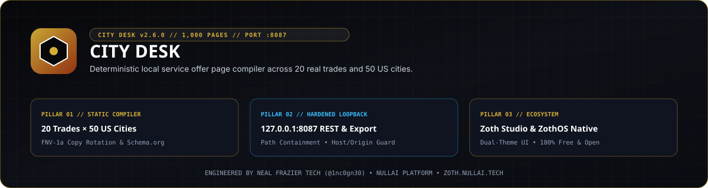

<p align="center">
  
</p>

# City Desk

Deterministic static site compiler and local trade offer page publisher generating **1,000 finished HTML pages** across **20 service trades** and **50 mid-size US cities**, paired with a hardened, zero-dependency Python 3 loopback server (`127.0.0.1:8087`).

- **Version**: `2.6.0`
- **Local Workstation Port**: `127.0.0.1:8087` (on-demand)
- **Zoth Studio Route**: [https://zoth.nullai.tech/tools/city-desk](https://zoth.nullai.tech/tools/city-desk)
- **Author**: Neal Frazier Tech ([@1nc0gn30](https://github.com/1nc0gn30)) • [NullAI Platform](https://nullai.tech)

## What It Does

`build.js` compiles **20 canonical service trade blueprints** across **50 mid-size US cities** (`20 × 50 = 1,000` localized pages plus trade/city indexes, `/terms`, `/privacy`, `/support`, `offers.json`, `sitemap.xml`, `robots.txt`, `llms.txt`, and `/.well-known/` JSON manifests) into `site/`.

### 20 Canonical Trades (`data.js`)
`painters` ($800), `plumbers` ($900), `hvac` ($1,100), `roofers` ($1,000), `electricians` ($1,000), `garage-doors` ($700), `landscapers` ($800), `cleaners` ($700), `detailers` ($700), `junk-removal` ($700), `pest-control` ($800), `movers` ($900), `groomers` ($700), `dentists` ($1,500), `med-spas` ($1,400), `gyms` ($900), `restaurants` ($1,200), `food-trucks` ($800), `auto-repair` ($1,000), `property-managers` ($1,300).

*(Listed amounts are reference single-page valuation anchors shown on offer sheets; City Desk itself and all standalone HTML exports are 100% free and open-access.)*

### 50 Canonical US Cities (`data.js`)
Boise ID, Spokane WA, Tacoma WA, Eugene OR, Salem OR, Bend OR, Reno NV, Tucson AZ, Albuquerque NM, El Paso TX, Lubbock TX, Amarillo TX, Corpus Christi TX, Shreveport LA, Lafayette LA, Mobile AL, Huntsville AL, Montgomery AL, Jackson MS, Little Rock AR, Fayetteville AR, Tulsa OK, Wichita KS, Des Moines IA, Cedar Rapids IA, Omaha NE, Sioux Falls SD, Fargo ND, Billings MT, Madison WI, Green Bay WI, Grand Rapids MI, Ann Arbor MI, Fort Wayne IN, Raleigh NC, Norfolk VA, Toledo OH, Dayton OH, Akron OH, Lexington KY, Knoxville TN, Chattanooga TN, Greenville SC, Savannah GA, Augusta GA, Chesapeake VA, Springfield MO, Fort Collins CO, Provo UT, Gainesville FL.

## How It Works

- **Deterministic Copy Rotation**: FNV-1a hashing (`build.js`) rotates headlines, ledes, work blocks, and FAQs per city+trade and checks every compiled page at build time for unique `<title>` tags, intact internal links, and zero banned hype phrases.
- **Live Synthesizer & 60s Written Price Estimator**: `city_engine.js` powers live trade/city/business preview assembly on `/`, URL query personalization (`?biz=...&phone=...&email=...`), interactive ballpark written estimate ranges, safe DOM rendering, and escaped single-file `.html` downloads with `\u003c`-escaped JSON-LD.
- **Dual-Theme Parity**: Full Editorial Ivory Light (`[data-theme="light"]`) and Obsidian Gold Dark (`[data-theme="dark"]`) tokens with a persistent header theme toggle, `?theme=light|dark`, `prefers-color-scheme`, and Zoth Studio `postMessage` sync.
- **Hardened Loopback Server (`server.py`)**:
  - Strict `SITE_DIR` path containment (`unquote` + `.resolve().is_relative_to(SITE_DIR)`) blocking traversal (`..`, `%2e%2e`, symlink escapes) with `403 JSON`.
  - Strict `Host` (`127.0.0.1`, `localhost`, `[::1]`) and `Origin` allowlists with `Vary: Origin` (zero wildcard `ACAO: *`).
  - `1 MiB` (`MAX_BODY_BYTES = 1_048_576`) request body cap (`413 JSON`), strict `Content-Length` & JSON object validation (`400 JSON`), `HEAD` support, JSON `404` for unknown `/api/*`, and `X-Frame-Options`, `X-Content-Type-Options`, `Referrer-Policy`, and loopback `Content-Security-Policy` headers.
  - Dynamic single source of truth loading all 20 trades and 50 cities directly from `site/api/services.json` and `site/offers.json`.

## Architecture

```text
city-desk/
├── build.js                     # Zero-dependency Node.js static compiler + invariant checker
├── data.js                      # Canonical 20 trade blueprints & 50 US cities
├── config.js                    # Origin, reply-to, and studio label settings
├── city_engine.js               # Dual-theme controller, live synthesizer, estimator & HTML exporter
├── style.css                    # Editorial Ivory & Obsidian Gold dual-theme stylesheet
├── server.py                    # Hardened Python 3 ThreadingHTTPServer & REST API (:8087)
├── bin/city-desk                # CLI entrypoint (--status, --trades, --cities, --build, --serve, --tui)
├── bin/city-desk-tui            # Live :8087 health & site/offers.json inventory Braille TUI
├── site/                        # Compiled static output (1,000 trade×city pages + legal + JSON APIs)
└── test/
    ├── build.test.js            # Node.js built-in build/HTML/PII/SEO verification suite
    └── test_server_security.py  # Pytest HTTP security, CORS, Host, traversal & API parity suite
```

## Quickstart

```bash
git clone https://github.com/1nc0gn30/city-desk.git
cd city-desk

# Compile all 1,000 localized trade pages, legal pages, sitemaps, and JSON indexes
node build.js

# Start the hardened local HTTP & REST server on 127.0.0.1:8087
python3 server.py --host 127.0.0.1 --port 8087
```

## ZothOS CLI, TUI & REST API Commands

### CLI & TUI
```bash
city-desk --help
city-desk --version
city-desk --status --json
city-desk --trades --json
city-desk --cities --json
city-desk --build
city-desk --serve

# Live :8087 health + site/offers.json inventory telemetry
city-desk-tui --json
city-desk-tui --benchmark
```

### Loopback REST API & Static Discovery (`http://127.0.0.1:8087`)

| Method | Endpoint | Description |
| :--- | :--- | :--- |
| `GET`, `HEAD` | `/health` | Daemon health, version (`2.6.0`), uptime, port, and live trade/city/page counts |
| `GET` | `/api/status`, `/api/info` | Service metadata, indexed page counts, and workbench URLs |
| `GET` | `/api/trades`, `/api/services` | Canonical 20 trade blueprints loaded dynamically from `site/api/services.json` |
| `GET` | `/api/cities` | Canonical 50 US cities loaded dynamically from `site/offers.json` |
| `GET` | `/api/offers` | Filterable manifest of all 1,000 compiled `{city, state, service, price, path}` entries (`?trade=&city=`) |
| `POST` | `/api/synth`, `/api/generate` | Validate `{trade, city, biz, phone}` and return properly encoded `preview_url` (`/cities/{city}/{trade}/?...`) |
| `POST` | `/api/lead` | Validate lead/spec submissions (`application/json` or form-encoded) and return a `201` receipt |
| `GET` | `/terms`, `/privacy`, `/support` | Dual-theme legal and support pages |
| `GET` | `/offers.json`, `/.well-known/mcp.json` | Static offer manifest and MCP static resource descriptor (note: City Desk exposes static discovery JSON + REST endpoints, not a stdio MCP server) |

## Testing & Verification

```bash
npm test                                   # Node.js build, link, escaping, PII & SEO tests
pytest -q test/test_server_security.py     # Python path traversal, Host, CORS, body cap & parity tests
python3 server.py --status --json
```

## Support

City Desk is 100% free and open-access with zero paywalls. Optional voluntary support:
- [☕ Buy Us a Coffee (Stripe)](https://buy.stripe.com/3cIfZg27PdKo2D64Ocfw40X)
- Solana Tip Address: `GG2eQbVh8ut1BK6j1A2tz7pSySdLpD38BgyEhGcxdXoK`

## License

Released under the [MIT License](LICENSE). Engineered by Neal Frazier Tech ([@1nc0gn30](https://github.com/1nc0gn30)) • [NullAI Platform](https://nullai.tech).
