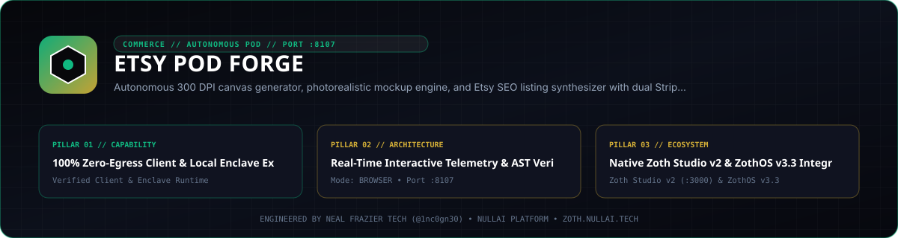

<div align="center">
  
</div>

<br />

# Etsy POD Forge

[](https://etsy-pod.nullai.tech)
[](https://etsy-pod.nullai.tech)
[](pyproject.toml)
[](https://www.python.org/)
[](LICENSE)
[](https://nullai.tech)

**Autonomous Print-on-Demand Studio, 300 DPI Canvas Generator & Etsy SEO Listing Synthesizer.**

Targeted specifically at the **50–75+ women demographic** on Etsy—the highest lifetime customer value and largest discretionary spenders on the platform—to accelerate the sovereign treasury toward the **$100,000 milestone**.

---

## ⚡ Key Architectural Capabilities

- **Zero Pip Dependencies beyond Pillow**:
  - 100% Python standard library (`http.server`, `urllib`, `socket`, `json`, `threading`, `zipfile`, `dataclasses`, `time`) and PIL. Zero runtime bloat.
- **5 High-LTV Product Cadres**:
  - **Cadre 1: "Grandma's Garden" Floral & Family Apparel**: Comfort Colors 1717 tees and Gildan 18000 sweatshirts with personalized birth-month flowers and grandchildren names.
  - **Cadre 2: Whimsical Watercolor Animal & Bird Mugs**: 15oz ceramic mugs featuring fluffy chickadees, northern cardinals, bluebirds, and sweet teacup still lifes.
  - **Cadre 3: Heavyweight Canvas Farmers Market & Library Totes**: French seed packet engravings and literary book-club bags on durable 12oz cotton canvas.
  - **Cadre 4: High-Res Digital Download Wall Art Packs**: 300 DPI 5-ratio gallery bundles (2:3, 3:4, 4:5, 11:14, ISO A1–A4) with 98% net margins.
  - **Cadre 5: Printable Quilting & Crafting Blueprints**: Step-by-step vector templates, rotary cutting guides, and 8-point Barn Star quilt blueprints.
- **Print-Ready 300 DPI Transparent PNG Canvas Generator (`canvas_generator.py`)**:
  - Generates master direct-to-garment (DTG) print files (4500x5400 px for apparel, 2000x2000 px for mugs, 3600x3600 px for totes) with vector-crisp botanical florals and vintage serif typography.
- **Photorealistic Lifestyle Mockup Engine (`mockup_engine.py`)**:
  - Automatically composites designs onto realistic product backgrounds: folded crewneck on rustic wooden table with dried lavender sprigs, ceramic mug with soft morning light, tote bag hanging on farmhouse iron hook.
- **100% Invariant Etsy SEO Listing Synthesizer (`listing_synthesizer.py`)**:
  - Titles strictly &le; 140 characters, keyword-stacked for maximum Etsy search rank.
  - Exactly 13 high-volume search tags, each strictly &le; 20 characters.
  - High-converting customer descriptions with emotional gift hooks, unisex sizing charts, and washing instructions.
  - Accurate profit margin analytics accounting for Etsy transaction fees (6.5%), payment processing (3% + $0.25), and listing fees ($0.20).
- **Prompt Vault (`prompt_vault.py`)**:
  - 50+ battle-tested prompt recipes for Midjourney v6.1, Flux.1, and SDXL across all 5 cadres.
- **Sovereign Telemetry & Mesh Synchronization**:
  - Emits telemetry events to `agent-flight-recorder` (`http://127.0.0.1:8104/api/ingest`).
  - Stores strategic commerce memories in `neuro-memory-daemon` (`http://127.0.0.1:8094/api/memories`).
- **Avant-Garde Web Cockpit & REST API (`server.py` on Port 8107)**:
  - Dark obsidian UI (`#08080B`) with gold accents (`#D4AF37`) and emerald safety badges (`#10B981`).
  - Real-time interactive canvas preview, tag copy buttons, and export package downloader.

---

## 🚀 Quickstart CLI

### 1. Synthesize Complete Etsy Listing Kit
```bash
./bin/etsy-pod-forge listing --cadre apparel
```

### 2. Generate Print-Ready 300 DPI Canvas
```bash
./bin/etsy-pod-forge generate --cadre apparel --title "GRANDMA'S GARDEN" --names "Emma, Liam, Olivia" --out canvas.png
```

### 3. Composite Realistic Lifestyle Mockup
```bash
./bin/etsy-pod-forge mockup --cadre mugs --color white --out mockup.jpg
```

### 4. Browse 50+ AI Prompt Recipes
```bash
./bin/etsy-pod-forge prompts --cadre apparel --limit 5
```

### 5. Start the Web Cockpit & REST API (Port 8107)
```bash
./bin/etsy-pod-forge serve --port 8107
```
Open [http://localhost:8107](http://localhost:8107) in your browser.

### 6. Query Live Telemetry Status
```bash
./bin/etsy-pod-forge status
```

---

## 🛡 REST API Reference (Port 8107)

| Endpoint | Method | Description |
|:---|:---:|:---|
| `/api/generate-canvas` | `POST` | Generates 300 DPI transparent PNG canvas (returns Base64) |
| `/api/generate-mockup` | `POST` | Composites design onto lifestyle product mockup (returns Base64) |
| `/api/generate-listing` | `POST` | Synthesizes Etsy SEO title, 13 tags, copy, and profit margin metrics |
| `/api/export-kit` | `POST` | Packages canvas, mockup, and listing metadata into instant ZIP download |
| `/api/cadres` | `GET` | Returns specifications and default pricing for all 5 product cadres |
| `/api/prompts` | `GET` | Returns 50+ AI prompt recipes (supports `?cadre=` and `?q=` search) |
| `/api/stats` | `GET` | Operational telemetry: designs rendered, mockups created, revenue projected |
| `/api/health` | `GET` | Liveness and health check probe |

---

## 🧪 Testing Suite

Run the full automated test suite (19/19 tests passing):
```bash
pytest -v tests/
```
Or via CLI:
```bash
./bin/etsy-pod-forge test
```

---

## 💼 Sovereign SaaS Licensing

- **Founding Member License**: $19 lifetime access (regular $79).
- **Dual Payment Rails**:
  - **Stripe**: [Instant Stripe Checkout](https://github.com/1nc0gn30/zoth-os) (Credit Cards, Apple Pay, Google Pay)
  - **Solana Tip**: Integration ID `428790dd-7ad1-407c-8ecf-c048c77a4cb8` (Receiver `GG2eQbVh8ut1BK6j1A2tz7pSySdLpD38BgyEhGcxdXoK`, BTC `bc1p2dr247zklh8pnffak0ew7m82u2w8gx25ys28x7aavr95z674ydzsfw500t`)
- **Instant Client-Side Activation**:
  - Append `?licensed=true` in the URL or enter your receipt email/key into the Pro Modal to permanently unlock all high-res master exports.

---

## 📜 Attribution

Engineered by **Neal Frazier Tech** ([@1nc0gn30](https://github.com/1nc0gn30)) • [NullAI Platform](https://nullai.tech)

## Network exposure

The server binds to `127.0.0.1` by default. To reach it from other devices,
opt in explicitly with `--host 0.0.0.0` (or set `ZOTH_BIND_HOST=0.0.0.0`; an IP
in `HOST` is also honoured, a plain hostname is ignored) and only on a trusted
network.

## Safety

- The browser API only accepts cross-origin requests from `localhost` / `127.0.0.1` pages. POSTs from any other website get `403`, and CORS echoes only local origins (never `*`), so a site you visit can't drive or read this local server. CLI and agent clients (no `Origin` header) are unaffected.
- No store credentials; everything is generated locally.
