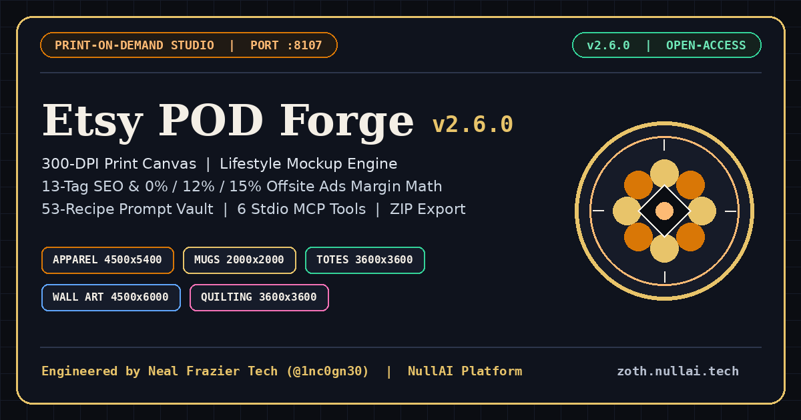

# Etsy POD Forge (`v2.6.0`)



**Local 300-DPI Print-on-Demand Canvas Generator, Lifestyle Mockup Compositor, 13-Tag Etsy SEO & 2026 Offsite Ads Margin Studio, 53-Recipe Prompt Vault, and 6-Tool Stdio MCP Server.**

100% Free & Open-Access · Zero Paywalls · Zero External CDN Egress · Strict Loopback Security (`127.0.0.1:8107`)

---

## What It Does

Etsy POD Forge runs a local Python 3 + Pillow workstation (`http://127.0.0.1:8107`) paired with a Zoth Studio v2 God-Mode route (`/tools/etsy-pod-forge`), CLI, Braille TUI, and JSON-RPC 2.0 stdio MCP server:

- **5 Print-on-Demand Cadres**:
  - `apparel` — `4500 × 5400 px` @ 300 DPI (`$34.99` retail / `$12.50` base COGS · Printify BP `#638` Provider `#29` · Gelato Heavyweight Crewneck)
  - `mugs` — `2000 × 2000 px` @ 300 DPI (`$21.99` retail / `$6.80` base COGS · Printify BP `#68` Provider `#26` · Gelato 15oz Ceramic Mug)
  - `totes` — `3600 × 3600 px` @ 300 DPI (`$24.99` retail / `$7.20` base COGS · Printify BP `#1090` Provider `#3` · Gelato Heavyweight Cotton Tote)
  - `wall_art` — `4500 × 6000 px` @ 300 DPI (`$29.99` retail / `$8.50` base COGS · Printify BP `#49` Provider `#29` · Gelato 18×24 Archival Matte)
  - `crafting` — `3600 × 3600 px` @ 300 DPI (`$18.99` retail / `$4.20` base COGS · Printify BP `#554` Provider `#29` · Gelato Spiral Pattern Guide)
- **Real 300-DPI Canvas & Lifestyle Mockup Engines**: Synthesizes transparent RGBA print canvases (`CanvasGenerator`) and composites them onto 1400×1400 / 1600×1200 lifestyle scenes (`MockupEngine`).
- **2026 Etsy Fee & Offsite Ads Margin Engine**: Computes `$0.20` listing fee, `6.5%` transaction fee (item + buyer shipping), `3% + $0.25` US payment processing, optional `0%`, `12%` (`>= $10k/yr`), and `15%` (`< $10k/yr`) Offsite Ads tiers, net profit, margin %, ROI %, and exact break-even price.
- **140-Char Title & 13-Tag Synthesizer + Master ZIP Export**: Generates compliant Etsy listing metadata and bundles `{cadre}_print_canvas.png`, `{cadre}_lifestyle_mockup.jpg`, `listing_details.txt`, and `listing_data.json` via both `POST` and `GET /api/export-kit`.
- **53-Recipe Curated Prompt Vault**: Filterable by cadre and keyword across Midjourney v6.1 / Flux.1 specifications.
- **Dual-Theme Workstation UI**: Full Editorial Ivory Light Mode and Obsidian Gold Dark Mode (`?theme=light|dark&embed=1`, toggle button, `prefers-color-scheme`) with zero Google Fonts or external CDN requests.

---

## How It Works

1. **Hardened Loopback HTTP Server (`src/etsy_pod_forge/server.py`)**:
   - Binds strictly to `127.0.0.1:8107` by default.
   - Enforces loopback `Host` header validation (`403 Forbidden`), exact-port `Origin` CORS allowlist (`127.0.0.1:<port>`, `localhost:<port>`, `[::1]:<port>`, `:3000`; rejects spoofed `:81070` and external origins with `403` + `Vary: Origin`), all 4 security headers (`X-Frame-Options`, `X-Content-Type-Options`, `Referrer-Policy`, `Content-Security-Policy`), `1 MiB` request body ceiling (`413`), strict JSON/type validation (`400`), disabled directory listings (`403`), and whitelisted `cadre` keys preventing Zip-Slip / header injection.
   - Zero unsolicited background network calls.
2. **REST API Endpoints (`http://127.0.0.1:8107`)**:
   - `GET / HEAD /health`, `/api/health`, `/api/stats`, `/api/cadres`, `/api/prompts`, `/api/mcp/tools`
   - `POST /api/generate-canvas`, `POST /api/generate-mockup`, `POST /api/generate-listing`, `POST /api/calculate-margins`
   - `GET / POST /api/export-kit`

---

## ZothOS CLI, Braille TUI & 6-Tool Stdio MCP Commands

```bash
# Start hardened local workstation on 127.0.0.1:8107
etsy-pod-forge serve --port 8107

# Check daemon & local engine status
etsy-pod-forge --status
etsy-pod-forge --json

# Synthesize compliant Etsy listing JSON (pure JSON stdout)
etsy-pod-forge listing --cadre apparel --title "Grandma's Garden" --offsite-ads-rate 0.12 --json

# Generate 300-DPI RGBA canvas and lifestyle mockup
etsy-pod-forge generate --cadre apparel --preview --out apparel_canvas.png
etsy-pod-forge mockup --cadre mugs --color white --out mug_mockup.jpg

# Browse the 53-recipe Prompt Vault
etsy-pod-forge prompts --cadre wall_art --limit 5

# Launch the Unicode U+2800 Braille TUI telemetry snapshot
etsy-pod-forge-tui --once
etsy-pod-forge-tui --once --json

# Launch the JSON-RPC 2.0 stdio MCP server
etsy-pod-forge mcp
# Or via Python module:
python3 -m etsy_pod_forge.cli mcp
```

### Registered MCP Tools (`6`)
1. `pod_list_cadres` — 5 POD cadres, 300-DPI dimensions, default pricing, Printify blueprint/provider IDs, Gelato v4 UIDs
2. `pod_generate_canvas` — 300-DPI RGBA print-ready PNG metadata + base64 preview
3. `pod_generate_mockup` — 1400×1400 / 1600×1200 lifestyle mockup JPEG + base64 preview
4. `pod_synthesize_listing` — 140-char title, 13 unique `<= 20`-char tags, SEO score, description, and 2026 margin math
5. `pod_calculate_margins` — Exact 2026 Etsy fees (`0%` / `12%` / `15%` Offsite Ads), shipping, net profit, ROI %, break-even price
6. `pod_search_prompts` — Search/filter the 53-recipe curated Prompt Vault by cadre and keyword

---

## Running Tests

```bash
PYTHONPATH=src pytest -q tests/
```

---

## Support & Attribution

- **100% Free & Open-Access** — Zero paywalls or license locks.
- Optional support: [Buy Us a Coffee (Stripe)](https://buy.stripe.com/3cIfZg27PdKo2D64Ocfw40X) · Solana Tip: `GG2eQbVh8ut1BK6j1A2tz7pSySdLpD38BgyEhGcxdXoK`
- **Engineered by Neal Frazier Tech (@1nc0gn30) • NullAI Platform** · [GitHub](https://github.com/1nc0gn30/etsy-pod-forge) · [nullai.tech](https://nullai.tech)
