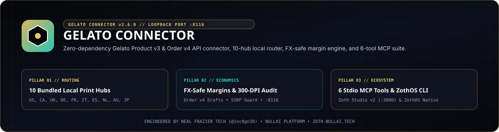

<p align="center">
  
</p>

# Gelato Connector (`v2.6.0`)

Zero-dependency Python 3.10+ toolkit and dual-theme loopback browser workstation for Gelato print-on-demand operations: a 7-product reference catalog with Gelato Order API v4 `product_uid`s, a 10-hub local production shipping engine (`US, CA, UK/GB, DE, FR, IT, ES, NL, AU, JP`), an FX-safe multi-currency (`USD, EUR, GBP, CAD, AUD, JPY`) margin calculator, a 300-DPI artwork & bleed auditor, an SSRF-guarded Order API v4 draft payload builder, a hardened loopback HTTP workstation (`127.0.0.1:8116`), and a 6-tool JSON-RPC 2.0 stdio MCP server.

- Zoth Studio v2 route: `https://zoth.nullai.tech/tools/gelato-connector` (`http://127.0.0.1:3000/tools/gelato-connector`)
- Local workstation: `http://127.0.0.1:8116`
- Runtime dependencies: none (100% Python Standard Library)
- License: MIT

## What It Does

- **Bundled Catalog (`catalog.py`)**: 7 curated print products (`acrylic_print_16x24`, `aluminum_print_16x24`, `wooden_framed_canvas_16x24`, `stanley_stella_organic_tee`, `ceramic_mug_15oz`, `enamel_campfire_mug`, `hardcover_photo_journal`) with real Gelato Order API v4 `product_uid` strings, USD/EUR/GBP base costs, weights, and 300-DPI print specs.
- **10-Hub Local Shipping Engine (`shipping_engine.py`)**: Quotes local production rates, carriers, lead times, and FX-converted cross-border freight savings across 10 bundled hub countries (`US`, `CA`, `UK`/`GB`, `DE`, `FR`, `IT`, `ES`, `NL`, `AU`, `JP`). Non-hub or non-local routes fall back to cross-border USD transit quotes with accurate customs notices.
- **FX-Safe Multi-Currency Margin Engine (`margin_engine.py`)**: Converts destination hub shipping costs (such as `650 JPY` -> `$4.33 USD`) into the chosen calculation currency (`USD`, `EUR`, `GBP`, `CAD`, `AUD`, `JPY`) before computing COGS, channel fees (Etsy `9.5% + $0.45`, Shopify & Direct Stripe `2.9% + $0.30`), net profit, margin %, break-even price, and recommended pricing tiers.
- **300-DPI Artwork & Bleed Auditor (`artwork_auditor.py`)**: Validates positive pixel dimensions (`width > 0`, `height > 0`), effective DPI, aspect ratio, and perimeter bleed compliance (marking `0 mm` bleed DTG apparel like `stanley_stella_organic_tee` as compliant).
- **Order API v4 Payload Builder & SSRF Guard (`client.py`)**: Synthesizes schema-valid payloads targeting `POST https://order.gelatoapis.com/v4/orders` with safe `"orderType": "draft"` default, real Gelato v4 `productUid`, and strict `validate_public_https_url()` protection blocking `file://`, `http://`, `localhost`, loopback, RFC1918 private, and `169.254.169.254` IMDS URLs.
- **Live Key Verification (`client.py`)**: When `GELATO_API_KEY` is exported, verifies against `GET https://product.gelatoapis.com/v3/catalogs`. Without a key, reports `api_connected: false` and `mode: "OFFLINE"` honestly.

Catalog costs, reference FX rates, hub lead times, and shipping fees are bundled planning figures. Confirm live figures in your Gelato dashboard before publishing retail prices.

## How It Works

```text
src/gelato_connector/
├── catalog.py          # 7 bundled products with Gelato Order v4 product_uid + slug lookup
├── shipping_engine.py  # 10-hub LOCAL_HUBS table, UK/GB normalization, FX_TO_USD conversion
├── margin_engine.py    # FX-safe per-channel fees, net profit, break-even, price tiers
├── artwork_auditor.py  # Positive-dimension 300-DPI, aspect ratio, and DTG-aware bleed checks
├── client.py           # Product v3 & Order v4 client + validate_public_https_url SSRF guard
├── mcp_server.py       # JSON-RPC 2.0 stdio MCP server (6 tools)
├── server.py           # Hardened loopback HTTP API + dual-theme workstation from public/
└── cli.py              # `gelato-connector` CLI (status, desktop, serve, mcp, catalog, shipping, margins, audit)
bin/gelato-connector       # Portable CLI launcher (ZOTH_REPO_DIR -> checkout -> /opt/gelato-connector)
bin/gelato-connector-tui   # Real margin/shipping benchmark + live :8116 status probe (--status, --once, --json)
public/                    # Editorial Ivory Light + Obsidian Gold Dark workstation (zero CDN egress)
```

### Security Controls (`127.0.0.1:8116`)
- Loopback-only `Host` header allowlist (`403 Forbidden` on DNS-rebinding hosts).
- Exact-port loopback `Origin` allowlist (`:8116` and Studio `:3000`; `403 Forbidden` on spoofed port suffixes like `:81160` and external origins across `GET`, `HEAD`, `OPTIONS`, `POST`, always emitting `Vary: Origin`, never `*`).
- All 4 HTTP security headers (`X-Frame-Options: SAMEORIGIN`, `X-Content-Type-Options: nosniff`, `Referrer-Policy: strict-origin-when-cross-origin`, and `Content-Security-Policy` with loopback `frame-ancestors`).
- Static directory listing disabled (`GET /assets/` -> `403 Forbidden` JSON), `HEAD` supported on `/health` & `/api/*`, `1 MiB` request body cap (`413`), and strict JSON/numeric/dimension validation (`400`).

## Install & Run

```bash
git clone https://github.com/1nc0gn30/gelato-connector.git
cd gelato-connector
python3 server.py --host 127.0.0.1 --port 8116
# or via CLI:
gelato-connector serve --host 127.0.0.1 --port 8116
# or via ZothOS user systemd service:
systemctl --user status gelato-connector.service
```

## ZothOS CLI & MCP Commands

```bash
gelato-connector --version
gelato-connector status --json
gelato-connector --status
gelato-connector desktop --dry-run --json
gelato-connector catalog
gelato-connector shipping --product wooden_framed_canvas_16x24 --country JP
gelato-connector margins --product wooden_framed_canvas_16x24 --price 68 --currency USD --country JP
gelato-connector audit --product stanley_stella_organic_tee --width 4000 --height 4800
gelato-connector mcp

gelato-connector-tui --status --json
gelato-connector-tui --once --json
```

### MCP Tools (`gelato-connector mcp` / `GET /api/mcp/tools`)

| Tool | Description |
| :--- | :--- |
| `gelato_search_catalog` | Search the 7 bundled products and real Gelato Order v4 `product_uid`s |
| `gelato_get_shipping_quote` | Quote domestic or cross-border shipping with FX-converted freight savings |
| `gelato_calculate_margins` | Compute FX-safe COGS, channel fees, net profit, and break-even price |
| `gelato_audit_print_spec` | Audit pixel dimensions, effective DPI, aspect ratio, and bleed compliance |
| `gelato_create_order_payload` | Build safe `draft` Order API v4 JSON with public `https://` SSRF guard |
| `gelato_get_shop_info` | Verify `GELATO_API_KEY` against `/v3/catalogs` or report honest offline mode |

## REST API (`http://127.0.0.1:8116`)

| Method | Endpoint | Description |
| :--- | :--- | :--- |
| `GET` / `HEAD` | `/health`, `/api/health` | Service status, `v2.6.0`, bound port, `apiConfigured` |
| `GET` / `HEAD` | `/api/stats` | Bundled product count (`7`), hub count (`10`), currencies, MCP tool count (`6`) |
| `GET` / `HEAD` | `/api/products`, `/api/products/<id>` | Product catalog and single-item lookup |
| `GET` / `HEAD` | `/api/hubs` | 10 bundled hubs + `FX_TO_USD` reference table |
| `GET` / `HEAD` | `/api/mcp/tools` | Machine-readable list of all 6 MCP tools |
| `GET` | `/api/shop` | Live key verification or honest offline mode status |
| `POST` | `/api/margins` | FX-safe multi-channel margin calculation |
| `POST` | `/api/shipping` | Domestic/cross-border shipping quote & freight savings |
| `POST` | `/api/audit` | 300-DPI & bleed specification audit |
| `POST` | `/api/create-payload` | Safe `draft` Order API v4 JSON builder with SSRF URL guard |

## Testing

```bash
PYTHONPATH=src /opt/zothos-ai-env/bin/pytest -q
```

## Support

Gelato Connector is 100% free and open-access under the MIT license with zero paywalls.

- **Stripe**: [Buy Us a Coffee](https://buy.stripe.com/3cIfZg27PdKo2D64Ocfw40X)
- **Solana Tip**: `GG2eQbVh8ut1BK6j1A2tz7pSySdLpD38BgyEhGcxdXoK`

## License

MIT License — Engineered by Neal Frazier Tech ([@1nc0gn30](https://github.com/1nc0gn30)) • [NullAI Platform](https://nullai.tech).
