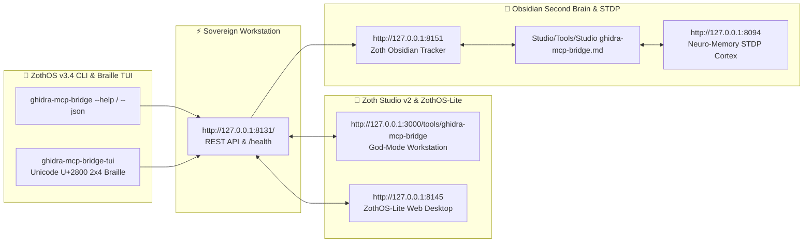

<div align="center">
  
</div>

<br />

<div align="center">
  <a href="https://zoth.nullai.tech/tools/ghidra-mcp-bridge"></a>
  <a href="http://127.0.0.1:8131"></a>
  <a href="https://nullai.tech"></a>
</div>

# ⚡ GhidraMCP Binary Reverse Engineering Bridge (`ghidra-mcp-bridge`)

> **LaurieWired Ghidra Model Context Protocol (MCP) bridge for autonomous binary decompilation, AST method analysis, and project variable annotation in the NullAI Platform.**

---

## 🏛️ Architectural Overview

**GhidraMCP Bridge** is an official sovereign reverse engineering tool in the **[Zoth Studio v2](https://zoth.nullai.tech)** (72-Tool Matrix) and **[ZothOS Linux 3.3](https://zothos.nullai.tech)** ecosystem, engineered by **1nc0gn30 • NullAI ([@1nc0gn30](https://github.com/1nc0gn30))**.

| Property | Specification |
| :--- | :--- |
| **Tool ID** | `ghidra-mcp-bridge` |
| **Category** | `Security & Enclave` |
| **Daemon Port** | `http://127.0.0.1:8131` |
| **Workbench Route** | `http://127.0.0.1:3000/tools/ghidra-mcp-bridge` |
| **Upstream Architecture** | [LaurieWired/GhidraMCP](https://github.com/LaurieWired/GhidraMCP) |
| **Protocol** | Model Context Protocol (MCP) 2024-11-05 via JSON-RPC 2.0 |
| **Execution Mode** | Local Enclave & MCP Server |
| **License** | 100% Free & Open Access (Zero Paywalls) |

---

## 💎 Key Capabilities

- **Autonomous Decompilation**: Exposes NSA Ghidra decompiler engine to LLMs and autonomous coding agents with zero cloud egress.
- **AST Method & Symbol Inspection**: Enumerates functions, data sections, and cross-references (XREFs) across x86_64, ARM, and MIPS binaries.
- **Variable & Stack Annotation**: Real-time renaming of decompiled variables and types directly synchronized back to Ghidra project files.
- **Dual-Pane Workstation**: Side-by-side native assembly instruction streams and syntax-highlighted C pseudocode.
- **JSON-RPC 2.0 MCP Protocol**: Native compatibility with Claude Code, Cursor, AGY, and Zoth Studio agents.

---

## 🚀 ZothOS CLI & Subcommands

Interact with the GhidraMCP bridge directly from your terminal:

```bash
# Check installation and live daemon telemetry
ghidra-mcp-bridge --status
# Or deterministic JSON telemetry
ghidra-mcp --json

# Decompile a function from a target binary
ghidra-bridge decompile zoth-vault-daemon main
ghidra-bridge decompile firmware-auth-arm Reset_Handler

# List available MCP tools
ghidra-mcp tools

# List indexed binary targets
ghidra-mcp programs

# Run local MCP daemon
ghidra-mcp-bridge serve --port 8131
```

---

## ☕ 100% Free Open Access & Sovereign Architecture

Every tool across the Zoth ecosystem is **100% free, open, and unlocked by default**. Zero paywalls, zero license modals, zero blur locks.

If you appreciate the sovereign reverse engineering tooling of ZothOS, consider supporting the continuous development:

* **☕ Buy Us a Coffee (Stripe)**: [buy.stripe.com/3cIfZg27PdKo2D64Ocfw40X](https://buy.stripe.com/3cIfZg27PdKo2D64Ocfw40X)
* **◎ Solana Tip Address**: `GG2eQbVh8ut1BK6j1A2tz7pSySdLpD38BgyEhGcxdXoK` (`solana:GG2eQbVh8ut1BK6j1A2tz7pSySdLpD38BgyEhGcxdXoK`)

---

<div align="center">
  <sub>Engineered by <b>1nc0gn30 • NullAI</b> (<a href="https://github.com/1nc0gn30">@1nc0gn30</a>) &bull; <a href="https://nullai.tech">NullAI Platform</a> &bull; <a href="https://zoth.nullai.tech">Zoth Studio v2</a></sub>
</div>

---

## 🏛️ ZothOS v3.4, Zoth Studio v2 & Obsidian Second Brain Ecosystem



### Cross-Surface Integration Matrix

| Surface | Endpoint / Binary | Capabilities |
| :--- | :--- | :--- |
| **Standalone Workstation** | `http://127.0.0.1:8131/` | 100% Free & Open-Access Web Deck, live `/health` & REST telemetry |
| **Zoth Studio v2 Route** | `http://127.0.0.1:3000/tools/ghidra-mcp-bridge` | Interactive God-Mode component inside Zoth Studio (`https://zoth.nullai.tech`) |
| **ZothOS v3.4 CLI & TUI** | `ghidra-mcp-bridge` / `ghidra-mcp-bridge-tui` | Global binary in `/usr/local/bin/` with Unicode `U+2800` Braille TUI & `--json` output |
| **ZothOS-Lite Web Desktop** | `http://127.0.0.1:8145` | Browser-native KDE-style window manager & terminal launcher |
| **Zoth Obsidian Tracker** | `http://127.0.0.1:8151` | Interactive Obsidian Second Brain vault explorer (`~/Documents/Obsidian Vault/Studio/Tools/Studio ghidra-mcp-bridge.md`) |
| **Neuro-Memory STDP Cortex** | `http://127.0.0.1:8094` | 3-Factor STDP synaptic memory daemon & 21-tool MCP server |

```bash
# Inspect CLI & Unicode U+2800 Braille TUI on ZothOS v3.4
ghidra-mcp-bridge --help
ghidra-mcp-bridge-tui --status
ghidra-mcp-bridge-tui --json

# Verify Second Brain Vault & 12-Step Verification Gallery on :8151
zoth-obsidian-tracker --verify
```

