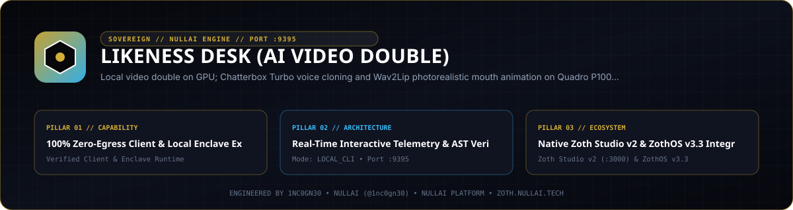
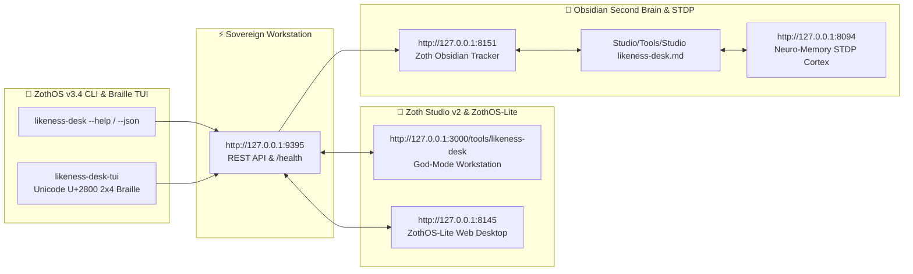

<div align="center">
  
</div>

<br />

<div align="center">
  <a href="https://zoth.nullai.tech/tools/likeness-desk"></a>
  <a href="https://zothos.nullai.tech"></a>
  <a href="https://nullai.tech"></a>
</div>

# ⚡ Likeness Desk (AI Video Double)

> **Local video double on GPU; Chatterbox Turbo voice cloning and Wav2Lip photorealistic mouth animation on Quadro P1000 with zero cloud leakage.**

---

## 🏛️ Architectural Overview

**Likeness Desk (AI Video Double)** is an official sovereign tool in the **[Zoth Studio v2](https://zoth.nullai.tech)** (72-Tool Matrix) and **[ZothOS Linux 3.3](https://zothos.nullai.tech)** ecosystem, engineered by **1nc0gn30 • NullAI ([@1nc0gn30](https://github.com/1nc0gn30))**.

| Property | Specification |
| :--- | :--- |
| **Tool ID** | `likeness-desk` |
| **Category** | `Voice & Real-Time` |
| **Loopback Port** | `http://127.0.0.1:9395` |
| **Execution Mode** | `local_cli` |
| **Zoth Studio Route** | [`https://zoth.nullai.tech/tools/likeness-desk`](https://zoth.nullai.tech/tools/likeness-desk) |

---

## 💎 Key Capabilities

- **100% Zero-Egress Client & Local Enclave Execution**
- **Real-Time Interactive Telemetry & AST Verification**
- **Native Zoth Studio v2 & ZothOS v3.4 Integration**
- **Zero-Egress Sovereign Guarantee**: Executes locally in-browser or on your loopback enclave (`127.0.0.1:9395`) with zero cloud telemetry.
- **Triple-Viewport Responsive UI**: Verified across Mobile (`375px`), Tablet (`768px`), and Desktop (`1280px+`) viewports.

---

## 🚀 Quick Start & ZothOS CLI

```bash
# Query live Quadro P1000 GPU and Chatterbox voice status
likeness --status
likeness status

# Synthesize speech via neural cloned voice directly from CLI
likeness speak "Deploying sovereign AI video double to local enclave."

# Start the background Node daemon
likeness serve --port 9395

# Supervise entire fleet from Zoth Studio v2
python3 ~/NullAITech/zoth-studio-v2/bin/ensure_fleet.py
```

---

## ☕ 100% Free Open-Access Architecture & Support

Likeness Desk is **100% free, unlocked, and sovereign by default**. There are zero paywalls, zero cloud subscriptions, zero telemetry leaks, and zero locked features.

If you appreciate local-first GPU AI engineering and zero cloud egress, support the ongoing mission:

- ☕ **Buy Us a Coffee (Stripe)**: [https://buy.stripe.com/3cIfZg27PdKo2D64Ocfw40X](https://buy.stripe.com/3cIfZg27PdKo2D64Ocfw40X)
- ◎ **Solana Tip Address**: `GG2eQbVh8ut1BK6j1A2tz7pSySdLpD38BgyEhGcxdXoK`

---

<div align="center">
  <sub>Engineered by <b>1nc0gn30 • NullAI</b> (<a href="https://github.com/1nc0gn30">@1nc0gn30</a>) &bull; <a href="https://nullai.tech">NullAI Platform</a> &bull; <a href="https://zoth.nullai.tech">Zoth Studio v2</a></sub>
</div>

---

## 🏛️ ZothOS v3.4, Zoth Studio v2 & Obsidian Second Brain Ecosystem



### Cross-Surface Integration Matrix

| Surface | Endpoint / Binary | Capabilities |
| :--- | :--- | :--- |
| **Standalone Workstation** | `http://127.0.0.1:9395` | 100% Free & Open-Access Web Deck, live `/health` & REST telemetry |
| **Zoth Studio v2 Route** | `http://127.0.0.1:3000/tools/likeness-desk` | Interactive God-Mode component inside Zoth Studio (`https://zoth.nullai.tech`) |
| **ZothOS v3.4 CLI & TUI** | `likeness-desk` / `likeness-desk-tui` | Global binary in `/usr/local/bin/` with Unicode `U+2800` Braille TUI & `--json` output |
| **ZothOS-Lite Web Desktop** | `http://127.0.0.1:8145` | Browser-native KDE-style window manager & terminal launcher |
| **Zoth Obsidian Tracker** | `http://127.0.0.1:8151` | Interactive Obsidian Second Brain vault explorer (`~/Documents/Obsidian Vault/Studio/Tools/Studio likeness-desk.md`) |
| **Neuro-Memory STDP Cortex** | `http://127.0.0.1:8094` | 3-Factor STDP synaptic memory daemon & 21-tool MCP server |

```bash
# Inspect CLI & Unicode U+2800 Braille TUI on ZothOS v3.4
likeness-desk --help
likeness-desk-tui --status
likeness-desk-tui --json

# Verify Second Brain Vault & 12-Step Verification Gallery on :8151
zoth-obsidian-tracker --verify
```

