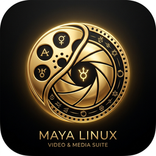

<div align="center">
  

  # Maya for Linux (Studio Pro `v2.0.0`)

  **Wrap screen recordings in 3D physical and vector device mockups, edit on a multi-track timeline, synthesize 60 FPS procedural motion clips, and export 4K MP4, transparent WebM, or CapCut drafts locally on Linux.**

  [](https://github.com/1nc0gn30/maya-linux)
  [](https://github.com/1nc0gn30/maya-linux)
  [](LICENSE)
</div>

---

## What It Does

Maya for Linux is a local-first desktop video studio (Electron + React 19 / Vite 6 + Python `maya_motion_engine.py`) packaged in ZothOS (`/opt/maya-linux` & `/usr/local/bin/maya`). All utilities, 4K/60 FPS exports, and headless motion presets are 100% open-access with zero paywalls.

### Core Capabilities

- **Device Framing & 3D Mockups**: iPhone 17/16/15 Pro, iPad Pro 11", MacBook Pro 14", Pixel 9 Pro, Apple Watch Ultra 2, Retro Terminal, Browser Frame, and Generic Phone bezel modes across `1:1`, `9:16`, `4:5`, `4:3`, and `16:9` canvases.
- **Multi-Track Timeline**: Zooms (6 easing curves + beat-sync), Taps, Typewriter stroke headings, Brand overlays, Lower Thirds, Captions, Stickers, Cinema Transitions, Speed segments (`0.25x`–`4x`), non-destructive In/Out trim, and Audio tracks.
- **60 FPS Procedural Motion Synth (In-App & Headless CLI)**: Generates zero-still-image 3D geometric motion clips with NumPy shaders, sub-pixel Braille streams, and synthesized audio (`zoth-sovereign-core`, `zoth-80-tool-arsenal`, `1nc0gn30-cyber-fortress`, `pantheon-hermes-swarm`, `vaelor-l1-gold-forge`, `world-of-zoth-citadel`).
- **Dual-Theme & Responsive UI**: Editorial Ivory Light Mode and Obsidian Dark Mode with persistent toggle, collapsible mobile/tablet settings drawer, and WCAG AA contrast.
- **Native Exports & CapCut Drafts**: Export 1080p/1440p/4K MP4 (60 FPS), 9:16 Vertical Reels/Shorts (`1080x1920`), transparent WebM alpha overlays, or CapCut/JianYing `draft_content.json` folders.

---

## How It Works & System Requirements

- **Runtime Dependencies**: Electron (`v34+`), `ffmpeg` (native RGBA pipe video export & headless motion engine), `python3` with `Pillow` and `numpy` (headless motion engine), optional `espeak-ng` (local offline voice synthesis), optional `yt-dlp` (manual YouTube audio extraction), and optional `edge-tts` (opt-in cloud neural TTS, disclosed in the UI).
- **Security Architecture**: Strict Electron process isolation (`nodeIntegration: false`, `contextIsolation: true`, `webSecurity: true`, `sandbox: true`), strict `Content-Security-Policy` with zero external font CDNs, `setWindowOpenHandler` / `will-navigate` guards, dialog-gated export paths, and zero shell interpolation in IPC handlers.
- **Clean-ISO Self-Contained Motion Engine**: `maya_motion_engine.py` bundles self-contained font fitting, karaoke caption layout, vector HUD, procedural audio synthesis, and WAV encoding helpers so headless renders work cleanly on any fresh Linux install without external dev scripts.

---

## ZothOS CLI Commands

```bash
maya                                               # Launch Maya Studio Pro GUI
maya /path/to/recording.mp4                        # Open a video directly in Maya
maya --version                                     # Print version (2.0.0)
maya --status [--json]                             # Check runtime paths & dependencies
maya --list-presets [--json]                       # List 6 headless 60fps motion presets
maya --render zoth-sovereign-core --out ~/Videos/maya-zoth-edits
maya --render all --out ~/Videos/maya-zoth-edits --mirror ~/Videos/maya-zoth-edits
```

---

## Keyboard Shortcuts

| Key | Action |
|---|---|
| `Space` | Play / Pause |
| `M` | Mute / Unmute |
| `I` / `O` | Set Trim In / Out Point |
| `S` | Split at Playhead |
| `Ctrl+Z` / `Ctrl+Shift+Z` | Undo / Redo |
| `Ctrl+S` / `Ctrl+O` | Save `.mayaproj` / Open Video |
| `Delete` / `Backspace` | Delete selected timeline event |
| `?` | Toggle Keyboard Shortcuts Cheat Sheet |

---

## Building & Testing from Source

```bash
git clone https://github.com/1nc0gn30/maya-linux.git
cd maya-linux
npm install
npm test                # Run Electron security & packaging checks
npm run build           # Build production Vite bundle into dist/
npm run app:dev         # Launch Electron desktop app in dev mode
npm run dist            # Package release/Maya-2.0.0.AppImage
```

---

## Attribution & Open-Access Support

Engineered by **Neal Frazier Tech (@1nc0gn30) • NullAI Platform**  
- Website: [https://nullai.tech](https://nullai.tech)  
- Repository: [https://github.com/1nc0gn30/maya-linux](https://github.com/1nc0gn30/maya-linux)  
- Support Open-Access Tools: [Buy Us a Coffee (Stripe)](https://buy.stripe.com/3cIfZg27PdKo2D64Ocfw40X)  
- Solana Tip Address: `GG2eQbVh8ut1BK6j1A2tz7pSySdLpD38BgyEhGcxdXoK`

Distributed under the [MIT License](LICENSE).
