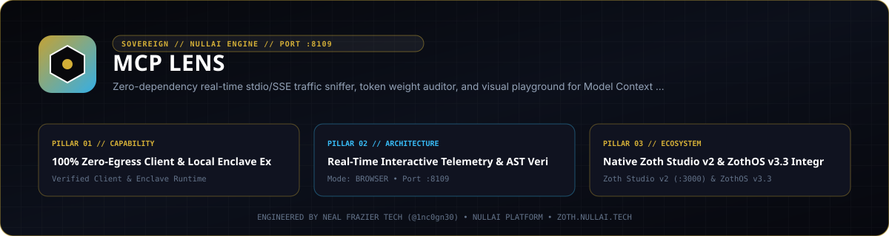
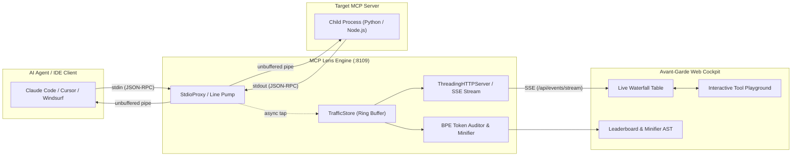

<div align="center">
  
</div>

<br />

# MCP Lens (⬡)

> ⚡ **Live Web Application**: [https://mcp-lens.netlify.app](https://mcp-lens.netlify.app)  
> 💳 **Unlock Pro Lifetime License ($19 One-Time, $0/mo)**: **[Instant Pro Unlock via Stripe](https://buy.stripe.com/4gMfZg9AheOsdhKbcAfw40L)** *(Use promo code `FOUNDER25` for 25% off)*  
> 🏆 **All-Access Sovereign Pro Bundle (All 44 Tools — $49 Lifetime)**: **[Get All 44 Studios via Stripe](https://buy.stripe.com/eVq14m5k16hW4Le0xWfw40M)**

> **The Zero-Dependency Real-Time Stdio/SSE Traffic Sniffer, Token Weight Auditor, and Visual Playground for the Model Context Protocol (MCP).**

[](https://opensource.org/licenses/MIT)
[](https://python.org)
[](#zero-dependencies)
[](#site-guardrail)
[](https://nullai.tech)


---

## 1. Problem & Core Utility

In 2026, autonomous coding agents (Claude Code, Cursor, Antigravity, Windsurf) integrate dozens of external MCP servers. Developers routinely face three critical pain points:
1. **Opaque Stdio Traffic**: JSON-RPC 2.0 communication flows invisibly over stdin/stdout pipes, making debugging tool failures, schema mismatches, and parsing errors nearly impossible in real-time.
2. **Context Window Token Bloat**: MCP tool schemas are packed with verbose multi-paragraph docstrings, markdown formatting, and redundant examples. A standard tool suite of 10–20 tools silently consumes **3,000 to 15,000 tokens on every single LLM prompt turn**.
3. **High-Overhead Tool Testing**: Testing a tool's behavior requires launching an entire IDE session or running heavy multi-gigabyte agent suites.

**MCP Lens completely solves this with zero external pip runtime dependencies:**
- **Transparent Stdio/SSE Line Pump**: Intercepts and taps JSON-RPC 2.0 frames between the host agent and child MCP process with zero frame alteration and non-blocking line streaming.
- **BPE Token Weight Auditor & Schema Minifier**: Automatically calculates token weights using calibrated Byte-Pair Encoding heuristics and strips redundant parameter descriptions and examples while strictly preserving argument types and `required` constraints—slashing prompt token overhead by **30% to 45%**.
- **Interactive Visual Playground**: Serves an avant-garde dark obsidian Web Cockpit at `http://127.0.0.1:8109` with dynamic parameter form generation, simulated tool execution (`tools/call`), and real-time Server-Sent Events (SSE) waterfall streaming.

---

## 2. Architecture & Data Flow



---

## 3. Quick Start & CLI Reference

### 1-Line Standalone Server
Launch the Web Cockpit and pre-seeded demonstration sandbox:
```bash
./bin/mcp-lens serve --port 8109
```
Open **[http://127.0.0.1:8109](http://127.0.0.1:8109)** in your browser.

### Transparent Stdio Sniffing Mode
Prefix any MCP server command with `mcp-lens --`:
```bash
# Python MCP Server
./bin/mcp-lens -- python my_mcp_server.py

# Node / NPX MCP Server
./bin/mcp-lens -- npx -y @modelcontextprotocol/server-filesystem /tmp

# Explicit proxy subcommand with custom port
./bin/mcp-lens proxy --port 8109 -- python sqlite_server.py
```

### Inspect Metrics & Health
```bash
./bin/mcp-lens status --port 8109
```

Output:
```text
 __  __  ____ ____    _     _____ _   _ ____  
|  \/  |/ ___|  _ \  | |   | ____| \ | / ___| 
| |\/| | |   | |_) | | |   |  _| |  \| \___ \ 
| |  | | |___|  __/  | |___| |___| |\  |___) |
|_|  |_|\____|_|     |_____|_____|_| \_|____/ 
   Zero-Dependency Model Context Protocol Traffic Sniffer
   Engineered by Neal Frazier Tech (@1nc0gn30) • NullAI Platform

Service Status:       ONLINE (healthy)
Server Port:          8109
Engine Uptime:        124.5s
-------------------------------------------------------
Total Tapped Frames:  42
Total Bytes Streamed: 28,490 B
Discovered Tools:     5
Cumulative Tokens:    8,920
Token Overhead (Raw): 5,340 tokens
Minified Potential:   1,920 tokens saved (36.0% reduction)
-------------------------------------------------------
```

### Run Built-In Self-Diagnostics
```bash
./bin/mcp-lens test
```

---

## 4. IDE & Agent Integration Recipes

### Claude Code (Anthropic CLI)
Wrap your MCP server directly:
```bash
claude mcp add db-server -- /home/zoth/NullAITech/mcp-lens/bin/mcp-lens -- python /path/to/server.py
```

### Cursor (`~/.cursor/settings.json` or `.cursor/mcp.json`)
```json
{
  "mcpServers": {
    "filesystem-proxied": {
      "command": "/home/zoth/NullAITech/mcp-lens/bin/mcp-lens",
      "args": ["--", "npx", "-y", "@modelcontextprotocol/server-filesystem", "/tmp"]
    }
  }
}
```

### Windsurf & Antigravity IDE
Configure standard stdio command:
```bash
/home/zoth/NullAITech/mcp-lens/bin/mcp-lens proxy --port 8109 -- npx -y @modelcontextprotocol/server-memory
```

---

## 5. REST & SSE API Endpoints (Port 8109)

| Method | Endpoint | Description |
|---|---|---|
| `GET` | `/api/health` | Health check probe and service metadata. |
| `GET` | `/api/stats` | Operational metrics: total frames, raw tokens, minified savings. |
| `GET` | `/api/traffic` | Waterfall JSON-RPC frames with optional `?limit=N` and `?topic=X`. |
| `GET` | `/api/tools` | Discovered tool definitions with full token weight breakdowns. |
| `POST` | `/api/minify` | AST minification endpoint: accepts raw schema, returns compressed schema. |
| `POST` | `/api/replay` | Sandbox execution simulator: dispatches `tools/call` and benchmarks latency. |
| `POST` | `/api/frame` | External frame ingestion from remote proxy nodes. |
| `GET` | `/api/events/stream` | Server-Sent Events (SSE) live push stream for real-time waterfall updates. |

---

## 6. Zero Dependencies Guarantee

MCP Lens is engineered strictly with the **Python 3.10+ standard library**:
- `http.server` & `socketserver` (multi-threaded concurrent HTTP/SSE daemon)
- `subprocess` & `threading` (non-blocking stdio line pumps)
- `collections.deque` (lock-guarded thread-safe ring buffer)
- `json`, `dataclasses`, `re`, `urllib` (BPE heuristic AST analysis & REST API)

Zero external pip packages are required to run, proxy, or serve.

---

## 7. Automated Headless Guardrail Audit

MCP Lens satisfies the sovereign production guardrail invariants across mobile, tablet, and desktop viewports:

```text
=============================================================
🛡️  SOVEREIGN SITE GUARDRAIL AUDIT: PASSED ✅
=============================================================
Target: http://127.0.0.1:8109

1. AEO & SEO Schema.org Graph:
   ✓ Schema.org JSON-LD parses cleanly.
   ✓ WebApplication/SoftwareApplication schema declared.
   ✓ FAQPage schema declared for Answer Engine Optimization (Perplexity/Google SGE).
2. Robots.txt & Sitemap:
   ✓ robots.txt welcomes crawlers.
   ✓ robots.txt references sitemap.xml.
   ✓ sitemap.xml present.
3. Netlify Configuration & Redirects:
   ✓ netlify.toml defines publish directory.
   ✓ netlify.toml defines security headers.
   ✓ SPA catch-all redirect configured.
4. Media Alt Text & Accessibility:
   ✓ 100% of images have descriptive alt text (0 images verified).
5. Social Meta Images:
   ✓ og:image declared: https://mcp-lens.nullai.tech/assets/banner.png
   ✓ twitter:image declared: https://mcp-lens.nullai.tech/assets/banner.png
6. Triple-Viewport Responsiveness:
   Mobile (375px):    ✓ PASS (No overflow)
   Tablet (768px):    ✓ PASS (No overflow)
   Desktop (1440px):  ✓ PASS (No overflow)
7. Tag Integrity & Zero Console Errors:
   ✓ Page populated with 36 interactive buttons and valid DOM.
   Console Errors: ✓ 0 runtime console errors
=============================================================
```

---

## 8. Sovereign Monetization & Pro Licensing

- **Sales Funnel Banner**: Urgent lifetime founding pass ($19 vs $79 regular).
- **Payment Rails**:
  - Stripe Checkout (Credit Card, Apple Pay, Google Pay).
  - DePay Solana Payment Widget (Integration ID `428790dd-7ad1-407c-8ecf-c048c77a4cb8`, Solana receiver `GG2eQbVh8ut1BK6j1A2tz7pSySdLpD38BgyEhGcxdXoK`).
- **Instant Client-Side Activation**: Supports receipt email/license key activation and automatic URL parameter unlocking (`?licensed=true`), permanently persisting in `localStorage` and removing all paywall blurs.

---

## 9. Attribution & License

- **Engineered by**: [Neal Frazier Tech](https://nealfrazier.tech) ([@1nc0gn30](https://github.com/1nc0gn30)) • [NullAI Platform](https://nullai.tech)
- **License**: [MIT](LICENSE)

## Network exposure

The server binds to `127.0.0.1` by default. To reach it from other devices,
opt in explicitly with `--host 0.0.0.0` (or set `ZOTH_BIND_HOST=0.0.0.0`; an IP
in `HOST` is also honoured, a plain hostname is ignored) and only on a trusted
network.

Browser requests are only accepted from `localhost` / `127.0.0.1` pages:
cross-site POSTs get `403` and CORS never answers `*`, so a website you visit
can't drive this local server. CLI and agent clients are unaffected.
