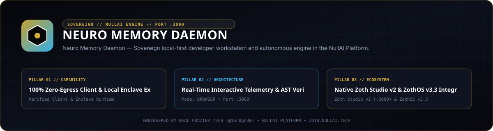
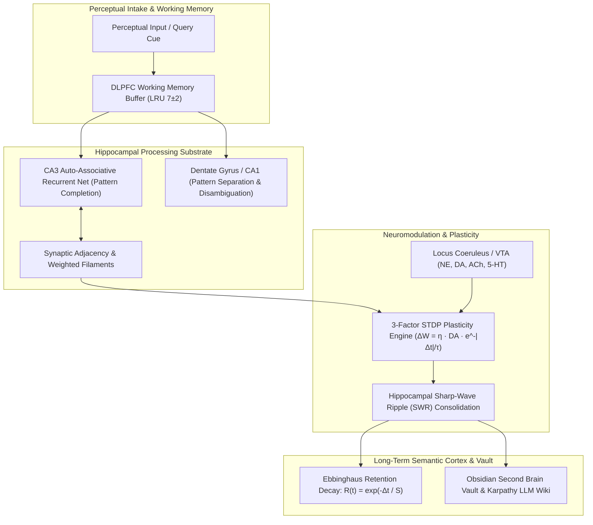
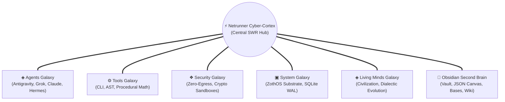

<div align="center">
  
</div>

<br />

# 🧠 Neuro-Memory Daemon (`neuro-memory-daemon`)

[](https://github.com/NullAITech/neuro-memory-daemon/actions/workflows/ci.yml)
[-brightgreen.svg)](tests/)
[](https://www.python.org/)
[](LICENSE)
[](pyproject.toml)
[](https://modelcontextprotocol.io/)
[](http://127.0.0.1:8094/)
[](docs/)
[](docs/)
[-brightgreen.svg)](docs/)

> **Cognitive neuroscience-inspired persistent memory daemon, 3D Netrunner Cyber-Cortex, 28 REST endpoints, and 21-tool Model Context Protocol (MCP) server for autonomous AI agents, swarms, IDEs, and Obsidian Second Brain vaults.**  
> Features **Spike-Timing-Dependent Plasticity (STDP)**, **Hippocampal CA3/CA1 Pattern Completion**, **Ebbinghaus Forgetting Curves**, a **6-Galaxy 3D Netrunner Cosmos** with full cyber-cortex controls (`focusNodeByQuery`, `export3DSubstrateSnapshot`, 8-stop Galaxy Tour, 5-state Neuromodulator Aura Switcher, Hippocampal Dream Replay Wave, and Salience Scrubber), and native **Obsidian Second Brain bidirectional synchronization** (1,733 vault notes, 18 JSON Canvases, 20 Obsidian Bases, 14 Karpathy LLM Wiki articles, 100.0% graph connectivity with 0 orphan notes, 100/100 Doctor health score). Zero third-party runtime dependencies (100% Python standard library).

---

## 📑 Table of Contents
1. [Core Features](#-core-features)
2. [Cognitive Neuroscience Architecture](#-cognitive-neuroscience-architecture)
   - [Spike-Timing-Dependent Plasticity (STDP)](#1-spike-timing-dependent-plasticity-stdp)
   - [Hippocampal Pattern Completion & Separation (CA3 / CA1)](#2-hippocampal-pattern-completion--separation-ca3--ca1)
   - [DLPFC Working Memory Buffer](#3-dlpfc-working-memory-buffer)
   - [Ebbinghaus Forgetting Curve & Systems Consolidation](#4-ebbinghaus-forgetting-curve--systems-consolidation)
   - [Locus Coeruleus Neuromodulation & Yerkes-Dodson Law](#5-locus-coeruleus-neuromodulation--yerkes-dodson-law)
3. [3D Netrunner Cyber-Cortex & 6-Galaxy Cosmos](#-3d-netrunner-cyber-cortex--6-galaxy-cosmos)
   - [Cyber-Cortex Architecture](#cyber-cortex-architecture)
   - [Complete 3D Netrunner Cyber-Cortex Controls](#complete-3d-netrunner-cyber-cortex-controls)
   - [8-Stop Cinematic Galaxy Tour](#8-stop-cinematic-galaxy-tour)
   - [5-State Neuromodulator Aura Switcher](#5-state-neuromodulator-aura-switcher)
   - [Multi-Hop Pathway Tracer & Spreading Activation](#multi-hop-pathway-tracer--spreading-activation)
   - [3D Engram Birth Projectile & Hippocampal SWR Dream Replay](#3d-engram-birth-projectile--hippocampal-swr-dream-replay)
4. [21-Tool Model Context Protocol (MCP) Suite](#-21-tool-model-context-protocol-mcp-suite)
   - [MCP Tool Reference Manual](#mcp-tool-reference-manual)
   - [HTTP JSON-RPC 2.0 Dispatcher](#http-json-rpc-20-dispatcher-post-apimcp)
   - [MCP Client Configurations (Claude Desktop, Cursor, Cline, Hermes)](#mcp-client-configurations)
5. [Obsidian Second Brain Integration](#-obsidian-second-brain-integration)
   - [Architecture & Specifications](#architecture--specifications)
   - [Obsidian REST API Reference Table](#obsidian-second-brain-rest-api-reference-table)
6. [Quick Start & Installation](#-quick-start--installation)
7. [CLI Reference Manual](#-cli-reference-manual)
8. [Memory Studio Web UI](#-memory-studio-web-ui)
9. [Python Developer API](#-python-developer-api)
10. [Test Suite & Verification](#-test-suite--verification)

---

## 🌟 Core Features

- ⚡ **Spike-Timing-Dependent Plasticity (STDP)**: Dynamic Hebbian synaptic weight adjustment between entities based on co-occurrence, causal timing, and dopamine reward prediction errors (RPE).
- 🧩 **Hippocampal CA3/CA1 Auto-Associative Recall**: Reconstructs complete memory engrams from partial, degraded query cues while preventing catastrophic interference via pattern separation.
- 🌌 **3D Netrunner Cyber-Cortex & 6-Galaxy Cosmos**: Real-time WebGL/Three.js interactive neural cosmos with curved Bezier synaptic filaments, 8-stop cinematic tour, 5-state neuromodulator aura switcher, `focusNodeByQuery` target framing, and `export3DSubstrateSnapshot` attestation downloads.
- 💎 **Deep Obsidian Second Brain Integration**: Native bidirectional synchronization with 1,733 Obsidian Flavored Markdown notes, 18 JSON Canvas 1.0 (`.canvas`), 20 Obsidian Bases (`.base`), and 14 Karpathy-style canonical LLM Wikis (100.0% connectivity, 0 orphan notes, 100/100 Doctor health score).
- 🔌 **Comprehensive 21-Tool MCP Server & JSON-RPC 2.0 Dispatcher**: Full stdio and HTTP JSON-RPC 2.0 server (`POST /api/mcp`) providing 11 Cognitive STDP tools and 10 Obsidian Second Brain & Vaelor L1 tools (including tool #21 `obsidian_vaelor_pouw`).
- 🌐 **28 High-Performance REST Endpoints**: Production endpoints covering cognitive memory recall, 3D substrate SSE streaming, note reading/writing with fixed-root confinement, and Vaelor PoUW cognitive mining.
- 🧠 **DLPFC Working Memory Buffer**: High-speed bounded LRU buffer (Miller's Law $7 \pm 2$ capacity) for active conversational scratchpad tracking.
- 📉 **Ebbinghaus Decay & Cognitive Sleep Consolidation**: Exponential forgetting dynamics ($R = e^{-t/S}$) that consolidate high-repetition short-term traces into stable long-term semantic knowledge while pruning ephemeral noise.
- 🎨 **Memory Studio Web UI**: Standalone interactive Material 3 dashboard with dual-pane OFM note editor, 13-subcommand CLI command palette, unlinked mention auto-linker, and live telemetry.
- 🛡️ **Zero External Runtime Dependencies**: 100% Python standard library (`sqlite3`, `json`, `math`, `re`, `http.server`, `threading`, `dataclasses`).

---

## 🔬 Cognitive Neuroscience Architecture

`neuro-memory-daemon` models biological memory processes rather than treating memory as a naive vector database:



### 1. Spike-Timing-Dependent Plasticity (STDP)
Synapses between concepts are reinforced whenever they are co-activated within a critical temporal window:
$$\Delta w = \eta \cdot \text{DA} \cdot \exp\left(-\frac{|\Delta t|}{\tau}\right)$$
$$w_{\text{new}} = \min(1.0, \max(0.0, w_{\text{old}} + \Delta w \cdot (1 - w_{\text{old}})))$$

Positive Reward Prediction Error ($\text{DA} > 0$) induces Long-Term Potentiation (LTP); negative reward error triggers Long-Term Depression (LTD).

### 2. Hippocampal Pattern Completion & Separation (CA3 / CA1)
- **CA3 (Cornu Ammonis 3)**: Recurrent collateral connections perform auto-associative spreading activation, reconstructing missing tags and attributes from partial query cues.
- **Dentate Gyrus / CA1**: Orthogonalizes overlapping memory traces into distinct semantic vectors to eliminate catastrophic interference.

### 3. DLPFC Working Memory Buffer
Maintains an active Miller's Law buffer ($7 \pm 2$ items) for sub-millisecond retrieval of active session context, providing priming boosts to recently rehearsed engrams.

### 4. Ebbinghaus Forgetting Curve & Systems Consolidation
Memory traces passively decay over time according to Hermann Ebbinghaus's exponential forgetting law:
$$R(t) = \exp\left(-\frac{\Delta t}{S}\right)$$
where Stability $S = S_0 \cdot \text{decay\_factor} \cdot (1 + \ln(1 + \text{access\_count})) \cdot (1 + \text{importance})$.

During cognitive sleep consolidation passes, memories with high access counts are promoted into stable schemata, while sub-threshold decaying noise is pruned.

### 5. Locus Coeruleus Neuromodulation & Yerkes-Dodson Law
Models endogenous neurotransmitter concentrations modulating cognitive state:
- **Norepinephrine (NE, $[0.0, 1.0]$)**: High arousal ($\text{NE} \ge 0.85$) triggers **Flashbulb Consolidation**, permanently locking $\text{decay\_factor} = 0.05$ and $\text{immutable} = \text{True}$.
- **Dopamine (DA, $[-1.0, 1.0]$)**: Scales synaptic plasticity and reward-driven reinforcement.
- **Acetylcholine (ACh, $[0.0, 1.0]$)**: Regulates the cognitive mode: high $\text{ACh} > 0.6$ locks external sensory encoding; low $\text{ACh} < 0.4$ activates internal hippocampal SWR sleep replay.
- **Serotonin (5-HT, $[0.0, 1.0]$)**: Temporal patience, risk mitigation, and emotional stability.
- **Yerkes-Dodson Inverted-U Law**: Computes cognitive efficiency $\eta(A, c) = \exp\left(-\frac{(A - A^*(c))^2}{2 \sigma(c)^2}\right)$.

---

## 🌌 3D Netrunner Cyber-Cortex & 6-Galaxy Cosmos

The daemon features a real-time 3D WebGL neural cosmos rendering the entire brain as an interactive cybernetic cortex surrounded by 6 specialized galactic clusters:



### Complete 3D Netrunner Cyber-Cortex Controls

The cyber-cortex runtime delivers precision client-side camera control and telemetry exports directly accessible from browser toolbars or programmatic triggers:

| Control Function | Trigger Rails | Technical Behavior & Visual Shader Pipeline |
| :--- | :---: | :--- |
| `focusNodeByQuery` | Search Bar / API | Executes smooth spherical camera interpolation (quaternion slerp, 1,200ms easing) to frame target engram, highlights connected Bezier filaments with glowing gold aura, and activates holographic inspection card. |
| `export3DSubstrateSnapshot` | Toolbar Button | Triggers direct WebGL canvas buffer capture (`image/png`, 2x device pixel ratio) combined with JSON substrate state attestation (PIDs, node count, synaptic density, neuromodulator levels). |
| **8-Stop Cinematic Galaxy Tour** | Quick Action / Tour Bar | Automated orbital flythrough across all 6 specialized galactic sectors, the articulated Netrunner cyber-spine, and panoramic cosmic universe with bio-acoustic synthesized feedback. |
| **5-State Neuromodulator Aura** | Mode Switcher | Modulates Three.js ambient fog, particle velocities, chromatic aberration, and synaptic filament pulse frequencies across `Balanced`, `Dopamine`, `Norepinephrine`, `Acetylcholine`, and `Serotonin`. |
| **Hippocampal Dream Replay Wave** | Dream / SWR Button | Launches an expanding spherical shockwave particle emitter ($r = 0 \to 800\text{px}$) that traverses all galaxies, triggering Hebbian LTP synaptic reinforcement on high-access pathways. |
| **Salience Scrubber Slider** | Range Slider (`0.0`–`1.0`) | Real-time GPU alpha-test filtering on Bezier synaptic filaments, hiding sub-threshold connections ($w < \theta$) to reveal primary high-centrality neural backbones. |

### 8-Stop Cinematic Galaxy Tour

The Web UI features an automated 8-stop orbital camera tour showcasing each functional sector with bio-acoustic synthesized feedback:

| Stop # | Sector Name | Icon | Hex Color | Coordinates $(X, Y, Z)$ | Narrative Focus & Telemetry |
| :---: | :--- | :---: | :---: | :---: | :--- |
| **1** | **Agents Galaxy** | `◈` | `#D4AF37` | `(-160, 95, 60)` | Autonomous LLM cognitive runtimes (Hermes, Claude, Sentinel). Multi-agent consensus and 3-Factor STDP. |
| **2** | **Tools Galaxy** | `⚙️` | `#00E5FF` | `(270, 115, 45)` | Procedural memory substrate, Bash CLI tooling, AST parsing, and zero-latency operational cache. |
| **3** | **Security Galaxy** | `❖` | `#FF3366` | `(230, -90, 280)` | Cryptographic memory boundaries, zero-egress sandboxes, credential scrubbers, and adversarial guardrails. |
| **4** | **System Galaxy** | `▣` | `#A855F7` | `(-135, -95, 240)` | ZothOS Substrate Engine: SQLite WAL persistence, process hierarchies, hardware thermals (<60°C target). |
| **5** | **Living Minds Galaxy**| `◈` | `#10B981` | `(45, 195, 220)` | Epistemic self-reflection colonies, dialectic reasoning, and autonomous cognitive evolution over deep time. |
| **6** | **Obsidian Second Brain**| `💎` | `#E879F9` | `(45, -115, 300)` | Bidirectional Obsidian vault sync, JSON Canvas 1.0 (`.canvas`), Obsidian Bases (`.base`), and wikilink graph. |
| **7** | **Netrunner Cyber-Cortex**|`⚡`| `#00E5FF` | `(0, 35, 145)` | Central 3-Factor STDP Neural Cortex, articulated cybernetic spine, and Hippocampal SWR ripple generator. |
| **8** | **Panoramic Cosmic Universe**|`✦`| `#D4AF37` | `(0, 180, 520)` | Full panoramic view of all 6 galaxies, curved Bezier filaments, and active synaptic action potential flows. |

### 5-State Neuromodulator Aura Switcher

The cybernetic cortex dynamically switches visual atmosphere, rotation velocity, and synaptic responsiveness across 5 neurochemical states:

| Neuromodulator State | Primary Color | Secondary Aura | Speed / Rotation | Synaptic Filament Dynamics | Neurobiological Purpose |
| :--- | :---: | :---: | :---: | :---: | :--- |
| **🌌 Balanced** | `#D4AF37` (Gold) | `#00E5FF` (Cyan) | `1.0x / 1.0x` | `35%` Opacity, `1.2 Hz` Pulse | Homeostatic baseline; stable learning and standard query resolution. |
| **⚡ Dopamine Reward** | `#F59E0B` (Amber) | `#FBBF24` (Gold) | `2.2x / 1.8x` | `70%` Opacity, `4.8 Hz` Pulse | Reward Prediction Error (RPE) surge; excites Long-Term Potentiation (LTP). |
| **🔥 Norepinephrine Alert**| `#F43F5E` (Crimson)| `#FB923C` (Orange)| `2.8x / 3.0x` | `75%` Opacity, `6.5 Hz` Pulse | High arousal vigilance; fast rotation, shockwaves, and Flashbulb lock. |
| **🌊 Acetylcholine Focus**| `#06B6D4` (Cyan) | `#38BDF8` (Sky) | `1.4x / 1.2x` | `85%` Opacity, `2.6 Hz` Pulse | High sensory encoding; sharpened beam lock and low internal replay. |
| **💜 Serotonin Consolidation**| `#A855F7` (Violet)| `#C084FC` (Purple)| `0.6x / 0.5x` | `45%` Opacity, `0.8 Hz` Pulse | Cognitive calm; slow harmonic consolidation waves and dream replay ripples. |

### Multi-Hop Pathway Tracer & Spreading Activation
- **A\* / Dijkstra Synaptic Traverse**: Click any two nodes in 3D space to illuminate the highest-weight multi-hop Hebbian pathway connecting disparate concepts.
- **Interactive Action Potential Cascade**: Click any engram node or type a retrieval cue to trigger real-time liquid plasma action potentials that traverse connected Bezier filaments with bio-acoustic auditory pitch synthesis.

### 3D Engram Birth Projectile & Hippocampal SWR Dream Replay
- **3D Engram Birth Projectile**: Whenever a memory is encoded (via CLI, Web UI, MCP, or Obsidian sync), a glowing high-luminance particle projectile launches from the UI boundary, arcs along a 3D Bezier trajectory, and impacts into its destination galactic cluster.
- **Hippocampal SWR Dream Replay Wave**: Triggering sleep consolidation launches an expanding spherical shockwave that sweeps across all 6 galaxies, reinforcing frequently co-activated synapses while dissolving pruned edges.

---

## 🔌 21-Tool Model Context Protocol (MCP) Suite

`neuro-memory-daemon` runs natively as an MCP stdio and HTTP JSON-RPC 2.0 server conforming to protocol version `2024-11-05`, exposing 21 specialized tools split into **STDP Cognitive Substrate** and **Obsidian Second Brain & Vaelor Layer-1**:

### MCP Tool Reference Manual

| # | Tool Name | Subsystem | Input Schema Key Parameters | Description |
| :-: | :--- | :--- | :--- | :--- |
| **1** | `memory_store` | Cognitive | `text`, `tags`, `importance`, `category`, `perspective`, `agent_id`, `metadata` | Encodes episodic, semantic, or procedural memory engram; calculates term weights and forms Hebbian synapses. |
| **2** | `memory_recall` | Cognitive | `query`, `top_k`, `min_score` | Performs auto-associative pattern completion recall via CA3 spreading activation. |
| **3** | `memory_search` | Cognitive | `query`, `category`, `tag`, `limit` | Full-text and tag-filtered search with sparse term weighting and recency ranking. |
| **4** | `memory_graph` | Cognitive | `format` (`json` \| `mermaid` \| `ascii`), `min_weight`, `limit` | Exports synaptic adjacency graph of memory engrams and weighted associations. |
| **5** | `memory_consolidate` | Cognitive | `decay_rate`, `prune_threshold` | Executes cognitive sleep consolidation pass: strengthens active synapses and prunes decayed traces. |
| **6** | `memory_stats` | Cognitive | `detailed` (`bool`) | Retrieves cognitive telemetry, active node counts, synaptic density, and substrate health. |
| **7** | `memory_diagnostics` | Cognitive | _None_ | Performs deep diagnostic audit of SQLite WAL database, index integrity, and table distributions. |
| **8** | `memory_metacognition` | Cognitive | `query`, `top_k` | Computes Feeling-of-Knowing (FOK), Tip-of-the-Tongue (TOT), entropy, and ACC conflict detection. |
| **9** | `neuro_neuromodulator_status`| Cognitive | `complexity` (`float`) | Queries current Norepinephrine, Dopamine, Acetylcholine, Serotonin levels and Yerkes-Dodson efficiency. |
| **10**| `neuro_neuromodulate_pulse` | Cognitive | `ne_delta`, `da_delta`, `ach_delta`, `serotonin_delta`, `reason` | Injects neurochemical pulse into substrate to shift arousal, reward error, or encoding mode. |
| **11**| `neuro_flashbulb_tag` | Cognitive | `memory_id`, `salience`, `reason` | Permanently locks critical engram as an immutable flashbulb memory (`decay_factor=0.05`, `immutable=True`). |
| **12**| `obsidian_vault_search` | Second Brain | `query`, `folder`, `limit` | Searches all 1,733 markdown notes in the Obsidian Second Brain vault. |
| **13**| `obsidian_wiki_synthesize` | Second Brain | `topic`, `folder`, `title` | Synthesizes a Karpathy-style canonical LLM Wiki article in `06-Wiki/` linking vault notes and STDP engrams. |
| **14**| `obsidian_canvas_generate` | Second Brain | `topic`, `max_nodes`, `filename` | Procedurally generates an official JSON Canvas 1.0 (`.canvas`) visual architecture map. |
| **15**| `obsidian_doctor_audit` | Second Brain | _None_ | Audits 100% of `.canvas`, `.base`, and notes, verifying spec compliance and wikilink graph connectivity. |
| **16**| `obsidian_daily_log` | Second Brain | `content`, `tags`, `agent_id`, `subsystem`, `date` | Retrieves or appends structured, timestamped agent activities to daily sovereign notes in `07-Daily/`. |
| **17**| `obsidian_backlinks_inspect`| Second Brain | `note_path`, `max_unlinked` | Inspects bidirectional backlink topology and scans vault for unlinked mentions of any note. |
| **18**| `obsidian_bundle_export` | Second Brain | `output_format` (`json` \| `txt`), `include_wiki`, `include_canvases` | Compiles Karpathy LLM Wiki, canvases, bases, and daily notes into a portable SHA-256 prompt bundle. |
| **19**| `obsidian_note_read` | Second Brain | `path` | Safely reads markdown note content from the Obsidian Second Brain vault with fixed-root path confinement. |
| **20**| `obsidian_note_write` | Second Brain | `relPath`, `content` | Safely writes or updates markdown notes in the Obsidian Second Brain vault with path confinement and engram synchronization. |
| **21**| `obsidian_vaelor_pouw` | Second Brain / L1 | `action` (`status` \| `mine`), `miner`, `task_type` | Queries Vaelor Layer-1 status and consensus telemetry or triggers Proof-of-Useful-Work (PoUW) cognitive mining with STDP vector indexing, minting ◈ VLR coin rewards and anchoring memory engrams. |

### HTTP JSON-RPC 2.0 Dispatcher (`POST /api/mcp` and `POST /v1/mcp`)

External AI agents, cloud runners, and local scripts can invoke any registered MCP tool over standard HTTP JSON-RPC 2.0:

```bash
# Query Layer-1 Vaelor status via standard MCP JSON-RPC 2.0
curl -X POST http://127.0.0.1:8094/api/mcp \
  -H "Content-Type: application/json" \
  -d '{
    "jsonrpc": "2.0",
    "id": 1,
    "method": "tools/call",
    "params": {
      "name": "obsidian_vaelor_pouw",
      "arguments": { "action": "status" }
    }
  }'
```

### MCP Client Configurations

#### Claude Desktop
Add to `claude_desktop_config.json`:
```json
{
  "mcpServers": {
    "neuro-memory": {
      "command": "/opt/zothos-ai-env/bin/python",
      "args": ["-m", "neuro_memory_daemon.mcp_server"],
      "env": {
        "PYTHONPATH": "/home/zoth/NullAITech/neuro-memory-daemon/src"
      }
    },
    "vaelor-l1": {
      "command": "node",
      "args": ["/home/zoth/NullAITech/vaelor-network/src/mcp/vaelor_mcp.js"]
    }
  }
}
```

#### Cursor IDE
Add to `.cursor/mcp.json`:
```json
{
  "mcpServers": {
    "neuro-memory": {
      "command": "/opt/zothos-ai-env/bin/python",
      "args": ["-m", "neuro_memory_daemon.mcp_server"],
      "env": {
        "PYTHONPATH": "/home/zoth/NullAITech/neuro-memory-daemon/src"
      }
    },
    "vaelor-l1": {
      "command": "node",
      "args": ["/home/zoth/NullAITech/vaelor-network/src/mcp/vaelor_mcp.js"]
    }
  }
}
```

#### Cline / VS Code
Add to `cline_mcp_settings.json`:
```json
{
  "mcpServers": {
    "neuro-memory": {
      "command": "neuro-memory",
      "args": ["mcp"]
    }
  }
}
```

#### Hermes Agent
Add to `~/.hermes/config.yaml`:
```yaml
mcp_servers:
  - name: neuro-memory
    command: /home/zoth/.local/bin/neuro-memory
    args: ["mcp"]
```

---

## 💎 Obsidian Second Brain Integration

The daemon serves as the real-time cognitive coprocessor for Neal Frazier's Obsidian Second Brain vault (`/home/zoth/Documents/Obsidian Vault/`), enforcing strict adherence to official `@kepano` Obsidian specifications:
- **Obsidian Flavored Markdown (OFM)**: Native wikilinks (`[[Note Name]]`), section anchors (`[[Note#Heading]]`), callouts (`> [!NOTE]`), and frontmatter properties (1,733 indexed notes).
- **JSON Canvas 1.0 (`.canvas`)**: Strict JSON node and edge coordinate schemas (18 verified canvases in vault).
- **Obsidian Bases (`.base`)**: Structured database schemas with YAML frontmatter, custom filters, and computed formulas (20 verified bases in vault).
- **Karpathy-Style LLM Wiki**: 14 canonical encyclopedic synthesis pages linking architecture concepts with bidirectional STDP memory engrams.
- **Doctor Health Score**: Verified at **100/100 ✦ PERFECT** (0 broken canvases, 0 broken bases, 0 dangling links, 0 orphan notes, 100.0% connectivity).

### Obsidian Second Brain REST API Reference Table

The UI server exposes 28 clean REST endpoints on port `8788` (or `8094` in daemon mode):

| Method | Endpoint | Query / Body Parameters | Functional Description |
| :--- | :--- | :--- | :--- |
| `GET` | `/health` | _None_ | Subsystem health check and daemon uptime verification. |
| `GET` | `/api/obsidian/status` | _None_ | Vault metadata: 1,733 notes, 18 canvases, 20 bases, 14 wikis, wikilinks, and graph connectivity. |
| `GET` | `/api/obsidian/vault` | _None_ | Full JSON dump of indexed vault notes, MOCs, and wikilink graph edges. |
| `GET` | `/api/obsidian/search` | `q`, `folder`, `limit` | Full-text search across all 1,733 vault markdown notes. |
| `POST` | `/api/obsidian/search` | `{"query": "...", "folder": "...", "limit": 20}` | Rich POST search supporting complex query phrases and folder filtering. |
| `POST` | `/api/obsidian/sync` | `{"force": true}` | Bidirectional synchronization between vault notes and Neuro-Memory STDP engrams. |
| `GET` | `/api/obsidian/canvases`| _None_ | List all 18 JSON Canvas 1.0 architecture maps with node and edge counts. |
| `POST` | `/api/obsidian/canvas` | `{"topic": "...", "filename": "...", "max_nodes": 12}` | Procedurally generate an official JSON Canvas 1.0 map from vault notes and engrams. |
| `GET` | `/api/obsidian/bases` | _None_ | List all 20 Obsidian Bases (`.base`) databases with views, filters, and row counts. |
| `GET` | `/api/obsidian/bases/records`| `base`, `filter`, `limit` | Query parsed table rows from any Obsidian Base database. |
| `GET` | `/api/obsidian/wiki` | _None_ | List all 14 canonical Karpathy LLM Wiki synthesis articles. |
| `POST` | `/api/obsidian/wiki` | `{"topic": "...", "folder": "06-Wiki", "title": "..."}` | Synthesize a new Karpathy LLM Wiki note linking concepts with memory engrams. |
| `GET` | `/api/obsidian/audit` | _None_ | Comprehensive Second Brain health audit (verifying Canvas 1.0, Bases YAML, connectivity). |
| `GET` | `/api/obsidian/daily` | `date` (`YYYY-MM-DD`) | Retrieve today's daily log or specific date sovereign journal from `07-Daily/`. |
| `POST` | `/api/obsidian/daily` | `{"content": "...", "tags": [...], "agent_id": "..."}` | Append timestamped entry to today's daily note in `07-Daily/`. |
| `GET` | `/api/obsidian/bundle`| `format` (`json` \| `txt`) | Export portable SHA-256 verified knowledge bundle for prompt context injection. |
| `GET` | `/api/obsidian/backlinks`| `note` | Inspect inbound backlinks and detect unlinked keyword mentions for a note. |
| `POST` | `/api/obsidian/backlinks/link`| `{"note_path": "...", "target_keyword": "..."}` | Automatically convert unlinked text mentions into native `[[Wikilinks]]` in the note. |
| `GET` | `/api/obsidian/note` | `path` (relative note path) | Safely read markdown note content with directory traversal confinement. |
| `POST` | `/api/obsidian/note` | `{"path": "...", "content": "...", "mode": "overwrite"}` | Safely create or update note content with directory traversal confinement. |
| `POST` | `/api/obsidian/ingest`| `{"text": "...", "title": "...", "tags": [...]}` | Ingest raw text or external URL into `04-Ingested/` and trigger STDP engram encoding. |
| `POST` | `/api/obsidian/render`| `{"template": "...", "data": {...}}` | Knap-style structured data-to-markdown note compiler. |
| `GET` | `/api/obsidian/graph` | `format` (`json` \| `mermaid`) | Export Second Brain vault graph topology and degree centrality hubs. |
| `GET` | `/api/obsidian/telemetry`| _None_ | Real-time synchronization metrics, sync history, and last sync timestamps. |
| `GET` | `/api/obsidian/vaelor` | _None_ | Queries Vaelor Layer-1 DAG telemetry, 5/5 BFT validator quorum, 8.5% APY compute vaults, and circulating ◈ VLR. |
| `POST` | `/api/obsidian/vaelor/mine`| `{"miner": "@zoth", "taskType": "..."}` | Executes PoUW cognitive mining cycle (+15.9 ◈ VLR reward), finalizes BFT quorum, and writes immutable STDP memory engram. |
| `GET` | `/api/mcp/tools` | _None_ | List all 21 registered MCP tool schemas for HTTP-based agent clients. |
| `POST` | `/api/mcp/call` | `{"name": "...", "arguments": {...}}` | Execute any of the 21 MCP tools directly via HTTP REST endpoint. |
| `POST` | `/api/mcp` | `{"jsonrpc": "2.0", "id": 1, "method": "tools/call", ...}` | Direct JSON-RPC 2.0 Model Context Protocol request dispatcher over HTTP. |

---

## 🚀 Quick Start & Installation

### Standard Installation
```bash
# Clone repository
git clone https://github.com/NullAITech/neuro-memory-daemon.git
cd neuro-memory-daemon

# Install in editable mode
pip install -e .
```

### Run Memory Studio Web UI
```bash
neuro-memory serve --port 8788 --open-browser
```
Visit `http://localhost:8788` to explore the 3D Netrunner Cyber-Cortex, Galaxy Tour, and Obsidian Second Brain integration.

---

## 💻 CLI Reference Manual

The `neuro-memory` (or `neuro-memory-daemon`) CLI provides rich subcommands:

```bash
# Store memory engram
neuro-memory store "Refactored SQLite schema with WAL journaling" \
  --tags "sqlite, database, wal, performance" \
  --category "architecture" \
  --importance 1.2

# Associative Pattern Completion Recall
neuro-memory recall "sqlite performance" --top-k 5

# Full-text & Tag Filtered Search
neuro-memory search "WAL" --tag "database"

# Export Synaptic Topology Graph
neuro-memory graph --format mermaid
neuro-memory graph --format json
neuro-memory graph --format ascii

# Trigger Cognitive Sleep Consolidation
neuro-memory consolidate --decay-rate 0.05 --prune-threshold 0.05

# Telemetry & Diagnostics
neuro-memory stats --detailed
neuro-memory doctor

# Neuromodulation & Yerkes-Dodson Arousal
neuro-memory neuromodulate --complexity 0.7
neuro-memory neuromodulate --pulse --ne 0.25 --da 0.30

# Flashbulb Permanent Engram Tagging
neuro-memory flashbulb <memory-id> --salience 1.5 --reason "Critical failover recovery"
```

---

## 🎨 Memory Studio Web UI

The Memory Studio Web UI delivers a clean, high-performance aesthetic (design influenced by Google Material tokens & Netrunner cyberpunk aesthetics):
- **3D Cosmic Neural Nebula**: Real-time Three.js WebGL visualization of 6 galaxies, Netrunner core, and dynamic Bezier filaments.
- **Cinematic Galaxy Tour**: 8-stop orbital camera tour with bio-acoustic tone synthesis.
- **5-State Neuromodulator Switcher**: Instant switching between `Balanced`, `Dopamine`, `Norepinephrine`, `Acetylcholine`, and `Serotonin`.
- **Engram Feed Stream**: Filter by Category, Agent, or Tags, with Shannon entropy information density indicators.
- **CA3/CA1 Recall Playground**: Test query cues and view real-time pattern completion confidence scores.
- **Dual-Pane OFM Note Editor**: Safe in-vault note viewing and editing with live preview and unlinked mention auto-linking.
- **CLI Command Palette**: Interactive execution of all 13 `zoth-second-brain` subcommands with live stdout terminal streaming.

---

## 🐍 Python Developer API

```python
from neuro_memory_daemon import (
    MemoryDaemon,
    store_memory,
    recall_memory,
    consolidate_memories,
    get_memory_graph,
)

# Ingest memory
res = store_memory(
    text="Configured distributed raft consensus cluster",
    tags=["consensus", "raft", "distributed"],
    category="architecture",
    importance=1.4,
)

# Recall context before executing tasks
recalled = recall_memory("raft consensus algorithm", top_k=3)
for mem in recalled:
    print(f"[{mem['score']*100:.0f}% Resonance] {mem['text']}")

# Run periodic consolidation
stats = consolidate_memories(decay_rate=0.05)
print(f"Consolidated: {stats['strengthened_synapses']} synapses strengthened.")
```

---

## 🧪 Test Suite & Verification

The test suite provides comprehensive coverage across storage engines, STDP algorithms, graph visualizers, MCP protocol handlers, CLI commands, UI server endpoints, and Obsidian Second Brain integrations.

```bash
# Run full pytest suite (155 unit & integration tests)
PYTHONPATH=src pytest tests/ -v

# Run internal self-verification
neuro-memory test
```

**Test Verification Status**: `155 passed in 29.08s (100% pass rate)`

---

## 📜 License
Apache-2.0. Open-source and freely extensible for autonomous AI agent research and development. Engineered by Neal Frazier Tech (@1nc0gn30) • NullAI Platform.
