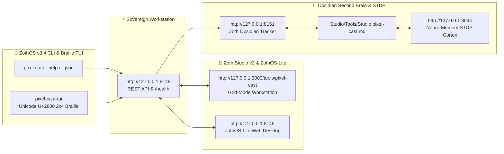

# PixelCast — Sovereign Google Pixel Screen Mirror & Tailscale Mesh Bridge

[](https://zoth.nullai.tech)
[](https://tailscale.com)
[](https://github.com/Genymobile/scrcpy)
[](LICENSE)

> **PixelCast** is an ultra-low latency Google Pixel screenshare, camera bridge, and sovereign wireless ADB mirroring workstation built natively for **ZothOS** and the **NullAI Platform** over the Tailscale mesh network.

---

## ⚡ Why Sovereign Developers Need PixelCast

Sharing a mobile device screen to a Linux desktop typically suffers from severe friction:
1. **Cloud Relays & Latency**: Commercial casting software routes unencrypted video frames through third-party servers, adding hundreds of milliseconds of lag and violating data sovereignty.
2. **Cable Tethering**: Physical USB cables restrict mobility and clutter the workstation desk.
3. **Android Chrome Limitations**: Mobile browsers reject WebRTC screen share APIs (`getDisplayMedia()`) by design.
4. **Complex Setup**: Pairing wireless ADB dynamically requires manual terminal typing of IP addresses and ports every time.

**PixelCast eliminates all four pain points:**
- **Zero Cloud & Zero Telemetry**: Operates 100% locally over private Tailscale WireGuard mesh tunnels.
- **Auto-Discovery**: Queries local Tailscale status to detect the active Google Pixel (`pixel-10-pro` @ `100.106.39.46`) with live ICMP latency measurement (~40ms).
- **60fps Native Mirroring**: Orchestrates hardware-accelerated `scrcpy 5.0.1` with Opus audio forwarding, mouse/touch passthrough, screen-off battery preservation, and direct MP4 recording.
- **Dual Mode**:
  - **Mode A (Desktop Mirror)**: Native high-FPS scrcpy mirror with hardware keyevent HUD (Back, Home, Recents, Power, Volume, Typer).
  - **Mode B (In-Browser Mobile Companion)**: Instant QR Code scan on the Pixel opens `http://100.106.132.5:8148/mobile` for live camera lens streaming and instant file/photo drop to desktop.

---

## 🏗 Architecture

```
┌─────────────────────────────────┐                 ┌──────────────────────────────────┐
│      Google Pixel 10 Pro        │                 │        ZothOS Host Desktop       │
│       (100.106.39.46)           │                 │         (100.106.132.5)          │
│                                 │                 │                                  │
│  • Developer Wireless Debugging │◄── Tailscale ──►│  • Tailscale Mesh Daemon         │
│  • Port 5555 / Dynamic Pair     │   WireGuard     │  • Scrcpy 5.0.1 Video Engine     │
│  • Chrome / Web Companion       │    Tunnel       │  • FastAPI / WebSocket (:8148)   │
│  • 4K/1080p Camera Stream       │                 │  • Zoth Studio v2 God-Mode Tool  │
└─────────────────────────────────┘                 └──────────────────────────────────┘
```

---

## 🚀 Quick Start

### 1. Launch the Standalone Web Workstation
Open the PixelCast Workstation on port `8148`:
```bash
pixel-cast serve --host 0.0.0.0 --port 8148
```
Visit `http://127.0.0.1:8148` or `http://100.106.132.5:8148` on desktop.

### 2. Connect Your Google Pixel
Ensure both your Google Pixel and ZothOS desktop are connected to the same Tailscale network:
```bash
# Check mesh discovery and battery level
pixel-cast status

# Connect wireless ADB over Tailscale
pixel-cast connect

# Launch 60fps Desktop Mirror
pixel-cast stream
```

### 3. Scan QR Code for Mobile Companion
Open terminal QR code to connect from your Pixel:
```bash
pixel-cast qr
```
Point your Pixel camera at the displayed QR code to open `http://100.106.132.5:8148/mobile`.

---

## 🛠 ZothOS CLI Reference (`pixel-cast`)

The `pixel-cast` command is installed globally in `/usr/local/bin/pixel-cast` and `~/.local/bin/pixel-cast`:

| Command | Description |
|---|---|
| `pixel-cast status` | Displays Tailscale mesh node, detected Pixel device, latency ping, ADB bridge status, and battery telemetry |
| `pixel-cast --json` | Returns machine-readable JSON status for scripts and AI agents |
| `pixel-cast stream` | Launches hardware-accelerated 60fps Scrcpy screen mirror window |
| `pixel-cast connect [port]` | Connects ADB wirelessly to Pixel's Tailscale IP (default: `5555`) |
| `pixel-cast pair <port> <code>` | Pairs ADB with Android's Wireless Debugging 6-digit code |
| `pixel-cast screenshot [file.png]` | Captures pristine screenshot from Pixel directly over Tailscale |
| `pixel-cast battery` | Reads real-time battery percentage, charging state, and thermal temperature |
| `pixel-cast text "hello world"` | Types strings directly into the active field on the Pixel |
| `pixel-cast key <home\|back\|power>` | Sends Android navigation keyevents (Home, Back, Recents, Power, Vol) |
| `pixel-cast qr` | Renders a high-contrast terminal QR code for the mobile companion |
| `pixel-cast serve [--port 8148]` | Runs the standalone FastAPI / WebSocket workstation daemon |
| `pixel-cast gui` | Opens the PixelCast web workstation in the default browser |

---

## 🎨 Stream Tuner Flags

When running `pixel-cast stream`, customize parameters to balance quality and bandwidth:
```bash
# High-Fidelity 1440p Master Stream
pixel-cast stream --max-size 1440 --bitrate 16M --max-fps 60

# Battery-Saver Mode (Phone screen turned off while mirroring)
pixel-cast stream --turn-screen-off --stay-awake

# Record session directly to MP4
pixel-cast stream --record /root/Videos/pixel_capture.mp4
```

---

## ☕ 100% Sovereign & Open-Access (Zero Paywalls)

PixelCast is 100% unlocked and free for sovereign developers and AI agents. If you find this software valuable, support continued autonomous engineering:

- **Stripe Buy Us a Coffee**: [buy.stripe.com/3cIfZg27PdKo2D64Ocfw40X](https://buy.stripe.com/3cIfZg27PdKo2D64Ocfw40X)
- **Solana Tip Address**: `GG2eQbVh8ut1BK6j1A2tz7pSySdLpD38BgyEhGcxdXoK`

---

## 👤 Attribution
Engineered by **1nc0gn30 • NullAI** ([@1nc0gn30](https://github.com/1nc0gn30)) • [NullAI Platform](https://nullai.tech)

---

## 🏛️ ZothOS v3.4, Zoth Studio v2 & Obsidian Second Brain Ecosystem



### Cross-Surface Integration Matrix

| Surface | Endpoint / Binary | Capabilities |
| :--- | :--- | :--- |
| **Standalone Workstation** | `http://127.0.0.1:8148` | 100% Free & Open-Access Web Deck, live `/health` & REST telemetry |
| **Zoth Studio v2 Route** | `http://127.0.0.1:3000/tools/pixel-cast` | Interactive God-Mode component inside Zoth Studio (`https://zoth.nullai.tech`) |
| **ZothOS v3.4 CLI & TUI** | `pixel-cast` / `pixel-cast-tui` | Global binary in `/usr/local/bin/` with Unicode `U+2800` Braille TUI & `--json` output |
| **ZothOS-Lite Web Desktop** | `http://127.0.0.1:8145` | Browser-native KDE-style window manager & terminal launcher |
| **Zoth Obsidian Tracker** | `http://127.0.0.1:8151` | Interactive Obsidian Second Brain vault explorer (`~/Documents/Obsidian Vault/Studio/Tools/Studio pixel-cast.md`) |
| **Neuro-Memory STDP Cortex** | `http://127.0.0.1:8094` | 3-Factor STDP synaptic memory daemon & 21-tool MCP server |

```bash
# Inspect CLI & Unicode U+2800 Braille TUI on ZothOS v3.4
pixel-cast --help
pixel-cast-tui --status
pixel-cast-tui --json

# Verify Second Brain Vault & 12-Step Verification Gallery on :8151
zoth-obsidian-tracker --verify
```

