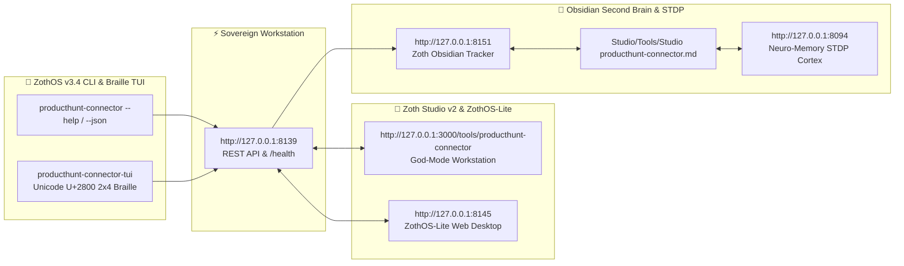

# 🚀 Product Hunt Connector (zoth-ph)

> **Local ZothOS Cockpit & URL Drift Sentinel for Product Hunt.**
> Diffs the ZOTHOS Product Hunt listing against live website/GitHub URLs, surfaces votes/ranks/comments, generates official SVG badges, and serves a loopback cockpit dashboard on `127.0.0.1:8139`. Developer tokens stay strictly in `~/.config/zothos/producthunt.secret.json` with 0600 permissions.

---

## 🏛️ Architectural Overview

**Product Hunt Connector (zoth-ph)** is an official sovereign tool in the **[Zoth Studio v2](https://zoth.nullai.tech)** (72-Tool Matrix) and **[ZothOS Linux 3.3](https://zothos.nullai.tech)** ecosystem, engineered by **1nc0gn30 • NullAI ([@1nc0gn30](https://github.com/1nc0gn30))**.

| Property | Specification |
| :--- | :--- |
| **Tool ID** | `producthunt-connector` |
| **Category** | `Commerce & POD` |
| **Loopback Port** | `http://127.0.0.1:8139` |
| **Execution Mode** | `local_cli` / `python` |
| **Zoth Studio Route** | [`http://127.0.0.1:3000/tools/producthunt-connector`](http://127.0.0.1:3000/tools/producthunt-connector) |
| **ZothOS CLI** | `producthunt-connector`, `zoth-ph` |
| **Access Model** | **100% Free & Open Access (Zero Paywalls)** |

---

## 💎 Key Capabilities

- **Zero-Egress Security Model**: Read-only listing verification. It never auto-posts comments, upvotes, or modifies live accounts.
- **URL Drift Sentinel**: Detects discrepancies between desired canonical domains (`zothos.nullai.tech`, GitHub release tags) and the Product Hunt public listing.
- **Real-Time Telemetry**: Surfaces live upvote counts, comments, review sentiment, and weekly/monthly ranks.
- **Official Badge Generation**: Generates embeddable light/dark featured and review badge markup.
- **Local Web Cockpit**: In-browser control panel on port `:8139` for reviewing telemetry and comments.

---

## 🚀 ZothOS CLI Usage

```bash
# Check daemon and system status
producthunt-connector --status
producthunt-connector --json

# Save developer token securely (mode 0600)
zoth-ph login

# Check authenticated user
zoth-ph whoami

# Check listing status and drift report
zoth-ph status
zoth-ph status --json

# Read latest community comments
zoth-ph comments

# Generate embeddable badge HTML
zoth-ph badges --json

# Launch local cockpit daemon
python3 ~/NullAITech/producthunt-connector/server.py --port 8139
```

---

## ☕ Support 1nc0gn30 • NullAI (Zero Paywalls)

All tools in the Zoth Arsenal are **100% free, open, and unlocked by default**. If you enjoy this tool and want to support continued sovereign development:

- ☕ **Buy Us a Coffee (Stripe)**: [buy.stripe.com/3cIfZg27PdKo2D64Ocfw40X](https://buy.stripe.com/3cIfZg27PdKo2D64Ocfw40X)
- ◎ **Solana Tip Address**: `GG2eQbVh8ut1BK6j1A2tz7pSySdLpD38BgyEhGcxdXoK` (`solana:GG2eQbVh8ut1BK6j1A2tz7pSySdLpD38BgyEhGcxdXoK`)

---

<div align="center">
  <sub>Engineered by <b>1nc0gn30 • NullAI</b> (<a href="https://github.com/1nc0gn30">@1nc0gn30</a>) &bull; <a href="https://nullai.tech">NullAI Platform</a> &bull; <a href="https://zoth.nullai.tech">Zoth Studio v2</a></sub>
</div>

---

## 🏛️ ZothOS v3.4, Zoth Studio v2 & Obsidian Second Brain Ecosystem



### Cross-Surface Integration Matrix

| Surface | Endpoint / Binary | Capabilities |
| :--- | :--- | :--- |
| **Standalone Workstation** | `http://127.0.0.1:8139` | 100% Free & Open-Access Web Deck, live `/health` & REST telemetry |
| **Zoth Studio v2 Route** | `http://127.0.0.1:3000/tools/producthunt-connector` | Interactive God-Mode component inside Zoth Studio (`https://zoth.nullai.tech`) |
| **ZothOS v3.4 CLI & TUI** | `producthunt-connector` / `producthunt-connector-tui` | Global binary in `/usr/local/bin/` with Unicode `U+2800` Braille TUI & `--json` output |
| **ZothOS-Lite Web Desktop** | `http://127.0.0.1:8145` | Browser-native KDE-style window manager & terminal launcher |
| **Zoth Obsidian Tracker** | `http://127.0.0.1:8151` | Interactive Obsidian Second Brain vault explorer (`~/Documents/Obsidian Vault/Studio/Tools/Studio producthunt-connector.md`) |
| **Neuro-Memory STDP Cortex** | `http://127.0.0.1:8094` | 3-Factor STDP synaptic memory daemon & 21-tool MCP server |

```bash
# Inspect CLI & Unicode U+2800 Braille TUI on ZothOS v3.4
producthunt-connector --help
producthunt-connector-tui --status
producthunt-connector-tui --json

# Verify Second Brain Vault & 12-Step Verification Gallery on :8151
zoth-obsidian-tracker --verify
```

