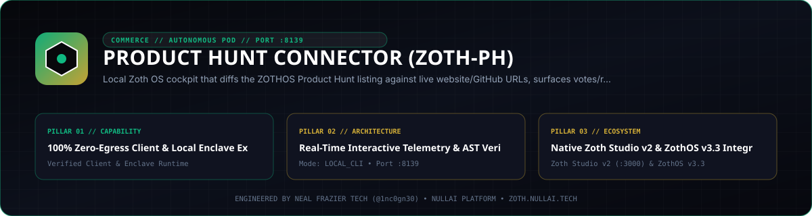

<div align="center">
  
</div>

<br />

<div align="center">
  <a href="https://zoth.nullai.tech/tools/producthunt-connector"></a>
  <a href="https://zothos.nullai.tech"></a>
  <a href="https://nullai.tech"></a>
</div>

# ⚡ Product Hunt Connector (zoth-ph)

> **Local Zoth OS cockpit that diffs the ZOTHOS Product Hunt listing against live website/GitHub URLs, surfaces votes/ranks/comments, and serves a loopback dashboard on :8139.**

---

## 🏛️ Architectural Overview

**Product Hunt Connector (zoth-ph)** is an official sovereign tool in the **[Zoth Studio v2](https://zoth.nullai.tech)** (71-Tool Matrix) and **[ZothOS Linux 3.3](https://zothos.nullai.tech)** ecosystem, engineered by **Neal Frazier Tech ([@1nc0gn30](https://github.com/1nc0gn30))**.

| Property | Specification |
| :--- | :--- |
| **Tool ID** | `producthunt-connector` |
| **Category** | `Commerce & POD` |
| **Loopback Port** | `http://127.0.0.1:8139` |
| **Execution Mode** | `local_cli` |
| **Zoth Studio Route** | [`https://zoth.nullai.tech/tools/producthunt-connector`](https://zoth.nullai.tech/tools/producthunt-connector) |

---

## 💎 Key Capabilities

- **100% Zero-Egress Client & Local Enclave Execution**
- **Real-Time Interactive Telemetry & AST Verification**
- **Native Zoth Studio v2 & ZothOS v3.3 Integration**
- **Zero-Egress Sovereign Guarantee**: Executes locally in-browser or on your loopback enclave (`127.0.0.1:8139`) with zero cloud telemetry.
- **Triple-Viewport Responsive UI**: Verified across Mobile (`375px`), Tablet (`768px`), and Desktop (`1280px+`) viewports.

---

## 🚀 Quick Start

```bash
# Launch via CLI or Zoth Fleet Supervisor
cd ~/NullAITech/producthunt-connector && npm start

# Or supervise the entire 73-port fleet from Zoth Studio v2:
python3 ~/NullAITech/zoth-studio-v2/bin/ensure_fleet.py
```

---

<div align="center">
  <sub>Engineered by <b>Neal Frazier Tech</b> (<a href="https://github.com/1nc0gn30">@1nc0gn30</a>) &bull; <a href="https://nullai.tech">NullAI Platform</a> &bull; <a href="https://zoth.nullai.tech">Zoth Studio v2</a></sub>
</div>
