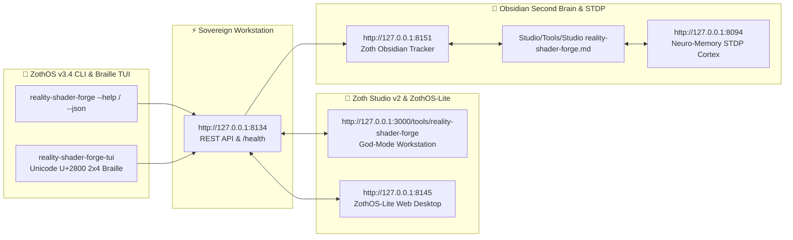

# 🎨 Zoth Reality Shader & Theme Forge

> **Interactive 60fps Reality Switch Shader Synthesizer & ZothOS Desktop Theme Compiler.**
> Synthesize dynamic particle shaders across the 5 Zoth Realities and compile production-grade theme bundles for KDE Plasma 6 (`.colors`), Alacritty terminal (`.toml`), and CSS design tokens.

---

## 🏛️ Architectural Overview

**Zoth Reality Shader & Theme Forge** is an official sovereign tool in the **[Zoth Studio v2](https://zoth.nullai.tech)** (72-Tool Matrix) and **[ZothOS Linux 3.3](https://zothos.nullai.tech)** ecosystem, engineered by **1nc0gn30 • NullAI ([@1nc0gn30](https://github.com/1nc0gn30))**.

| Property | Specification |
| :--- | :--- |
| **Tool ID** | `reality-shader-forge` |
| **Category** | `Media & 3D` |
| **Loopback Port** | `http://127.0.0.1:8134` |
| **Execution Mode** | `browser` / `python` |
| **Zoth Studio Route** | [`http://127.0.0.1:3000/tools/reality-shader-forge`](http://127.0.0.1:3000/tools/reality-shader-forge) |
| **ZothOS CLI** | `reality-shader-forge`, `theme-forge`, `reality-forge`, `zoth-theme-forge` |
| **Access Model** | **100% Free & Open Access (Zero Paywalls)** |

---

## 💎 The 5 Zoth Realities

1. **Aurum Gold** (`#D4AF37` / `#F59E0B`): The flagship sovereign standard. Rich gold accents over deep obsidian voids.
2. **Sovereign Emerald** (`#10B981` / `#059669`): High-clarity bio-cybernetic matrix.
3. **Cyber Cyan** (`#38BDF8` / `#0284C7`): Electric neon interface designed for night surveillance.
4. **Ghost Crimson** (`#F43F5E` / `#BE123C`): Critical threat and high-alert tactical telemetry.
5. **Void Obsidian** (`#8B5CF6` / `#6D28D9`): Quantum hyper-dimensional amethyst void.

---

## 🚀 ZothOS CLI Usage

```bash
# Check daemon and system status
reality-shader-forge --status
reality-shader-forge --json

# List all 5 Zoth Realities
theme-forge --list

# Compile theme formats directly to stdout
reality-forge --reality gold --format kde
reality-forge --reality emerald --format alacritty
reality-forge --reality cyan --format css
reality-forge --reality purple --format json

# Launch local web workstation daemon
python3 ~/NullAITech/reality-shader-forge/server.py --port 8134
```

---

## ☕ Support 1nc0gn30 • NullAI (Zero Paywalls)

All tools in the Zoth Arsenal are **100% free, open, and unlocked by default**. If you enjoy this tool and want to support continued sovereign development:

- ☕ **Buy Us a Coffee (Stripe)**: [buy.stripe.com/3cIfZg27PdKo2D64Ocfw40X](https://buy.stripe.com/3cIfZg27PdKo2D64Ocfw40X)
- ◎ **Solana Tip Address**: `GG2eQbVh8ut1BK6j1A2tz7pSySdLpD38BgyEhGcxdXoK` (`solana:GG2eQbVh8ut1BK6j1A2tz7pSySdLpD38BgyEhGcxdXoK`)

---

<div align="center">
  <sub>Engineered by <b>1nc0gn30 • NullAI</b> (<a href="https://github.com/1nc0gn30">@1nc0gn30</a>) &bull; <a href="https://nullai.tech">NullAI Platform</a> &bull; <a href="https://zoth.nullai.tech">Zoth Studio v2</a></sub>
</div>

---

## 🏛️ ZothOS v3.4, Zoth Studio v2 & Obsidian Second Brain Ecosystem



### Cross-Surface Integration Matrix

| Surface | Endpoint / Binary | Capabilities |
| :--- | :--- | :--- |
| **Standalone Workstation** | `http://127.0.0.1:8134` | 100% Free & Open-Access Web Deck, live `/health` & REST telemetry |
| **Zoth Studio v2 Route** | `http://127.0.0.1:3000/tools/reality-shader-forge` | Interactive God-Mode component inside Zoth Studio (`https://zoth.nullai.tech`) |
| **ZothOS v3.4 CLI & TUI** | `reality-shader-forge` / `reality-shader-forge-tui` | Global binary in `/usr/local/bin/` with Unicode `U+2800` Braille TUI & `--json` output |
| **ZothOS-Lite Web Desktop** | `http://127.0.0.1:8145` | Browser-native KDE-style window manager & terminal launcher |
| **Zoth Obsidian Tracker** | `http://127.0.0.1:8151` | Interactive Obsidian Second Brain vault explorer (`~/Documents/Obsidian Vault/Studio/Tools/Studio reality-shader-forge.md`) |
| **Neuro-Memory STDP Cortex** | `http://127.0.0.1:8094` | 3-Factor STDP synaptic memory daemon & 21-tool MCP server |

```bash
# Inspect CLI & Unicode U+2800 Braille TUI on ZothOS v3.4
reality-shader-forge --help
reality-shader-forge-tui --status
reality-shader-forge-tui --json

# Verify Second Brain Vault & 12-Step Verification Gallery on :8151
zoth-obsidian-tracker --verify
```

