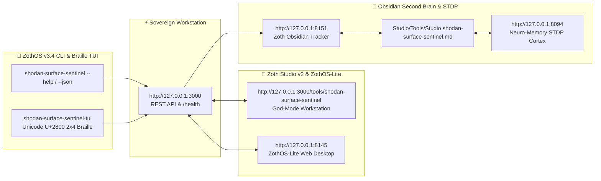

<div align="center">
  
</div>

<br />

<div align="center">
  <a href="https://zoth.nullai.tech/tools/shodan-surface-sentinel"></a>
  <a href="http://127.0.0.1:8130"></a>
  <a href="https://nullai.tech"></a>
</div>

# 🛡️ Shodan Attack Surface Sentinel (`shodan-surface-sentinel`)

> **Zero-egress defensive asset auditor and InternetDB exposure engine. Real-time open port detection, CPE software stack fingerprinting, and confirmed CVE vulnerability reconnaissance.**

---

## 🏛️ Architectural Overview

**Shodan Attack Surface Sentinel** is an official sovereign defensive tool in the **[Zoth Studio v2](https://zoth.nullai.tech)** (72-Tool Matrix) and **[ZothOS Linux 3.3](https://zothos.nullai.tech)** ecosystem, engineered by **1nc0gn30 • NullAI ([@1nc0gn30](https://github.com/1nc0gn30))**.

| Property | Specification |
| :--- | :--- |
| **Tool ID** | `shodan-surface-sentinel` |
| **Category** | `Security & Enclave` |
| **Daemon Port** | `http://127.0.0.1:8130` |
| **Workbench Route** | `http://127.0.0.1:3000/tools/shodan-surface-sentinel` |
| **API Backend** | Shodan InternetDB + Local Socket DNS Resolver |
| **Execution Mode** | Local Enclave & Browser |
| **License** | 100% Free & Open Access (Zero Paywalls) |

---

## 💎 Key Capabilities

- **InternetDB Exposure Audit**: Passively queries Shodan InternetDB with zero intrusive scanning or active probing packets.
- **Port & Service Fingerprinting**: Identifies open edge ports and maps recognized services (SSH, HTTP, HTTPS, FastCGI, Docker, Ollama-AI).
- **CPE Component Mapping**: Extracts Common Platform Enumeration (CPE) software stacks to isolate vulnerable legacy software.
- **Confirmed CVE Exposure Detection**: Cross-references open ports and components with verified CVE vulnerability lists.
- **Local Enclave Inspection**: Safely inspects loopback addresses (`127.0.0.1`) and private RFC1918 networks.

---

## 🚀 ZothOS CLI & Subcommands

Audit any infrastructure perimeter directly from the command line:

```bash
# Check installation and live daemon status
shodan-surface-sentinel --status
# Or deterministic JSON telemetry
shodan-sentinel --json

# Audit an external IP or domain
surface-sentinel scan 1.1.1.1
surface-sentinel scan nullai.tech

# Output structured JSON for pipeline integration
shodan-sentinel scan 1.1.1.1 --json

# Run local sentinel daemon
shodan-surface-sentinel serve --port 8130
```

---

## ☕ 100% Free Open Access & Sovereign Architecture

Every tool across the Zoth ecosystem is **100% free, open, and unlocked by default**. Zero paywalls, zero license modals, zero blur locks.

If you appreciate the sovereign defense tools of ZothOS, consider supporting the continuous development:

* **☕ Buy Us a Coffee (Stripe)**: [buy.stripe.com/3cIfZg27PdKo2D64Ocfw40X](https://buy.stripe.com/3cIfZg27PdKo2D64Ocfw40X)
* **◎ Solana Tip Address**: `GG2eQbVh8ut1BK6j1A2tz7pSySdLpD38BgyEhGcxdXoK` (`solana:GG2eQbVh8ut1BK6j1A2tz7pSySdLpD38BgyEhGcxdXoK`)

---

<div align="center">
  <sub>Engineered by <b>1nc0gn30 • NullAI</b> (<a href="https://github.com/1nc0gn30">@1nc0gn30</a>) &bull; <a href="https://nullai.tech">NullAI Platform</a> &bull; <a href="https://zoth.nullai.tech">Zoth Studio v2</a></sub>
</div>

---

## 🏛️ ZothOS v3.4, Zoth Studio v2 & Obsidian Second Brain Ecosystem



### Cross-Surface Integration Matrix

| Surface | Endpoint / Binary | Capabilities |
| :--- | :--- | :--- |
| **Standalone Workstation** | `http://127.0.0.1:3000` | 100% Free & Open-Access Web Deck, live `/health` & REST telemetry |
| **Zoth Studio v2 Route** | `http://127.0.0.1:3000/tools/shodan-surface-sentinel` | Interactive God-Mode component inside Zoth Studio (`https://zoth.nullai.tech`) |
| **ZothOS v3.4 CLI & TUI** | `shodan-surface-sentinel` / `shodan-surface-sentinel-tui` | Global binary in `/usr/local/bin/` with Unicode `U+2800` Braille TUI & `--json` output |
| **ZothOS-Lite Web Desktop** | `http://127.0.0.1:8145` | Browser-native KDE-style window manager & terminal launcher |
| **Zoth Obsidian Tracker** | `http://127.0.0.1:8151` | Interactive Obsidian Second Brain vault explorer (`~/Documents/Obsidian Vault/Studio/Tools/Studio shodan-surface-sentinel.md`) |
| **Neuro-Memory STDP Cortex** | `http://127.0.0.1:8094` | 3-Factor STDP synaptic memory daemon & 21-tool MCP server |

```bash
# Inspect CLI & Unicode U+2800 Braille TUI on ZothOS v3.4
shodan-surface-sentinel --help
shodan-surface-sentinel-tui --status
shodan-surface-sentinel-tui --json

# Verify Second Brain Vault & 12-Step Verification Gallery on :8151
zoth-obsidian-tracker --verify
```

