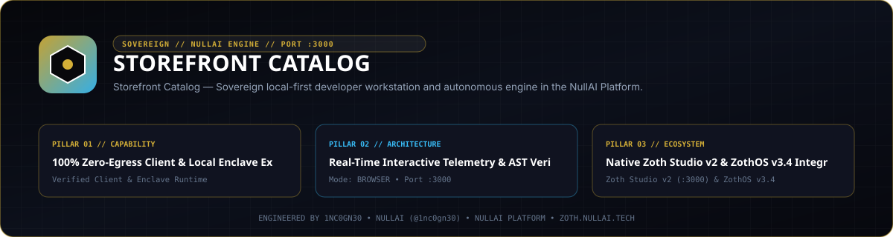
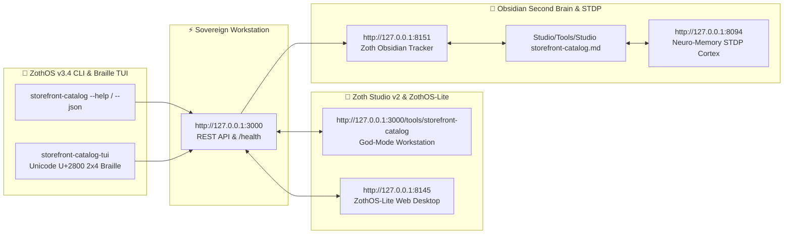

<div align="center">
  
</div>

<br />

<div align="center">
  <a href="https://zoth.nullai.tech/tools/storefront-catalog"></a>
  <a href="http://127.0.0.1:8143"></a>
  <a href="https://nullai.tech"></a>
</div>

# ⚡ YourDigitalSpace Master POD Catalog (`storefront-catalog`)

> **10 Master Etsy Print-on-Demand products optimized for the 55+ women demographic with 62.6% blended profit margin, 13/13 tag sets, 300 DPI master canvases, and 1-click Printify fulfillment payloads.**

---

## 🏛️ Architectural Overview

**Storefront Catalog** is an official sovereign tool in the **[Zoth Studio v2](https://zoth.nullai.tech)** (72-Tool Matrix) and **[ZothOS Linux 3.3](https://zothos.nullai.tech)** ecosystem, engineered by **1nc0gn30 • NullAI ([@1nc0gn30](https://github.com/1nc0gn30))**.

| Property | Specification |
| :--- | :--- |
| **Tool ID** | `storefront-catalog` |
| **Category** | `Commerce & POD` |
| **Daemon Port** | `http://127.0.0.1:8143` |
| **Workbench Route** | `http://127.0.0.1:3000/tools/storefront-catalog` |
| **Live Showcase** | [`https://yourdigitalspace.nullai.tech`](https://yourdigitalspace.nullai.tech) |
| **Total Listings** | 10 Master Etsy / Printify listings |
| **Target Demographic** | 55+ Women (Grandmothers, Gardeners, Cottagecore, Crafters) |
| **Blended Net Margin** | 62.6% ($127.41 Net Profit per full basket) |

---

## 💎 Key Capabilities

- **10 Verified Etsy POD Products**: Complete titles, 13/13 long-tail SEO tag sets, pricing matrices, and copy blocks.
- **300 DPI Print Canvases & Mockups**: Transparent print-ready artwork and photorealistic mockups.
- **Direct Printify API Payloads**: 1-click JSON payloads ready for Printify API or the Zoth Etsy Connector MCP bridge.
- **Interactive Financial Engine**: Real-time margin calculator projecting daily orders, monthly gross, and horizon to $100K net.
- **100% Free & Open-Access**: Zero paywalls, zero license modals, zero blur locks.

---

## 🚀 ZothOS CLI & Subcommands

Run `storefront-catalog` directly from the command line:

```bash
# Check installation and live daemon telemetry
storefront-catalog --status
# Or deterministic JSON
storefront --json

# List the 10 master Print-on-Demand products
pod-storefront list

# Inspect portfolio financial breakdown & profit margins
yourdigitalspace financials

# Run local showcase daemon
storefront-catalog serve --port 8143
```

---

## ☕ 100% Free Open Access & Sovereign Architecture

Every tool across the Zoth ecosystem is **100% free, open, and unlocked by default**. Zero paywalls, zero license modals, zero blur locks.

If you appreciate the sovereign architecture of YourDigitalSpace, consider supporting the continuous development:

* **☕ Buy Us a Coffee (Stripe)**: [buy.stripe.com/3cIfZg27PdKo2D64Ocfw40X](https://buy.stripe.com/3cIfZg27PdKo2D64Ocfw40X)
* **◎ Solana Tip Address**: `GG2eQbVh8ut1BK6j1A2tz7pSySdLpD38BgyEhGcxdXoK` (`solana:GG2eQbVh8ut1BK6j1A2tz7pSySdLpD38BgyEhGcxdXoK`)

---

<div align="center">
  <sub>Engineered by <b>1nc0gn30 • NullAI</b> (<a href="https://github.com/1nc0gn30">@1nc0gn30</a>) &bull; <a href="https://nullai.tech">NullAI Platform</a> &bull; <a href="https://zoth.nullai.tech">Zoth Studio v2</a></sub>
</div>

---

## 🏛️ ZothOS v3.4, Zoth Studio v2 & Obsidian Second Brain Ecosystem



### Cross-Surface Integration Matrix

| Surface | Endpoint / Binary | Capabilities |
| :--- | :--- | :--- |
| **Standalone Workstation** | `http://127.0.0.1:3000` | 100% Free & Open-Access Web Deck, live `/health` & REST telemetry |
| **Zoth Studio v2 Route** | `http://127.0.0.1:3000/tools/storefront-catalog` | Interactive God-Mode component inside Zoth Studio (`https://zoth.nullai.tech`) |
| **ZothOS v3.4 CLI & TUI** | `storefront-catalog` / `storefront-catalog-tui` | Global binary in `/usr/local/bin/` with Unicode `U+2800` Braille TUI & `--json` output |
| **ZothOS-Lite Web Desktop** | `http://127.0.0.1:8145` | Browser-native KDE-style window manager & terminal launcher |
| **Zoth Obsidian Tracker** | `http://127.0.0.1:8151` | Interactive Obsidian Second Brain vault explorer (`~/Documents/Obsidian Vault/Studio/Tools/Studio storefront-catalog.md`) |
| **Neuro-Memory STDP Cortex** | `http://127.0.0.1:8094` | 3-Factor STDP synaptic memory daemon & 21-tool MCP server |

```bash
# Inspect CLI & Unicode U+2800 Braille TUI on ZothOS v3.4
storefront-catalog --help
storefront-catalog-tui --status
storefront-catalog-tui --json

# Verify Second Brain Vault & 12-Step Verification Gallery on :8151
zoth-obsidian-tracker --verify
```

