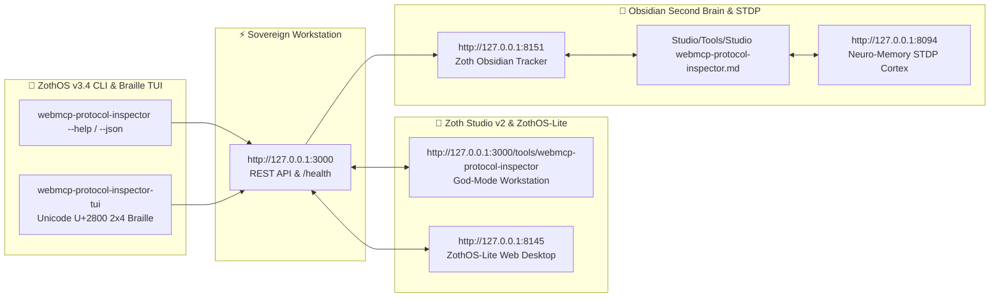

# WebMCP Protocol Suite (`webmcp-protocol-inspector`)

> Sovereign in-browser and local daemon Model Context Protocol (MCP) JSON-RPC 2.0 inspector, tool schema dispatcher, token meter, and schema security firewall.

[](https://zoth.nullai.tech)
[](/usr/local/bin/webmcp-protocol-inspector)
[](LICENSE)

---

## ☕ 100% Free & Open Access (Zero Paywalls)

WebMCP Protocol Suite is completely unrestricted and free forever. No subscriptions, no frosted blur locks, and no paywalls. If this tool saves you time and enhances your sovereign workflow, consider supporting development:

- **☕ Buy Us a Coffee (Stripe)**: [https://buy.stripe.com/3cIfZg27PdKo2D64Ocfw40X](https://buy.stripe.com/3cIfZg27PdKo2D64Ocfw40X)
- **◎ Solana Tip Address**: `GG2eQbVh8ut1BK6j1A2tz7pSySdLpD38BgyEhGcxdXoK`

---

## What It Does

1. **JSON-RPC 2.0 MCP Protocol Inspection**: Validates Anthropic MCP tool schemas and proposed W3C `navigator.modelContext` standard definitions directly in your browser or local terminal.
2. **Deterministic Token Metering**: Calculates LLM context token overheads for tool definitions before dispatching to frontier models.
3. **Schema Security Firewall**: Analyzes parameter naming, description clarity, argument typing, and Ring-level boundary enforcement to prevent prompt injection or unbounded execution.
4. **Live Wire Simulation**: Simulates bi-directional JSON-RPC 2.0 request/response cycles over sovereign local IPC with zero external network egress.

---

## How It Works

- **Architecture**: A lightweight Python `server.py` daemon runs on port `8142`, serving the standalone visual workstation and exposing real `/health`, `/api/presets`, `/api/inspect`, and `/api/rpc/simulate` REST endpoints.
- **Client-Side Synthesis**: The browser workstation and Zoth Studio God-Mode view (`/tools/webmcp-protocol-inspector`) execute real schema validation client-side while synchronizing state with the local daemon.

---

## ZothOS CLI & MCP Commands

The CLI binary is pre-installed at `/usr/local/bin/webmcp-protocol-inspector` and symlinked as `webmcp`:

```bash
# Check daemon status and health on :8142
webmcp --status

# Output deterministic JSON telemetry
webmcp --json

# Inspect and audit an MCP JSON schema file
webmcp --inspect path/to/schema.json

# Launch the standalone daemon on custom port
python3 server.py --port 8142
```

### Studio Integration
- **Standalone Workstation**: `http://127.0.0.1:8142`
- **Zoth Studio God-Mode Workbench**: `http://127.0.0.1:3000/tools/webmcp-protocol-inspector`

---

## Attribution & Authorship

Engineered by **1nc0gn30 • NullAI** ([@1nc0gn30](https://github.com/1nc0gn30)) • NullAI Platform & Research.

---

## 🏛️ ZothOS v3.4, Zoth Studio v2 & Obsidian Second Brain Ecosystem



### Cross-Surface Integration Matrix

| Surface | Endpoint / Binary | Capabilities |
| :--- | :--- | :--- |
| **Standalone Workstation** | `http://127.0.0.1:3000` | 100% Free & Open-Access Web Deck, live `/health` & REST telemetry |
| **Zoth Studio v2 Route** | `http://127.0.0.1:3000/tools/webmcp-protocol-inspector` | Interactive God-Mode component inside Zoth Studio (`https://zoth.nullai.tech`) |
| **ZothOS v3.4 CLI & TUI** | `webmcp-protocol-inspector` / `webmcp-protocol-inspector-tui` | Global binary in `/usr/local/bin/` with Unicode `U+2800` Braille TUI & `--json` output |
| **ZothOS-Lite Web Desktop** | `http://127.0.0.1:8145` | Browser-native KDE-style window manager & terminal launcher |
| **Zoth Obsidian Tracker** | `http://127.0.0.1:8151` | Interactive Obsidian Second Brain vault explorer (`~/Documents/Obsidian Vault/Studio/Tools/Studio webmcp-protocol-inspector.md`) |
| **Neuro-Memory STDP Cortex** | `http://127.0.0.1:8094` | 3-Factor STDP synaptic memory daemon & 21-tool MCP server |

```bash
# Inspect CLI & Unicode U+2800 Braille TUI on ZothOS v3.4
webmcp-protocol-inspector --help
webmcp-protocol-inspector-tui --status
webmcp-protocol-inspector-tui --json

# Verify Second Brain Vault & 12-Step Verification Gallery on :8151
zoth-obsidian-tracker --verify
```

