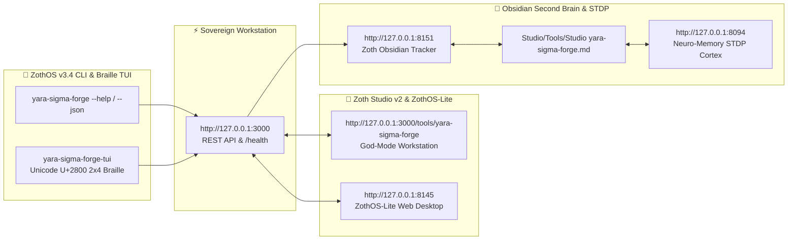

# 🛡️ YARA-X & Sigma Threat Rule Forge

> **Zero-Egress Threat Signature Compiler, Rolling Shannon Entropy Radar & MITRE ATT&CK Matrix Synthesizer.**
> 100% client-side YARA-X & Sigma threat detection compiler with 60fps byte-offset entropy radar, CVE-2024-4577 PHP-CGI / ELF64 memfd / AI Agent exfil signatures, and MITRE ATT&CK mapping.

---

## 🏛️ Architectural Overview

**YARA-X & Sigma Threat Rule Forge** is an official sovereign tool in the **[Zoth Studio v2](https://zoth.nullai.tech)** (72-Tool Matrix) and **[ZothOS Linux 3.3](https://zothos.nullai.tech)** ecosystem, engineered by **1nc0gn30 • NullAI ([@1nc0gn30](https://github.com/1nc0gn30))**.

| Property | Specification |
| :--- | :--- |
| **Tool ID** | `yara-sigma-forge` |
| **Category** | `Security & Recon` |
| **Loopback Port** | `http://127.0.0.1:8133` |
| **Execution Mode** | `browser` / `python` |
| **Zoth Studio Route** | [`http://127.0.0.1:3000/tools/yara-sigma-forge`](http://127.0.0.1:3000/tools/yara-sigma-forge) |
| **ZothOS CLI** | `yara-sigma-forge`, `yara-forge`, `sigma-forge`, `zoth-yara-forge` |
| **Access Model** | **100% Free & Open Access (Zero Paywalls)** |

---

## 💎 Key Capabilities

- **Zero-Egress In-Browser Compilation**: Compiles production YARA-X (`.yar`) rules and Sigma YAML (`.yml`) detection rules without external cloud dependencies.
- **Byte-Offset Shannon Entropy Radar**: Calculates rolling Shannon entropy ($H = -\sum p_i \log_2 p_i$) across byte buffers to detect obfuscation, packed shellcode, and encrypted stagers.
- **Battle-Tested Threat Presets**:
  - `php-cgi-rce`: CVE-2024-4577 PHP-CGI FastCGI argument injection and code execution.
  - `agent-exfil-trap`: LLM agent prompt injection to shell exfiltration via base64 pipe.
  - `elf-shellcode-stager`: Linux ELF64 memfd anonymous memory execution and syscall stagers.
  - `ransomware-shadow-copy`: Windows VSS shadow copy deletion and recovery disablement.
- **MITRE ATT&CK Mapping**: Automatic alignment with techniques (T1190, T1059, T1552, T1048, T1620, T1490).

---

## 🚀 ZothOS CLI Usage

```bash
# Check daemon and system status
yara-sigma-forge --status
yara-sigma-forge --json

# Compile threat rules to stdout
yara-forge --compile yara --preset php-cgi-rce
yara-forge --compile sigma --preset agent-exfil-trap

# Calculate Shannon byte entropy
yara-sigma-forge --entropy "suspicious_base64_or_string"
yara-sigma-forge --entropy /path/to/binary

# Scan arbitrary payload against signature rules
yara-sigma-forge --scan "POST /index.php?%ADd+allow_url_include=1"

# Launch sovereign web workstation daemon
python3 ~/NullAITech/yara-sigma-forge/server.py --port 8133
```

---

## ☕ Support 1nc0gn30 • NullAI (Zero Paywalls)

All tools in the Zoth Arsenal are **100% free, open, and unlocked by default**. If you enjoy this tool and want to support continued sovereign development:

- ☕ **Buy Us a Coffee (Stripe)**: [buy.stripe.com/3cIfZg27PdKo2D64Ocfw40X](https://buy.stripe.com/3cIfZg27PdKo2D64Ocfw40X)
- ◎ **Solana Tip Address**: `GG2eQbVh8ut1BK6j1A2tz7pSySdLpD38BgyEhGcxdXoK` (`solana:GG2eQbVh8ut1BK6j1A2tz7pSySdLpD38BgyEhGcxdXoK`)

---

<div align="center">
  <sub>Engineered by <b>1nc0gn30 • NullAI</b> (<a href="https://github.com/1nc0gn30">@1nc0gn30</a>) &bull; <a href="https://nullai.tech">NullAI Platform</a> &bull; <a href="https://zoth.nullai.tech">Zoth Studio v2</a></sub>
</div>

---

## 🏛️ ZothOS v3.4, Zoth Studio v2 & Obsidian Second Brain Ecosystem



### Cross-Surface Integration Matrix

| Surface | Endpoint / Binary | Capabilities |
| :--- | :--- | :--- |
| **Standalone Workstation** | `http://127.0.0.1:3000` | 100% Free & Open-Access Web Deck, live `/health` & REST telemetry |
| **Zoth Studio v2 Route** | `http://127.0.0.1:3000/tools/yara-sigma-forge` | Interactive God-Mode component inside Zoth Studio (`https://zoth.nullai.tech`) |
| **ZothOS v3.4 CLI & TUI** | `yara-sigma-forge` / `yara-sigma-forge-tui` | Global binary in `/usr/local/bin/` with Unicode `U+2800` Braille TUI & `--json` output |
| **ZothOS-Lite Web Desktop** | `http://127.0.0.1:8145` | Browser-native KDE-style window manager & terminal launcher |
| **Zoth Obsidian Tracker** | `http://127.0.0.1:8151` | Interactive Obsidian Second Brain vault explorer (`~/Documents/Obsidian Vault/Studio/Tools/Studio yara-sigma-forge.md`) |
| **Neuro-Memory STDP Cortex** | `http://127.0.0.1:8094` | 3-Factor STDP synaptic memory daemon & 21-tool MCP server |

```bash
# Inspect CLI & Unicode U+2800 Braille TUI on ZothOS v3.4
yara-sigma-forge --help
yara-sigma-forge-tui --status
yara-sigma-forge-tui --json

# Verify Second Brain Vault & 12-Step Verification Gallery on :8151
zoth-obsidian-tracker --verify
```

