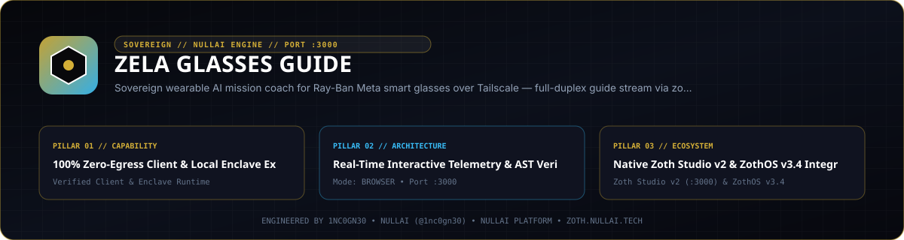
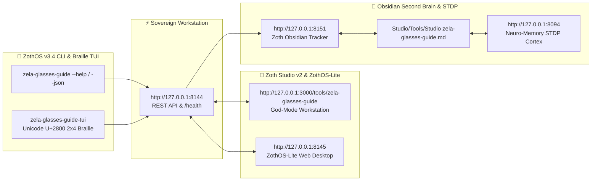

<div align="center">
  
</div>

<br />

<div align="center">
  <a href="https://zoth.nullai.tech/tools/zela-glasses-guide"></a>
  <a href="http://127.0.0.1:8144"></a>
  <a href="https://buy.stripe.com/3cIfZg27PdKo2D64Ocfw40X"></a>
  <a href="https://nullai.tech"></a>
</div>

# ⚡ Zela Glasses Guide

> **Sovereign wearable AI mission coach for Ray-Ban Meta smart glasses over Tailscale — full-duplex WebSocket guide stream, Moondream vision, AGY coaching, and Kokoro TTS via zoth-relay-mobile.**

---

## 🏛️ Architectural Overview

**Zela Glasses Guide** is an official sovereign tool in the **[Zoth Studio v2](https://zoth.nullai.tech)** (72-Tool Matrix) and **[ZothOS Linux 3.3](https://zothos.nullai.tech)** ecosystem, engineered by **1nc0gn30 • NullAI ([@1nc0gn30](https://github.com/1nc0gn30))**.

| Property | Specification |
| :--- | :--- |
| **Tool ID** | `zela-glasses-guide` |
| **Category** | `Swarm & Core` |
| **Workstation Port** | `http://127.0.0.1:8144` |
| **Relay Port** | `http://127.0.0.1:8766` (`zoth-relay-mobile`) |
| **Execution Mode** | `browser` / `local_cli` |
| **Zoth Studio Route** | [`http://127.0.0.1:3000/tools/zela-glasses-guide`](http://127.0.0.1:3000/tools/zela-glasses-guide) |
| **Licensing** | **100% Free & Open-Access** (Zero Paywalls) |

---

## 💎 Key Capabilities

- **Full-Duplex Encrypted Stream**: Connect Ray-Ban Meta Smart Glasses to your Linux workstation over Tailscale WireGuard (`100.64.0.10:8766/v1/guide/stream`).
- **Local Moondream Vision**: 1.34s ask-to-say latency with edge frame captioning via local Ollama (`moondream`).
- **Persistent AGY Session Rolling**: Pre-warmed spare AGY session rolling with low-effort sub-second prompt caching.
- **24kHz Kokoro ONNX Neural TTS**: Studio-quality voice synthesis (`af_heart`) running 100% in local volatile RAM.
- **Zero-Egress RAM-Only Privacy**: Camera frames, speech recognition transcripts, and spoken audio are held strictly in RAM for the active turn and never written to disk.
- **100% Unlocked**: Zero blur locks, zero license modals, zero paywalls.

---

## 💻 ZothOS CLI Binary Usage

```bash
# Check workstation & daemon status
zela-glasses-guide --status

# Telemetry JSON output
zela --json

# View wearable mission coaching presets
zela-guide --presets

# Print tuned Zoth Relay mobile config YAML
zela-guide --config

# Start local server on custom port
zela-glasses-guide --serve 8144
```

---

## ☕ Support 1nc0gn30 • NullAI & NullAI Platform

This tool is 100% free, open, and unlocked by default. If it empowers your sovereign AI workflow, consider supporting ongoing development:

- **Stripe "Buy Us a Coffee"**: [https://buy.stripe.com/3cIfZg27PdKo2D64Ocfw40X](https://buy.stripe.com/3cIfZg27PdKo2D64Ocfw40X)
- **Solana Tip Address**: `GG2eQbVh8ut1BK6j1A2tz7pSySdLpD38BgyEhGcxdXoK`

---

<div align="center">
  <sub>Engineered by <b>1nc0gn30 • NullAI</b> (<a href="https://github.com/1nc0gn30">@1nc0gn30</a>) &bull; <a href="https://nullai.tech">NullAI Platform</a> &bull; <a href="https://zoth.nullai.tech">Zoth Studio v2</a></sub>
</div>

---

## 🏛️ ZothOS v3.4, Zoth Studio v2 & Obsidian Second Brain Ecosystem



### Cross-Surface Integration Matrix

| Surface | Endpoint / Binary | Capabilities |
| :--- | :--- | :--- |
| **Standalone Workstation** | `http://127.0.0.1:8144` | 100% Free & Open-Access Web Deck, live `/health` & REST telemetry |
| **Zoth Studio v2 Route** | `http://127.0.0.1:3000/tools/zela-glasses-guide` | Interactive God-Mode component inside Zoth Studio (`https://zoth.nullai.tech`) |
| **ZothOS v3.4 CLI & TUI** | `zela-glasses-guide` / `zela-glasses-guide-tui` | Global binary in `/usr/local/bin/` with Unicode `U+2800` Braille TUI & `--json` output |
| **ZothOS-Lite Web Desktop** | `http://127.0.0.1:8145` | Browser-native KDE-style window manager & terminal launcher |
| **Zoth Obsidian Tracker** | `http://127.0.0.1:8151` | Interactive Obsidian Second Brain vault explorer (`~/Documents/Obsidian Vault/Studio/Tools/Studio zela-glasses-guide.md`) |
| **Neuro-Memory STDP Cortex** | `http://127.0.0.1:8094` | 3-Factor STDP synaptic memory daemon & 21-tool MCP server |

```bash
# Inspect CLI & Unicode U+2800 Braille TUI on ZothOS v3.4
zela-glasses-guide --help
zela-glasses-guide-tui --status
zela-glasses-guide-tui --json

# Verify Second Brain Vault & 12-Step Verification Gallery on :8151
zoth-obsidian-tracker --verify
```

