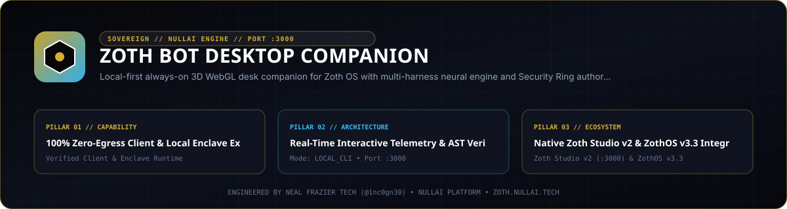

<div align="center">
  
</div>

<br />

# Zoth Bot — Sovereign Desktop Companion for Zoth OS

Local-first, always-on 3D WebGL & multi-harness agent companion for **Zoth OS** (`Linux 6.17` · X11 Sovereign Session).

Summon from anywhere on the desktop with **`Ctrl+Shift+Space`** or **`Super+Shift+Z`**. Autostart is registered at `~/.config/autostart/zoth-bot.desktop`.

---

## Core Architecture

### 1. 24K Liquid Gold & Obsidian Monolith UI
- **3D WebGL Companion Stage (`renderer/stage.js`)**: Real-time Three.js PBR stage rendering `zoth-guy.glb` and the equippable `azoth-mask.glb`, framed by a counter-rotating 3D gold astrolabe halo (`createAstrolabeHalo`), 42 additive-blended golden stardust particles (`createStarDust`), and pointer-reactive head/body parallax.
- **Dual-Mode Window (`main.js`)**:
  - **Compact Orb (`220×220`)**: Frameless, draggable circular desk orb with live status dot.
  - **Expanded Sovereign HUD (`432×760`)**: Non-overlapping command monolith with top Security Ring & Neural Engine pill, 3D viewport, live host telemetry bar, teammate & quick-action chip rail, interactive drawers, and command composer.
- **100% Offline Self-Hosted Typography (`renderer/fonts/`)**: Bundled `.woff2` fonts for `Syne` (700/800), `Space Grotesk` (400–700), and `JetBrains Mono` (400–600).

### 2. Multi-Harness Neural Engine (`lib/agent.js`, `lib/grok.js`, `lib/hermes.js`, `lib/brain.js`, `lib/catalog.js`)
Switch seamlessly between 5 inference providers and harnesses:
- **Grok (`xAI Grok CLI`)**: Streams NDJSON (`--output-format streaming-json`) with full agentic tool use (`grok-4.7`, `grok-4.7-build-fast`, `grok-4.6`, `grok-4.5`).
- **Nous (`Hermes Agent`)**: Runs `~/.local/bin/hermes` (`--format stream-json --oneshot`) across Nous Research frontier models (`stepfun/step-3.7-flash:free`, `google/gemini-4-argon`, `x-ai/grok-4.6`, `anthropic/claude-sonnet-4.5`, `openai/gpt-5`, `moonshotai/kimi-k2.5`).
- **Copilot (`Hermes Copilot`)**: Routes through Hermes Copilot provider.
- **Ollama (`Hermes Custom`)**: Routes Hermes tool loop through local Ollama (`127.0.0.1:11434`).
- **Native (`Local Ollama Loop`)**: Direct zero-overhead local tool-calling loop against `zoth-model:latest`, `qwen2.5:1.5b`, `qwen2.5-coder:1.5b`, and `llama3.2:1b`.

### 3. Zoth OS Kernel Authority & 152 MCP Server Hub (`lib/tools.js`)
- **Security Ring Authority (Rings 0–3)**: Reads and writes `~/.config/zothos/agent-ring.state` & `agent-layer.state`:
  - `Ring 0 (SOVEREIGN)` — Root, Kernel & Amnesic Authority
  - `Ring 1 (SYSADMIN)` — System Daemons & Package Control
  - `Ring 2 (TOOLMASTER)` — Agent Tools, GUI & MCP Runtime
  - `Ring 3 (SPECTRE)` — Sandboxed Read-Only Telemetry
- **Interactive 152 MCP Server Hub (`#mcpDrawer`)**: Reads `/etc/zothos/mcp-servers.json`, filters all 152 cataloged MCP servers by name, description, or Security Ring, toggles individual servers `HOT`/`OFF` via `/usr/local/bin/zoth-mcp`, and syncs across Grok, AGY, Claude Code, Hermes, Codex, OpenCode, Cursor, and Aider.
- **In-App Pocket Workspace Explorer (`#pocketDrawer`)**: Inspects `~/.config/zothos/zoth-bot/workspace`, previews Markdown/code files directly in the HUD, and opens the workspace in the system file manager.
- **Live Host Telemetry**: Probes `Ollama :11434`, `Studio :3000`, `WebGen :5173`, `Civilization :9393`, `Relay :8765`, `Vault :8787`, and `zoth-lock`, plus real-time CPU load, RAM usage, and uptime.

### 4. Accessibility & Tactical Controls
- **WAI-ARIA & Screen Reader Live Region**: Polite announcer (`#a11yAnnouncer`), semantic `role="log"`, `role="radiogroup"`, roving arrow-key navigation, high-contrast gold `:focus-visible` outlines, and `prefers-reduced-motion` support.
- **Local TTS Voice Synthesis**: Offline speech synthesis via `spd-say` / `espeak-ng`, with per-message **COPY** and **SPEAK 🔊** buttons.

---

## Tactical Slash Commands (`/`)

| Command | Description |
| :--- | :--- |
| `/status` | Probe live ZothOS ports, Ring authority & CPU/RAM vitals |
| `/grok [model]` | Switch neural harness to xAI Grok CLI (default: `grok-4.7`) |
| `/hermes [model]` | Switch neural harness to Nous Hermes Agent |
| `/ollama [model]` | Switch neural harness to local Ollama (`zoth-model:latest`) |
| `/ring <0-3>` | Switch ZothOS Security Ring (`0`=Sovereign, `1`=SysAdmin, `2`=Toolmaster, `3`=Spectre) |
| `/mcp` | Open interactive 152 MCP Server Hub drawer |
| `/pocket` | Open in-app Pocket Workspace file explorer & preview drawer |
| `/screen` | Capture desktop screenshot into Pocket Workspace |
| `/os <directive>` | Execute `/usr/local/bin/zoth-agent-os` autonomous OS command |
| `/goal <text>` | Add an active sovereign goal for the current teammate |
| `/remember <fact>` | Commit a persistent fact to teammate `memory.md` |
| `/voice` | Toggle local TTS voice synthesis readback |
| `/clear` | Clear conversation transcript for active teammate |
| `/help` | List all tactical slash commands & keyboard shortcuts |

---

## Keyboard Shortcuts

- **`Ctrl+Shift+Space`** / **`Super+Shift+Z`**: Summon Zoth Bot from anywhere on the desktop
- **`Alt+1`**: Equip / unequip the 3D Azoth Mask
- **`Alt+2`**: Open Neural Power & Security Ring Matrix drawer
- **`Alt+3`**: Open Persistent Memory & Sovereign Goals drawer
- **`Alt+4`**: Toggle Local TTS Voice Synthesis
- **`Alt+5`**: Commission a New Teammate
- **`Alt+6`**: Open 152 MCP Server Hub drawer
- **`Alt+7`**: Open Pocket Workspace Explorer drawer
- **`Alt+M`**: Minimize to Compact 3D Orb
- **`Escape`**: Close active drawer or slash command palette

---

## CLI Usage

```bash
# Launch Zoth Bot desktop companion
zoth-bot

# Run headless self-test (verifies store, workspace, Hermes, Grok, and Ollama)
zoth-bot --selftest
```

---

## Providers (direct API via Vercel AI SDK, or the CLI harnesses)

`/provider` lists providers; `/provider <id> [model]` switches. IDs: `xai`, `openai`, `anthropic`, `google`, `ollama-sdk` (direct API) and `grok`, `nous`, `copilot`, `ollama`, `native` (CLI harnesses).
API keys come from env (`XAI_API_KEY`, `OPENAI_API_KEY`, `ANTHROPIC_API_KEY`, `GOOGLE_GENERATIVE_AI_API_KEY`) or the OS keyring via `/key <id> <key>` (Electron safeStorage → KWallet/libsecret; only ciphertext in `keys.enc.json`). Never in state.json.
Direct providers get tools: host_status, screenshot, clipboard_read/write, run_command (approval required), list_files, read_file, write_file. Conversations, messages, jobs and an audit log live in `zoth-bot.db` (SQLite).

## Hardening

- Single instance: a second launch focuses the existing window.
- Debug server off unless `ZOTH_BOT_DEBUG=1` (or a port); `/eval` also needs `ZOTH_BOT_DEBUG_EVAL=1`.
- Portal binds the Tailscale IP (else 127.0.0.1; override `ZOTH_PORTAL_HOST`) and requires the token in `portal-token` (QR/links include it; hover the Taildrop line in the portal drawer to see it).
- Chromium sandbox is on; `ZOTH_BOT_NO_SANDBOX=1` restores the old flags. Note: `bin/zoth-bot` goes through `/usr/local/bin/electron`, which still adds `--no-sandbox`.

## Tests

`npm test` (node test runner inside Electron's Node, so native better-sqlite3 matches the Electron ABI).
