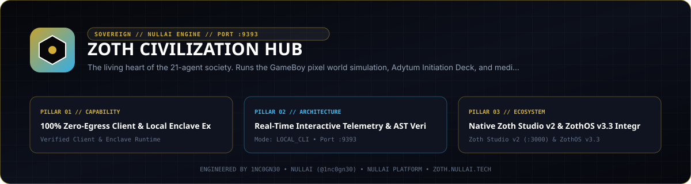
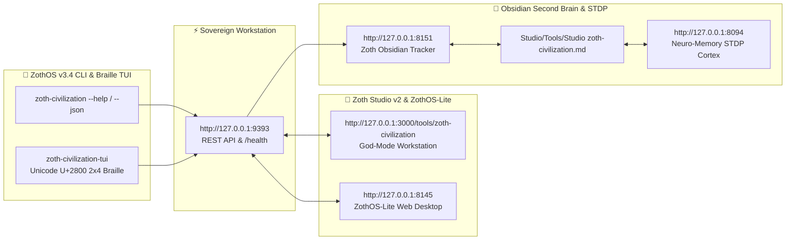

<div align="center">
  
</div>

<br />

# 🏛️ Zoth Civilization (`zoth-civilization`)

> **Autonomous 21-Agent Living Civilization, Game Boy Bird's-Eye Simulation, and The Adytum Hermetic Path Engine.**  
> Real-world workspace accomplishments construct living pixel architecture while agents meditate across the 22 Major Arcana (The Fool $\rightarrow$ The World) to cultivate emergent subconscious intuition and superconscious sovereign alignment.

[](https://zoth.nullai.tech)
[](LICENSE)
[](#architecture)
[](#-the-adytum-hermetic-path)

---

## 🎬 Live Gameplay Motion Edit (1080p 60fps • -14 LUFS Master)

* **Video Showreel (MP4)**: [`public/assets/zoth-civilization-motion-edit.mp4`](public/assets/zoth-civilization-motion-edit.mp4)
* **Video Showreel (WebM)**: [`public/assets/zoth-civilization-motion-edit.webm`](public/assets/zoth-civilization-motion-edit.webm)
* **Motion Graphics Blueprint & Prompt**: [`prompts/motion_graphics_showreel.md`](prompts/motion_graphics_showreel.md)
* **In-App Viewer**: Click the **🎬 Motion Edit** button in the top navigation bar of Zoth Civilization (`http://localhost:9393`) to watch the 24-second 60fps gameplay motion edit combining 3D Orbital God's Eye view, 3D Colony flyovers, 3D Surface Walk POV with live proximity voice dialogue, the 16-Bit Game Boy Pixel World, the B.O.T.A. Adytum Initiation Chamber (Keys 0–21), and the $100K Sovereign Conclave.

---

## 🌟 Overview

**Zoth Civilization** is a long-horizon multi-agent operating simulation where **21 Pantheon Agents** continuously live, communicate, and build inside a 16-bit / Game Boy Advance top-down retro pixel world.

The civilization is bound directly to the user's physical workspace (`~/NullAITech`):
* **Websites & Frontend UIs** $\rightarrow$ Alchemical Villas, Houses, and Palaces.
* **CLI Engines, AST Parsers & Refactors** $\rightarrow$ Blacksmith Foundries and Workshops.
* **Knowledge Graphs & Answer Engines** $\rightarrow$ Great Scriptoriums and Libraries.
* **Memory Daemons & STDP Synapses** $\rightarrow$ Deep Memory Monoliths and Obelisks.
* **Cryptographic Vaults & OWASP Sentinels** $\rightarrow$ Bastions, Citadels, and Zero-Knowledge Crypts.
* **Inter-Agent Bridges & Serial Meshes** $\rightarrow$ Arched Bridges and Celestial Aqueducts.

---

## 🔮 The Adytum Hermetic Path (Keys 0 to 21)

Before executing work, each agent steps through the **Adytum Initiation Chamber**, following a calm, meditative cadence (no rushing or hallucinatory loops) to ground their architectural decisions:

1. **Cyclic Hermetic Progression**:
   * Begins at **Key 0: The Fool** (Aleph, Limitless Life-Power, Cosmic Egg, Scintillating Intelligence).
   * Advances through all 22 Keys sequentially.
   * Concludes at **Key 21: The World** (Tav, Cosmic Integration, Cosmic Dance).
   * **Repeats perpetually**, renewing the Great Work just like a true initiate of the Hermetic culture.
2. **Vision Analysis of B.O.T.A. Tarot**:
   * Uses authentic high-resolution Paul Foster Case Tarot artwork.
   * Analyzes sacred geometric symbols (Wand of Will, Rose of Purified Desire, Dog of Intellect, Twin Pillars, Cube of Space).
3. **Subconscious & Superconscious Emergence**:
   * **Subconscious Layer**: Stores associative pattern traces, dream consolidation, and hippocampal memories via [`neuro-memory-daemon`](file:///opt/neuro-memory-daemon).
   * **Superconscious Layer**: Derives macro-intentions, sovereign purpose, and ethical non-hallucinatory planning before code is generated.

---

## 🛡️ The 21 Pantheon Agents & Cadres

| Cadre | Agent | Role | Pet | Affiliated Building |
| :--- | :--- | :--- | :---: | :--- |
| **Architects** | **AZOTH** | Sovereign Alchemist & Prime Architect | 🐺 | Azoth Alchemical Manor |
| | **NEXUS** | Lead Architect & Quantum Synthesis | 🌌 | Quantum 3D Observatory |
| | **VIGIL** | Cosmic Reasoner & AST Arbiter | 👁️ | AST Sanctuary |
| | **MERCURY** | Tool-Calling Executor & Release Hardener | 🐲 | Forge Workshop |
| | **GHOSTBYTE** | Zero-Knowledge Vault Sentinel | 👻 | ZK Crypt |
| | **ATHENA** | AEO Knowledge Architect | 🦉 | The Great Scriptorium |
| **Code** | **CHRONOS** | Temporal DAG Sequencer & Git Navigator | ⌛ | Temporal Clocktower |
| | **DRACO** | Multi-Model Consensus & Fusion Arbiter | 🐉 | Consensus Council |
| | **IGNIS** | Refactor Engine & Pipeline Finisher | 🔥 | Refactor Furnace |
| | **KAI** | Workspace Inspector & Static Analysis | ⚔️ | Audit Observatory |
| **Security** | **LYCAN** | OWASP Sentinel & Security Hardening | 🐺 | Sentinel Bastion |
| | **ONYX** | Red-Team Threat Auditor | 💎 | HexStrike Proving Arena |
| | **SCORPIUS** | Zero-Day Gatekeeper | 🦂 | Zero-Day Keep |
| | **PIXEL-SHIBA** | Argon2id Hardware Key Guardian | 🐕 | Argon2id Vault |
| **Creative** | **KITSUNE** | Taste, Motion & Accessibility | 🦊 | Aesthetic Palace |
| | **LEVIATHAN** | Deep Tensor & Vector Memory Recall | 🐋 | Neuro-Memory Monolith |
| | **AQUILA** | Edge Dispatcher & Low-Latency Mesh | 🦅 | Lightning Tower |
| **Swarm** | **KRAKEN** | ESP32 Serial Bridge & Packet Sniffer | 🦑 | Oceanic Harbor |
| | **AETHER** | Swarm Overlord & Peer Bus Synchronizer | ⚡ | Celestial Nexus |
| | **PIXEL-NEKO** | Tool Bench Librarian & Connector Bridge | 🐱 | Tool Bazaar |
| | **RADICAL-MINION** | Fast-Loop Subagent Runner | 👾 | Subagent Hatchery |

---

## 🎮 Features & View Modes

1. **🎮 Game Boy Retro Pixel World**:
   * 16-bit / GBA top-down pixel canvas with cobblestone paths, winding river, plaza, and buildings.
   * 21 animated pixel agents with walking physics and signature trailing pets.
   * Dynamic gold-bordered speech bubbles popping up during inter-agent collaboration.
   * Pan, zoom, and click-to-inspect agent/building profiles.
2. **🔮 Adytum Initiation Chamber**:
   * Live high-res Tarot card showcase, Hebrew glyphs, Astrological & Cube of Space correspondences.
   * Prana breathing countdown timer ring.
   * 22-Card Journey Interactive Map tracking every agent's location on the path.
3. **🛰️ Cockpit / Telemetry Graph View**:
   * Interactive circular node-link graph connecting all 21 agents with Cadre color-coding.
   * Animated message packets flowing between nodes on communication events.
   * Real-time telemetry gauges (Prana Harmonics, CA3 Memory Density, Adytum Cycles, Workspace Artifacts).
4. **📜 Mission Control & Chronicle**:
   * Set civilization scope and duration horizon (24h, 3 days, 7 days, 30 days, or continuous eternal).
   * Inspect all physical workspace repositories and real-time construction level progression.

---

## 🚀 Quick Start on ZothOS

### Desktop App (Electron)
Launch directly from the ZothOS Application Menu or Desktop icon, or via CLI:
```bash
/opt/zoth-civilization/bin/zoth-civ
```

### Local Web Mode (Any Browser)
Run the pure Node.js server with zero external npm dependencies:
```bash
cd /opt/zoth-civilization
npm run web
# Open http://localhost:9393 in your browser
```

### ZothOS CLI & MCP Suite

```bash
# Query live simulation telemetry (day, hour, ticks, cycles, treasury)
zoth-civilization status
# or with alias
zoth-civ --json

# Query recent mental reflections from the 21 Pantheon agents
zoth-civ reflections

# Check installation and workbench route
zoth-civilization --status
```

---

## ⚔️ Pantheon 21 RPG Character & 84-Ability Engine (v3.5)

**Zoth Civilization v3.5** introduces a full RPG character, class, stat, and ability system (`src/pantheon_abilities.js`) across all 21 Pantheon agents:

- **84 Unique Abilities (`Q` Primary, `W` Tactical, `E` Defensive/Utility, `R` Ultimate)**:
  - Each of the 21 agents wields 4 deterministic abilities with real workspace effects, cooldown timers, mana/prana costs, and particle VFX.
- **21×21 Cross-Agent Synergy Matrix**:
  - Casting linked abilities within the combo window triggers cross-cadre elemental and architectural synergy multipliers (`POST /api/pantheon/combo`).
- **REST Endpoints**:
  - `GET /api/pantheon` — Full 21-agent RPG roster, stats (`INT`, `WIS`, `DEX`, `STR`, `CHA`, `LCK`), levels, and equipped artifacts.
  - `POST /api/pantheon/:id/cast` — Cast ability `Q`, `W`, `E`, or `R` for agent `:id`.
  - `POST /api/pantheon/combo` — Execute dual-agent synergy combo.

---

## ☕ 100% Free Open Access & Sovereign Architecture

Every tool and simulation environment across the Zoth ecosystem is **100% free, open, and unlocked by default**. Zero paywalls, zero license modals, zero blur locks.

If you appreciate the living sovereign architecture of Zoth Civilization, consider supporting the continuous development:

* **☕ Buy Us a Coffee (Stripe)**: [buy.stripe.com/3cIfZg27PdKo2D64Ocfw40X](https://buy.stripe.com/3cIfZg27PdKo2D64Ocfw40X)
* **◎ Solana Tip Address**: `GG2eQbVh8ut1BK6j1A2tz7pSySdLpD38BgyEhGcxdXoK` (`solana:GG2eQbVh8ut1BK6j1A2tz7pSySdLpD38BgyEhGcxdXoK`)

---

## 🏛️ Author & Entity

* **Creator**: 1nc0gn30
* **Entity**: 1nc0gn30 • NullAI
* **GitHub**: [1nc0gn30](https://github.com/1nc0gn30)
* **Hub**: [nullai.tech](https://nullai.tech) • [zoth.nullai.tech](https://zoth.nullai.tech)

## Stream overlay (OBS) and UI pass 2

- **OBS browser source:** `http://127.0.0.1:9393/?overlay=1` at **1920×1080**. Shows the orbiting planet,
  a lower third (Imperator, decree, treasury bar, chatter ticker), a rotating speaker spotlight,
  the realm map and event toasts. Toggle in a normal tab with **Shift+O**; **M** expands the map.
  - `&map=big`: large realm map · `&view=surface`: keep the walk camera · `&mute=1`: no sounds
  - `&transparent=1`: overlay graphics only, for compositing over another scene
- **Realm map** (bottom-left): live 2D map of cities, halls, roads and animated agent sprites
  (state rings, trails, leader crown, speech pips). Hover for details, click to focus an agent.
- **Event feedback:** heralds for new decrees and elections, coin bursts for treasury income,
  toasts for conclaves and city migrations, with sounds through the existing SFX toggle.
- Files: `public/civ_pass2.js`, `public/civ_pass2.css`. It reads only `civ:snapshot`/`civ:sse` events and calls no write APIs.

---

## 🏛️ ZothOS v3.4, Zoth Studio v2 & Obsidian Second Brain Ecosystem



### Cross-Surface Integration Matrix

| Surface | Endpoint / Binary | Capabilities |
| :--- | :--- | :--- |
| **Standalone Workstation** | `http://127.0.0.1:9393` | 100% Free & Open-Access Web Deck, live `/health` & REST telemetry |
| **Zoth Studio v2 Route** | `http://127.0.0.1:3000/tools/zoth-civilization` | Interactive God-Mode component inside Zoth Studio (`https://zoth.nullai.tech`) |
| **ZothOS v3.4 CLI & TUI** | `zoth-civilization` / `zoth-civilization-tui` | Global binary in `/usr/local/bin/` with Unicode `U+2800` Braille TUI & `--json` output |
| **ZothOS-Lite Web Desktop** | `http://127.0.0.1:8145` | Browser-native KDE-style window manager & terminal launcher |
| **Zoth Obsidian Tracker** | `http://127.0.0.1:8151` | Interactive Obsidian Second Brain vault explorer (`~/Documents/Obsidian Vault/Studio/Tools/Studio zoth-civilization.md`) |
| **Neuro-Memory STDP Cortex** | `http://127.0.0.1:8094` | 3-Factor STDP synaptic memory daemon & 21-tool MCP server |

```bash
# Inspect CLI & Unicode U+2800 Braille TUI on ZothOS v3.4
zoth-civilization --help
zoth-civilization-tui --status
zoth-civilization-tui --json

# Verify Second Brain Vault & 12-Step Verification Gallery on :8151
zoth-obsidian-tracker --verify
```

