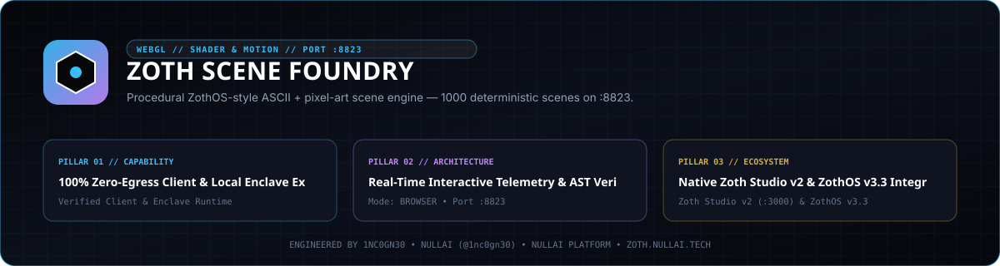
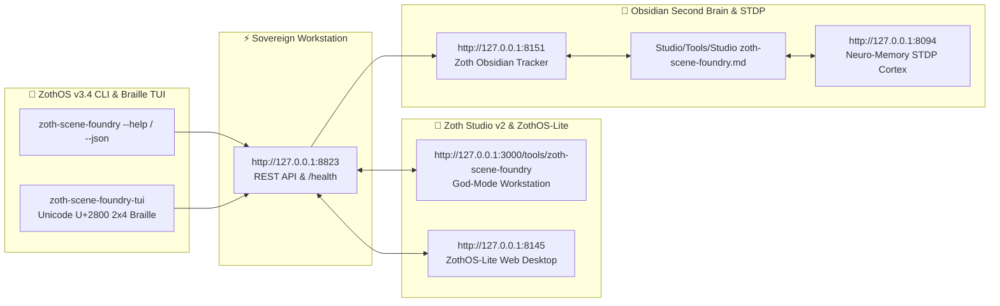

<div align="center">
  
</div>

<br />

<div align="center">
  <a href="https://zoth.nullai.tech/tools/zoth-scene-foundry"></a>
  <a href="http://127.0.0.1:8823"></a>
  <a href="https://buy.stripe.com/3cIfZg27PdKo2D64Ocfw40X"></a>
  <a href="https://nullai.tech"></a>
</div>

# 🎨 Zoth Scene Foundry

> **Procedural ZothOS-style ASCII + pixel-art scene engine — 1000 deterministic scenes with Bayer 8×8 dither, cathode tube palettes, and Three.js AsciiEffect stage on :8823.**

---

## 🏛️ Architectural Overview

**Zoth Scene Foundry** is an official sovereign tool in the **[Zoth Studio v2](https://zoth.nullai.tech)** (72-Tool Matrix) and **[ZothOS Linux 3.3](https://zothos.nullai.tech)** ecosystem, engineered by **1nc0gn30 • NullAI ([@1nc0gn30](https://github.com/1nc0gn30))**.

| Property | Specification |
| :--- | :--- |
| **Tool ID** | `zoth-scene-foundry` |
| **Category** | `Media & 3D` |
| **Workstation Port** | `http://127.0.0.1:8823` |
| **Gallery Route** | [`http://127.0.0.1:8823/gallery.html`](http://127.0.0.1:8823/gallery.html) |
| **Execution Mode** | `browser` / `local_cli` |
| **Zoth Studio Route** | [`http://127.0.0.1:3000/tools/zoth-scene-foundry`](http://127.0.0.1:3000/tools/zoth-scene-foundry) |
| **Total Scenes** | 1000 Deterministic Compositions Across 17 Sheets |
| **Dither Engine** | Ordered 8×8 Bayer Matrix + Signed Distance Field Raymarching |
| **Licensing** | **100% Free & Open-Access** (Zero Paywalls) |

---

## 💎 Key Capabilities

- **1000 Cataloged Deterministic Scenes**: Full procedural gallery browsing at `/gallery.html` with real-time field filters and tube palette selectors.
- **Ordered Bayer Dithering**: Authentic retro monochrome and multi-shade matrix rendering directly in the browser canvas.
- **Cathode Tube Color Profiles**: Aurum Gold, Retro Amber, Cyber Cyan, Sovereign Emerald, and Ghost Crimson.
- **Three.js AsciiEffect Stage**: Real-time 3D geometry rendered as ASCII character grids at 60 FPS.
- **100% Client-Side Synthesis**: Zero external network egress, no telemetry, no tracking.

---

## 💻 ZothOS CLI Binary Usage

```bash
# Check daemon & workstation status
zoth-scene-foundry --status

# Output telemetry JSON
zoth-scene-foundry --json

# View available cathode tube palettes
scene-foundry --tubes

# Synthesize deterministic ASCII scene from seed
zoth-foundry --synthesize 42

# Start standalone web server on custom port
zoth-scene-foundry --serve 8823
```

---

## ☕ Support 1nc0gn30 • NullAI & NullAI Platform

This tool is 100% free, open, and unlocked by default. If it empowers your creative coding workflow, consider supporting ongoing development:

- **Stripe "Buy Us a Coffee"**: [https://buy.stripe.com/3cIfZg27PdKo2D64Ocfw40X](https://buy.stripe.com/3cIfZg27PdKo2D64Ocfw40X)
- **Solana Tip Address**: `GG2eQbVh8ut1BK6j1A2tz7pSySdLpD38BgyEhGcxdXoK`

---

<div align="center">
  <sub>Engineered by <b>1nc0gn30 • NullAI</b> (<a href="https://github.com/1nc0gn30">@1nc0gn30</a>) &bull; <a href="https://nullai.tech">NullAI Platform</a> &bull; <a href="https://zoth.nullai.tech">Zoth Studio v2</a></sub>
</div>

---

## 🏛️ ZothOS v3.4, Zoth Studio v2 & Obsidian Second Brain Ecosystem



### Cross-Surface Integration Matrix

| Surface | Endpoint / Binary | Capabilities |
| :--- | :--- | :--- |
| **Standalone Workstation** | `http://127.0.0.1:8823` | 100% Free & Open-Access Web Deck, live `/health` & REST telemetry |
| **Zoth Studio v2 Route** | `http://127.0.0.1:3000/tools/zoth-scene-foundry` | Interactive God-Mode component inside Zoth Studio (`https://zoth.nullai.tech`) |
| **ZothOS v3.4 CLI & TUI** | `zoth-scene-foundry` / `zoth-scene-foundry-tui` | Global binary in `/usr/local/bin/` with Unicode `U+2800` Braille TUI & `--json` output |
| **ZothOS-Lite Web Desktop** | `http://127.0.0.1:8145` | Browser-native KDE-style window manager & terminal launcher |
| **Zoth Obsidian Tracker** | `http://127.0.0.1:8151` | Interactive Obsidian Second Brain vault explorer (`~/Documents/Obsidian Vault/Studio/Tools/Studio zoth-scene-foundry.md`) |
| **Neuro-Memory STDP Cortex** | `http://127.0.0.1:8094` | 3-Factor STDP synaptic memory daemon & 21-tool MCP server |

```bash
# Inspect CLI & Unicode U+2800 Braille TUI on ZothOS v3.4
zoth-scene-foundry --help
zoth-scene-foundry-tui --status
zoth-scene-foundry-tui --json

# Verify Second Brain Vault & 12-Step Verification Gallery on :8151
zoth-obsidian-tracker --verify
```

