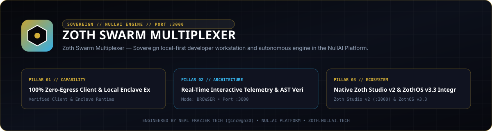

<div align="center">
  
</div>

<br />

# ⚡ Zoth Swarm Multiplexer (`zoth-swarm-multiplexer`)

> **21-Agent Sovereign Terminal Multiplexer & Universal Harness Daemon**  
> Pure Python 3 standard library · Zero external pip dependencies · 100% Offline Air-Gapped Egress · Model Context Protocol (MCP) compliant.

---

## 🏛️ Overview

The **Zoth Swarm Multiplexer** is a universal multi-agent terminal cockpit and orchestration daemon. It coordinates **21 concurrent agent nodes** across five functional Cadres, allowing operators and autonomous tools to spawn, monitor, and direct agents within a unified interface.

```
┌────────────────────────────────────────────────────────────────────────┐
│                   ZOTH 21-AGENT SWARM MULTIPLEXER                      │
│                                                                        │
│  [Cadre Filter: All (21) | Architects (6) | Code (4) | Security (4)...] │
│  [Global Broadcast: "git status -s && verify zero-egress" ──────▶ [SEND]│
├───────────────────┬────────────────────┬───────────────────────────────┤
│ TERMINAL 01: AZOTH│ TERMINAL 02: LUCY  │ TERMINAL 03: SENTINEL         │
│ Mascot: 🐺 [Agy]   │ Mascot: 🦊 [Claude]│ Mascot: 🛡️ [HexStrike/Codex]  │
│ Model: Claude 3.7 │ Model: DeepSeek R1 │ Model: Qwen 2.5 Coder         │
│ PWD: ~/zoth-studio│ PWD: ~/memory      │ PWD: ~/NullAI-HexStrike       │
│ Memory: 98% (STDP)│ Memory: 94% (STDP) │ Memory: 91% (STDP)            │
│ > Streaming Logs..│ > Streaming Logs.. │ > Streaming Logs..            │
│ [Execute Command] │ [Execute Command]  │ [Execute Command]             │
├───────────────────┼────────────────────┼───────────────────────────────┤
│ ... (Up to 21 concurrent live interactive terminal consoles)           │
└────────────────────────────────────────────────────────────────────────┘
```

---

## ⚡ Key Capabilities

1. **21 Concurrent Pantheon Agent Terminals**:
   - Organized across **Architects**, **Code**, **Security**, **Creative**, and **Swarm** cadres.
   - Each agent has an autonomous process context, individual pet mascot avatar, and dedicated PWD.

2. **Hot-Swappable 2026 AI Harnesses**:
   - **Hermes Agent** (`hermes-agent`)
   - **Antigravity CLI** (`agy`)
   - **OpenAI Codex CLI** (`codex`)
   - **Claude Code CLI** (`claude-code`)
   - **OpenCode CLI** (`opencode`)
   - **Local Ollama Ring-0** (`ollama`)

3. **Dynamic Model & PWD Targeting**:
   - Hot-swap model weights (`claude-3-7-sonnet`, `deepseek-r1:70b`, `qwen2.5-coder:32b`, `llama3.3:70b`, `hermes-3:70b`, `gpt-4.5`).
   - Switch and inspect working directories across repositories and isolated enclaves.

4. **STDP Synaptic Memory Integration**:
   - Direct loopback connection to `neuro-memory-daemon` (`http://127.0.0.1:8788`).
   - Live Long-Term Potentiation (LTP) synaptic weight meters and memory recall indexing.

5. **Universal Tool Embeddability**:
   - Run as a background daemon (`:8989`) with Server-Sent Events (SSE).
   - Standalone HTML5 web console (`index.html`) with zero build steps and audio feedback.
   - Embeddable into Zoth Studio v2, CLI harnesses, or any custom developer tool.

6. **Model Context Protocol (MCP)**:
   - Full MCP stdio server adhering to the `2024-11-05` specification for seamless Claude Code, Cursor, and Hermes Agent integration.

---

## 🏛️ The 21 Pantheon Nodes

| Agent ID | Name | Cadre | Pet / Mascot | Default Harness | Default Model | Primary Domain |
|---|---|---|---|---|---|---|
| `AZOTH` | Azoth | Architects | 🐺 Wolf | `agy` | `claude-3-7-sonnet` | Sovereign Alchemist & Prime Architect |
| `NEXUS` | Nexus | Architects | 🌌 Nebula | `claude-code` | `claude-3-7-sonnet` | Lead Architect & Quantum Synthesis |
| `VIGIL` | Vigil | Architects | 👁️ Eye | `codex` | `deepseek-r1:70b` | Cosmic Reasoner & AST Arbiter |
| `MERCURY` | Mercury | Architects | 🐲 Dragon | `hermes-agent` | `hermes-3:70b` | Tool-Calling Executor & Release Hardener |
| `GHOSTBYTE` | Ghostbyte | Architects | 👻 Phantom | `agy` | `claude-3-5-sonnet` | Zero-Knowledge Vault Sentinel |
| `ATHENA` | Athena | Architects | 🦉 Owl | `opencode` | `gpt-4.5` | AEO Knowledge Architect |
| `CHRONOS` | Chronos | Code | ⌛ Hourglass | `claude-code` | `claude-3-7-sonnet` | Temporal DAG Sequencer & Git Navigator |
| `DRACO` | Draco | Code | 🐉 Wyrm | `codex` | `deepseek-r1:70b` | Multi-Model Consensus & Fusion Arbiter |
| `IGNIS` | Ignis | Code | 🔥 Flame | `hermes-agent` | `qwen2.5-coder:32b` | Refactor Engine & Pipeline Finisher |
| `KAI` | Kai | Code | ⚔️ Blade | `agy` | `claude-3-5-sonnet` | Workspace Inspector & Static Analysis |
| `LYCAN` | Lycan | Security | 🐺 Werewolf | `hermes-agent` | `hermes-3:70b` | OWASP Sentinel & Security Hardening |
| `ONYX` | Onyx | Security | 💎 Gem | `codex` | `deepseek-r1:70b` | Red-Team Threat Auditor |
| `SCORPIUS` | Scorpius | Security | 🦂 Scorpion | `agy` | `claude-3-7-sonnet` | Zero-Day Gatekeeper |
| `PIXEL-SHIBA` | Pixel-Shiba | Security | 🐕 Shiba | `opencode` | `llama3.3:70b` | Argon2id Hardware Key Guardian |
| `KITSUNE` | Kitsune | Creative | 🦊 Fox | `claude-code` | `claude-3-7-sonnet` | Taste, Motion & Accessibility |
| `LEVIATHAN` | Leviathan | Creative | 🐋 Whale | `agy` | `claude-3-5-sonnet` | Deep Tensor & Vector Memory Recall |
| `AQUILA` | Aquila | Creative | 🦅 Eagle | `hermes-agent` | `hermes-3:70b` | Edge Dispatcher & Low-Latency Mesh |
| `KRAKEN` | Kraken | Swarm | 🦑 Kraken | `opencode` | `qwen2.5-coder:32b` | ESP32 Serial Bridge & Packet Sniffer |
| `AETHER` | Aether | Swarm | ⚡ Lightning | `claude-code` | `claude-3-7-sonnet` | Swarm Overlord & Peer Bus Synchronizer |
| `PIXEL-NEKO` | Pixel-Neko | Swarm | 🐱 Neko | `agy` | `claude-3-5-sonnet` | Tool Bench Librarian & Connector Bridge |
| `RADICAL-MINION` | Radical-Minion | Swarm | 👾 Minion | `hermes-agent` | `hermes-3:70b` | Fast-Loop Subagent Runner |

---

## 🚀 Quick Start

### 1. Inspect Status via CLI
```bash
python3 swarm_cli.py status
```

Filter by Cadre:
```bash
python3 swarm_cli.py status --cadre Architects
python3 swarm_cli.py status --cadre Security
```

### 2. Execute a Command on a Specific Agent
```bash
python3 swarm_cli.py exec --agent AZOTH "git status -s"
python3 swarm_cli.py exec --agent MERCURY "python3 webgen_engine.py --help"
```

### 3. Broadcast a Command to All 21 Agents (or Cadre)
```bash
# Broadcast to all 21 agents
python3 swarm_cli.py broadcast "verify zero-egress"

# Broadcast only to Security cadre
python3 swarm_cli.py broadcast --cadre Security "status"
```

### 4. Hot-Swap Harness & Model
```bash
python3 swarm_cli.py switch --agent AZOTH --harness hermes-agent --model hermes-3:70b
```

### 5. Start the Swarm Daemon
```bash
python3 swarm_daemon.py --port 8989
```

Once running, access the web console directly in your browser:
```
http://127.0.0.1:8989/
```

---

## 🌐 HTTP REST & SSE Endpoints

| Method | Endpoint | Description |
|---|---|---|
| `GET` | `/status` | Full JSON state of all 21 agents, cadres, and active PWDs |
| `GET` | `/stream` | Real-time Server-Sent Events (SSE) telemetry feed |
| `POST` | `/execute` | Execute command on agent (`{ "agent_id": "AZOTH", "command": "..." }`) |
| `POST` | `/broadcast` | Broadcast command (`{ "command": "...", "cadre": "All" }`) |
| `POST` | `/harness` | Switch harness (`{ "agent_id": "...", "harness": "hermes-agent" }`) |
| `POST` | `/model` | Switch model (`{ "agent_id": "...", "model": "deepseek-r1:70b" }`) |
| `POST` | `/pwd` | Change PWD context (`{ "agent_id": "...", "pwd": "/path/to/repo" }`) |
| `POST` | `/memory/sync` | Trigger STDP memory synchronization with neuro-memory-daemon |
| `GET` | `/archive` | Fetch chronological multi-agent execution history |

---

## 🤖 Model Context Protocol (MCP) Integration

Integrate the 21-Agent Swarm directly into **Claude Code**, **Cursor**, or **Hermes Agent**.

### Configuration Snippet (`claude_desktop_config.json` / `settings.json`):

```json
{
  "mcpServers": {
    "zoth-swarm": {
      "command": "python3",
      "args": [
        "~/zoth-micro-repos/zoth-swarm-multiplexer/mcp_server.py"
      ]
    }
  }
}
```

### Available MCP Tools:
- `swarm_list_agents`: List 21 nodes with cadre, status, harness, model, and PWD.
- `swarm_execute`: Execute bash scripts or instructions on an agent terminal.
- `swarm_broadcast`: Dispatch instructions across all 21 agents or a specific cadre.
- `swarm_switch_harness`: Re-assign an agent's harness tool and model.
- `swarm_set_pwd`: Switch an agent's working directory.
- `swarm_get_logs`: Fetch recent logs and reasoning traces for an agent.
- `swarm_sync_memory`: Synchronize STDP synapses with neuro-memory-daemon.

---

## 🧪 Testing

Run the automated test suite:

```bash
pytest -v tests/test_swarm.py
```

All 12 unit and integration tests execute in < 0.1s with zero external dependencies.

---

## 📄 License

MIT License. Designed and built by **NullAI Tech** & the **Zoth Architecture Council**.
