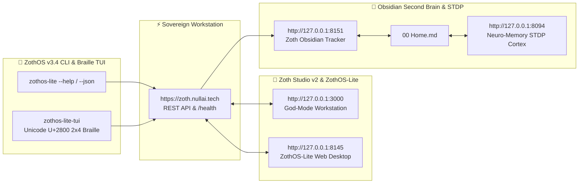

# ◈ ZothOS-Lite v1.1 (`zothos-lite`)

> **1-Bit Monotone Amnesic Security & AI Workstation (`toram noswap`) — Featuring the AZOTH Embodied Braille/ASCII AI Agent, Kokoro ONNX Neural Voice, Chain of Thoughts (`zoth-cot`) Working Memory DAG, 3D Perspective Braille/Dither Desktop, and 75+ Armed Kali/Parrot & 72 Zoth Arsenal CLI Tools**

[](https://opensource.org/licenses/MIT)
[-000000)](https://github.com/NullAITech/zothos-lite)
[](https://github.com/NullAITech/zothos-lite)
[](https://github.com/NullAITech/chain-of-thoughts)

**ZothOS-Lite v1.1** is an ultra-lightweight, Tails-inspired **1-Bit Monotone (`#FFFFFF` Paper White + `#000000` Ink Black + Ordered Bayer 4×4/8×8 Dither + Unicode `U+2800` Braille)** operating environment that boots entirely in volatile RAM (`toram noswap`) in **958 MB** (90% smaller than the 9.3 GB full ZothOS ISO).

---

## ⣿ Core Architecture & Subsystems

### 1. ◉ AZOTH — Embodied Braille & ASCII AI Agent + Real-Time Kokoro Neural Voice (`winAgent`)
- **60FPS Articulated Face & Body Rig**: Rendered in pure 1-Bit Unicode `U+2800` Braille and Ordered Bayer 4×4/8×8 dither with blinking eyes, expressive eyebrows,upper/lower teeth, dithered tongue, and 2-segment articulated arms/hands.
- **Real-Time Phoneme Viseme Lip-Sync**: Synchronizes mouth shapes (`MBP` closed, `FV` lip-bite, `AI` open, `EE` wide teeth, `OH` rounded, `AH` full jaw drop) to live WebAudio FFT + phoneme timelines.
- **6 Mood-Driven Body Kinematics**: Dynamically transitions between `SPEAKING`, `EXCITED`, `TACTICAL` (visor locked + Braille hex-shield), `THINKING` (hand-on-chin + floating math glyphs), `EMPATHETIC`, and `STOIC`.
- **Multi-Provider Neural Bus + Kokoro ONNX TTS (`:9394`)**: Connects to local **Ollama** models (`qwen2.5`, `zoth-hermes`, `hermes3-teknium`, `zoth-coder`) and cloud providers (**Claude 3.7 Sonnet**, **GPT-4o**, **Grok-3**, **Gemini 2.5 Pro**, **DeepSeek R1**) while routing 54-voice **Kokoro ONNX neural speech** directly through connected hardware speakers (`PipeWire Pro-Audio Duplex` + `ALSA`) and capturing **Microphone Voice-to-Text (`◉ MIC`)**.

### 2. ◈ Chain of Thoughts (`winCoT` // `zoth-cot`) — Multi-Turn Context & Working Memory DAG
- **Cryptographic Merkle Thought DAG**: Every conversation turn generates a SHA-256 linked reasoning node (`N00 -> N01 -> N02...`) recording `1. MEMORY RECALL`, `2. CONTEXT LINK`, `3. DEDUCTION`, and `4. SYNTHESIS`.
- **Automatic Semantic Fact Extraction & Pinned Vault**: Automatically extracts operator callsigns, active targets, and reminders from natural speech/text and injects them alongside a 24-turn rolling context window into every LLM call so AZOTH never forgets context.

### 3. ◈ Three.js-Styled 3D Perspective + Braille / Bayer Dither / ASCII Desktop Engine
- **True 3D Perspective Camera Projection (`fov = 520`)**: Receding 3D topographical floor & ceiling wave grids with depth-scaled Unicode Braille and ASCII nodes, an Ordered Bayer 8×8 horizon band, and a rotating **3D Torus-Knot `(p=2, q=3)` Monolith** with painter's algorithm hidden-surface removal and Lambertian directional lighting shaded in Bayer 4×4 halftone dither.
- **3 Interactive 3D Desktop Scenes**: Switch live between `◈ 3D Torus Knot`, `⛰ 3D Wave Canyon`, and `◎ 3D Wormhole`.

### 4. ⏳ Sovereign Horology Niche Chronometer (`#topClockUtc` & `#clockDropdownMenu`)
- **Top-Bar Horology Instrument**: Displays a live **3-Glyph `U+2800` 8-Dot Braille Binary BCD Matrix** encoding `[Hours][Minutes][Seconds]`, a 12.5Hz sub-second Braille phase rotor, **Swatch Internet Time (`.beats` BMT)**, **16-Bit Hexadecimal Day-Fraction Chron (`0x0000`–`0xFFFF`)**, **Greenwich Mean Sidereal Time (`GMST`)**, **Julian Date (`JD`)**, and **Lunar Synodic Phase**.

### 5. [>_] 75+ Armed Kali Linux, Parrot OS, Reversing & 72 Zoth Arsenal CLI Tools + Cyber Dojo (`winDojo`)
- **Live Root Terminal (`winEnvGuard`)**: Direct execution of `nmap`, `whatweb`, `wafw00f`, `nuclei`, `subfinder`, `sqlmap`, `nikto`, `ffuf`, `gobuster`, `searchsploit`, `linpeas`, `anonsurf`, `macchanger`, `mat2`, `exiftool`, `checksec`, `ropper`, `radare2`, `gdb`, `binwalk`, `john`, `hashcat`, `zoth-cot`, `zoth-rayban`, `zoth-envguard`, `zoth-ghostbyte`, and `zoth-vaelor-coldsign`.
- **Interactive Cyber Dojo (`winDojo`)**: 6 hands-on gamified security & privacy missions with XP progression and a verifiable **Ed25519 Braille Operator Diploma**.

### 6. ⚔️ Pantheon 21 Agent Swarm Dock & 🔮 Adytum 22 Tarot Oracle (`v1.1` Upgrade)
- **Pantheon 21 Agent Swarm Dock (`winPantheon` · `GET /api/pantheon` · `POST /api/pantheon/cast`)**:
  - Inspect all 21 sovereign agents, their RPG stats, and cast their `Q`/`W`/`E`/`R` abilities directly from the ZothOS-Lite desktop.
- **Adytum 22 Major Arcana Tarot Oracle (`winTarot` · `GET /api/tarot/draw`)**:
  - Draw 1-card or 3-card Major Arcana spreads (`0 The Fool` → `XXI The World`) with Hebrew glyph correspondences, Cube of Space directions, and architectural guidance.

---

## 🚀 Quick Start

```bash
git clone https://github.com/NullAITech/zothos-lite.git
cd zothos-lite

# Start the ZothOS-Lite v1.1 Desktop & API Server (:8145)
node server.js

# Optional: Build and launch the bootable QEMU/KVM Amnesic RAM VM
./vm/build-vm-image.sh
./vm/launch-vm.sh
```

---

## ☕ 100% Open-Access & Support

Every tool, daemon, and cryptographic enclave in **ZothOS-Lite** is **100% free, open, and unlocked by default** with zero paywalls.

- **☕ Buy Us a Coffee (Stripe)**: [https://buy.stripe.com/3cIfZg27PdKo2D64Ocfw40X](https://buy.stripe.com/3cIfZg27PdKo2D64Ocfw40X)
- **◎ Solana Tip Address**: `GG2eQbVh8ut1BK6j1A2tz7pSySdLpD38BgyEhGcxdXoK`

---

**Engineered by 1nc0gn30 • NullAI ([@1nc0gn30](https://github.com/1nc0gn30)) • [NullAI Platform](https://nullai.tech) • [ZothOS](https://zoth.nullai.tech)**

---

## 🏛️ ZothOS v3.4, Zoth Studio v2 & Obsidian Second Brain Ecosystem



### Cross-Surface Integration Matrix

| Surface | Endpoint / Binary | Capabilities |
| :--- | :--- | :--- |
| **Standalone Workstation** | `https://zoth.nullai.tech` | 100% Free & Open-Access Web Deck, live `/health` & REST telemetry |
| **Zoth Studio v2 Route** | `http://127.0.0.1:3000` | Interactive God-Mode component inside Zoth Studio (`https://zoth.nullai.tech`) |
| **ZothOS v3.4 CLI & TUI** | `zothos-lite` / `zothos-lite-tui` | Global binary in `/usr/local/bin/` with Unicode `U+2800` Braille TUI & `--json` output |
| **ZothOS-Lite Web Desktop** | `http://127.0.0.1:8145` | Browser-native KDE-style window manager & terminal launcher |
| **Zoth Obsidian Tracker** | `http://127.0.0.1:8151` | Interactive Obsidian Second Brain vault explorer (`~/Documents/Obsidian Vault/00 Home.md`) |
| **Neuro-Memory STDP Cortex** | `http://127.0.0.1:8094` | 3-Factor STDP synaptic memory daemon & 21-tool MCP server |

```bash
# Inspect CLI & Unicode U+2800 Braille TUI on ZothOS v3.4
zothos-lite --help
zothos-lite-tui --status
zothos-lite-tui --json

# Verify Second Brain Vault & 12-Step Verification Gallery on :8151
zoth-obsidian-tracker --verify
```

