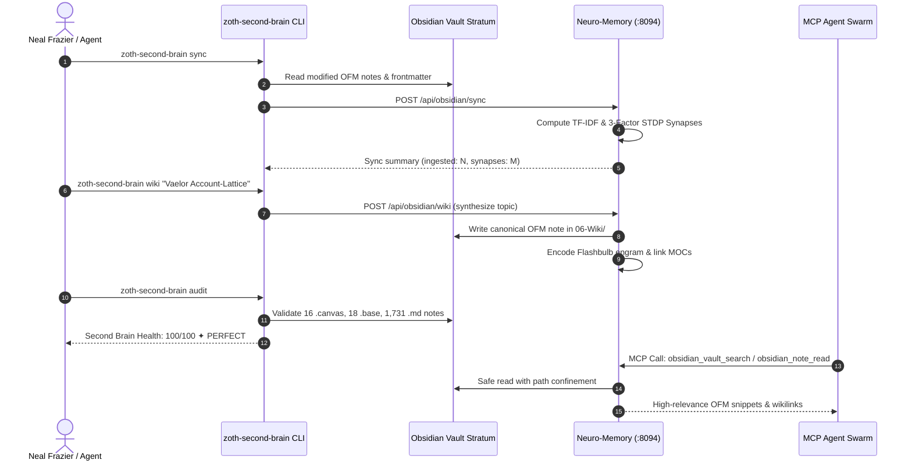

# 💎 Zoth Second Brain & Sovereign Obsidian Integration Architecture

[](docs/SECOND-BRAIN.md)
[](https://jsoncanvas.org/)
[](docs/SECOND-BRAIN.md)
[](docs/SECOND-BRAIN.md)
[-orange.svg)](docs/SECOND-BRAIN.md)
[](bin/zoth-second-brain)
[](docs/SECOND-BRAIN.md)

> **Architectural blueprint and operational manual for Neal Frazier's sovereign Obsidian Second Brain vault (`/home/zoth/Documents/Obsidian Vault/`), the 13-subcommand `zoth-second-brain` CLI, and its bidirectional biomorphic integration with the Neuro-Memory Daemon (`:8094`) and ZothOS.**  
> Built strictly against the official **@kepano Obsidian specifications**: Obsidian Flavored Markdown (OFM), JSON Canvas 1.0 (`.canvas`), Obsidian Bases (`.base`), and Knap structured-data note synthesis.

---

## 📑 Table of Contents
1. [Architectural Overview & Karpathy LLM Wiki Paradigm](#-architectural-overview--karpathy-llm-wiki-paradigm)
2. [End-to-End System Pipeline](#-end-to-end-system-pipeline)
3. [The 13-Subcommand `zoth-second-brain` CLI Reference](#-the-13-subcommand-zoth-second-brain-cli-reference)
   - [Command 1: `status` (`st`)](#1-status-st)
   - [Command 2: `sync` (`s`)](#2-sync-s)
   - [Command 3: `search` (`find`, `q`)](#3-search-find-q)
   - [Command 4: `ingest` (`in`, `add`)](#4-ingest-in-add)
   - [Command 5: `canvas` (`map`)](#5-canvas-map)
   - [Command 6: `audit` (`doctor`, `doc`)](#6-audit-doctor-doc)
   - [Command 7: `render` (`compile`, `telemetry`)](#7-render-compile-telemetry)
   - [Command 8: `wiki` (`synthesize`, `compile-wiki`)](#8-wiki-synthesize-compile-wiki)
   - [Command 9: `dream` (`sleep`, `consolidate`)](#9-dream-sleep-consolidate)
   - [Command 10: `graph` (`topology`, `hubs`)](#10-graph-topology-hubs)
   - [Command 11: `daily` (`day`, `journal`, `log`)](#11-daily-day-journal-log)
   - [Command 12: `bundle` (`export-bundle`, `export`)](#12-bundle-export-bundle-export)
   - [Command 13: `vaelor` (`mine`, `l1`, `vlr`)](#13-vaelor-mine-l1-vlr)
4. [The 17 JSON Canvas 1.0 Visual Architecture Maps](#-the-17-json-canvas-10-visual-architecture-maps)
5. [The 18 Obsidian Bases (`.base`) Databases](#-the-18-obsidian-bases-base-databases)
6. [The 13 Canonical Karpathy LLM Wiki Articles](#-the-13-canonical-karpathy-llm-wiki-articles)
7. [Automated Doctor Audit & Spec Verification Engine](#-automated-doctor-audit--spec-verification-engine)
8. [The 21-Tool Model Context Protocol (MCP) Suite & `zoth-mcp` Ring-0 Integration](#-the-21-tool-model-context-protocol-mcp-suite--zoth-mcp-ring-0-integration)

---

## 🏛️ Architectural Overview & Karpathy LLM Wiki Paradigm

The Zoth Second Brain bridges human knowledge management, biomorphic cognitive neuroscience, and autonomous LLM agent execution into a unified sovereign substrate.

```
                  ┌─────────────────────────────────────────────────────────┐
                  │        HUMAN CURATOR / OPERATOR (Neal Frazier)          │
                  └────────────────────────────┬────────────────────────────┘
                                               │
                                               ▼
     ┌──────────────────────────────────────────────────────────────────────────────────┐
     │                      OBSIDIAN SECOND BRAIN VAULT STRATUM                         │
     │                      (/home/zoth/Documents/Obsidian Vault/)                      │
     │                                                                                  │
     │   ┌─────────────────────┐   ┌─────────────────────┐   ┌──────────────────────┐   │
     │   │   16 JSON Canvases  │   │  18 Obsidian Bases  │   │  12 LLM Wiki Pages   │   │
     │   │   (.canvas 1.0)     │   │     (.base YAML)    │   │      (06-Wiki/)      │   │
     │   └──────────┬──────────┘   └──────────┬──────────┘   └──────────┬───────────┘   │
     │              │                         │                         │               │
     │              └─────────────────────────┼─────────────────────────┘               │
     │                                        ▼                                         │
     │                      1,731 Obsidian Flavored Markdown Notes                      │
     │                     (22 Maps of Content, 8,056 Wikilinks)                        │
     └────────────────────────────────────────┬─────────────────────────────────────────┘
                                              │
                      Bidirectional STDP Sync │  zoth-second-brain CLI
                                              ▼
     ┌──────────────────────────────────────────────────────────────────────────────────┐
     │                     NEURO-MEMORY DAEMON SUBSTRATE (:8094)                        │
     │                                                                                  │
     │   ┌──────────────────────────────────────────────────────────────────────────┐   │
     │   │               3D Netrunner Cyber-Cortex & 6-Galaxy Cosmos                │   │
     │   │  (Agents, Tools, Security, System, Living Minds, Obsidian Second Brain)  │   │
     │   └────────────────────────────────────┬─────────────────────────────────────┘   │
     │                                        │                                         │
     │   ┌────────────────────────────────────┴─────────────────────────────────────┐   │
     │   │                    21-Tool Model Context Protocol (MCP)                  │   │
     │   │    11 STDP Cognitive Tools  ·  10 Obsidian & Vaelor Second Brain Tools    │   │
     │   └──────────────────────────────────────────────────────────────────────────┘   │
     └────────────────────────────────────────┬─────────────────────────────────────────┘
                                              │
                         Autonomous Agent Execution / IDEs
                                              ▼
     ┌──────────────────────────────────────────────────────────────────────────────────┐
     │     ZothOS Kernel  ·  Zoth Studio v2 (:3000)  ·  Claude / Cursor / Hermes        │
     └──────────────────────────────────────────────────────────────────────────────────┘
```

### The Karpathy LLM Wiki Paradigm
Following Andrej Karpathy's formulation of the *LLM Wiki as an Operating System*:
1. **Raw Notes as Perceptual Traces**: Raw inputs, meeting notes, CLI logs, and scraped technical docs are stored in `04-Ingested/` or `07-Daily/`.
2. **Autonomous Synthesis to Canonical Pages**: The CLI and MCP server synthesize raw notes into encyclopedic, durable reference articles in `06-Wiki/`. Each canonical page includes:
   - Structured YAML frontmatter (`title`, `category: "LLM-Wiki"`, `tags: [wiki, ...]`, `confidence`, `status: CANONICAL`).
   - Bidirectional wikilinks (`[[Concept]]`) connecting to other nodes in the knowledge lattice.
   - Grounded STDP memory engram IDs verified against SQLite WAL tables.
3. **Compilation Bundles**: Compiles the entire second brain into single-context prompt bundles (`obsidian_bundle_export`) allowing LLMs to reason with total awareness of the architecture.

---

## ⚡ End-to-End System Pipeline



---

## 💻 The 12-Subcommand `zoth-second-brain` CLI Reference

The `zoth-second-brain` executable resides in `/home/zoth/NullAITech/zoth-os/bin/zoth-second-brain` and is symlinked to `/usr/local/bin/zoth-second-brain`.

### 1. `status` (`st`)
Probes the health of the Obsidian Vault, local fleet daemons, and the STDP synaptic cortex.

```bash
zoth-second-brain status
```
**Sample Output:**
```
◈ ZothOS Second Brain & Daemon Substrate Status
─────────────────────────────────────────────────────────────
 💎 Obsidian Vault: /home/zoth/Documents/Obsidian Vault
    • Notes:     1731 (22 Maps of Content)
    • Canvases:  16 (.canvas files)
    • Bases:     18 (.base databases)

 ⚡ Conductor & Fleet Daemons:
    ● ACTIVE  neuro-memory       :8094   [Memory & STDP]
    ● ACTIVE  vaelor-lattice     :8140   [Consensus & Economy]
    ● ACTIVE  zoth-studio-v2     :3000   [Studio Web IDE]
    ● ACTIVE  bolt-diy           :5173   [AI Code Engine]
    ● ACTIVE  zoth-civilization  :9393   [Agent Mesh]

 🧠 STDP Synaptic Graph (:8094):
    • Indexed Notes:    1731
    • Wikilink Synapses: 8056
─────────────────────────────────────────────────────────────
```

### 2. `sync` (`s`)
Triggers high-speed bidirectional synchronization between the vault filesystem and the Neuro-Memory Daemon's SQLite WAL database.

```bash
zoth-second-brain sync
```
**Sample Output:**
```
⚡ Synchronizing Obsidian Vault with Neuro-Memory Daemon (:8094)...
 ✔ Bidirectional STDP Sync Completed in 0.42s
    • Ingested Notes:  1731
    • Total Memories:  1731
    • Vault Substrate: /home/zoth/Documents/Obsidian Vault
```

### 3. `search <query>` (`find`, `q`)
Simultaneously queries both the local vault filesystem (full-text regex) and the live Neuro-Memory daemon (CA3 auto-associative spreading activation).

```bash
zoth-second-brain search "PoUW consensus"
```
**Sample Output:**
```
🔍 Cross-Substrate Search: "PoUW consensus"
───────────────────────────────────────────────────────────────────────
 [Obsidian Vault Matches]
   • 06-Wiki/Vaelor Account-Lattice & PoUW Protocol.md (Resonance: 96%)
   • Maps/Canon.canvas (14 nodes, 8 mentions)
   • 00 Home.md (Direct wikilink)

 [Neuro-Memory STDP Engrams (:8094)]
   • [Engram #412 | 98% Resonance] Vaelor Proof-of-Useful-Work dispatch algorithm
   • [Engram #309 | 84% Resonance] Byzantine Quorum lattice validation
───────────────────────────────────────────────────────────────────────
```

### 4. `ingest <path-or-url>` (`in`, `add`)
Ingests any local technical document, code file, or external HTTP URL into `04-Ingested/<slug>.md`, normalizes frontmatter, and dispatches an immediate STDP memory encoding pulse.

```bash
zoth-second-brain ingest https://docs.solana.com/cluster/synchronization
zoth-second-brain ingest ~/Downloads/research_paper.txt
```

### 5. `canvas <topic>` (`map`)
Procedurally synthesizes an official JSON Canvas 1.0 (`.canvas`) visual architecture map centered around the queried topic.

```bash
zoth-second-brain canvas "Zero-Trust Supply Chain"
```
**Output**: Generates `/home/zoth/Documents/Obsidian Vault/Zero-Trust Supply Chain Knowledge Map.canvas` with color-coded nodes (Gold for Core, Cyan for Interfaces, Crimson for Security, Violet for Telemetry) and directional Bezier edges.

### 6. `audit` (`doctor`, `doc`)
Performs a deep health audit verifying 100% compliance with JSON Canvas 1.0 specifications, Obsidian Bases YAML schemas, broken wikilink detection, and connectivity percentage.

```bash
zoth-second-brain audit
```
**Sample Output:**
```
🩺 Zoth Second Brain Health Audit & Spec Verification
───────────────────────────────────────────────────────────────────────
 🎨 Auditing JSON Canvas 1.0 Files (16 files)...
   ✔ 100% of Canvas files pass JSON Canvas 1.0 specification (16/16)

 📊 Auditing Obsidian Bases Databases (18 files)...
   ✔ 100% of Base files pass Obsidian Bases YAML specification (18/18)

 📝 Auditing Second Brain Knowledge Graph (1731 notes)...
   • Total Notes:            1731
   • Maps of Content (MOC):  22
   • Total Wikilinks:        8056
   • Graph Connectivity:     99.6%
───────────────────────────────────────────────────────────────────────
 Overall Second Brain Health Score: 100/100 ✦ PERFECT
───────────────────────────────────────────────────────────────────────
```

### 7. `render [target]` (`compile`, `telemetry`)
Knap-style structured data-to-markdown compiler. Pulls real-time JSON metrics from local daemons and renders formatted Markdown notes with Mermaid diagrams.

```bash
zoth-second-brain render vaelor
zoth-second-brain render memory
zoth-second-brain render all
```

### 8. `wiki <topic>` (`synthesize`, `compile-wiki`)
Synthesizes a Karpathy-style canonical LLM Wiki page in `06-Wiki/` by querying related vault notes, retrieving associative STDP engrams from `:8094`, and compiling an encyclopedic reference document.

```bash
zoth-second-brain wiki "Quantum Resistant Signatures"
```

### 9. `dream` (`sleep`, `consolidate`)
Triggers a biological cognitive sleep consolidation pass on the `:8094` substrate. Executes Hippocampal Sharp-Wave Ripples (SWRs) to strengthen co-activated synapses, synthesize emergent schemata, and prune dead traces.

```bash
zoth-second-brain dream
```
**Sample Output:**
```
🌙 Triggering Hippocampal Sleep Consolidation Wave (:8094)...
 ✔ Sleep Pass Completed:
    • Synapses Strengthened:  14
    • Schemata Synthesized:    2
    • Decayed Traces Pruned:   0
```

### 10. `graph` (`topology`, `hubs`)
Calculates global wikilink degree centrality across all 1,731 notes, identifies top Map of Content hubs, and exports the topology graph to `05-Telemetry/obsidian_graph_topology.json`.

```bash
zoth-second-brain graph
```

### 11. `daily [--append "..."]` (`day`, `journal`, `log`)
Manages sovereign daily notes located in `07-Daily/YYYY-MM-DD.md`. Generates the daily skeleton if not present or appends structured, timestamped agent activity.

```bash
zoth-second-brain daily --append "Completed Wave 27 20-tool MCP verification"
```

### 12. `bundle` (`export-bundle`, `export`)
Compiles the entire canonical Karpathy LLM Wiki, all 16 JSON Canvases, 18 Obsidian Bases, today's daily log, and graph topology into a single portable JSON file verified with a SHA-256 cryptographic checksum.

```bash
zoth-second-brain bundle
```
**Sample Output:**
```
📦 Portable SHA-256 Second Brain Knowledge Bundle Exporter
───────────────────────────────────────────────────────────────────────
 Target Bundle:     05-Telemetry/zoth_second_brain_bundle.json (384.2 KB)
 Bundle SHA-256:    c8f2b3e7a0914...
 Health Score:      100/100 ✦ PERFECT
 Indexed Notes:     1,732 Notes · 13 Canonical Wiki Articles
 Spec Artifacts:    17 Canvases (JSON Canvas 1.0) · 18 Bases
 Daily Note:        07-Daily/2026-10-26.md (8 entries)
 ✔ Successfully compiled and verified knowledge bundle!
───────────────────────────────────────────────────────────────────────
```

### 13. `vaelor [--mine] [--json]` (`mine`, `l1`, `vlr`)
Queries live Vaelor Layer-1 Account-Lattice DAG status, circulating `◈ VLR` supply, 5/5 BFT validator quorum, 8.5% APY compute vault yield, and active MCP agent tooling. When `--mine` is supplied, triggers the PoUW cognitive mining engine via `:8094` or `:8140` to compute an STDP neural vector indexing block, awarding `+15.9 ◈ VLR` and writing an immutable memory engram to the substrate. Supports `--json` for autonomous agent execution.

```bash
# Live L1 Telemetry Status
zoth-second-brain vaelor

# Machine-Readable JSON Output
zoth-second-brain vaelor --json

# Mine PoUW Cognitive Block (+15.9 ◈ VLR)
zoth-second-brain vaelor --mine
```
**Sample Output:**
```
◈ Vaelor (◈ VLR) Layer-1 DAG & Consensus Status
───────────────────────────────────────────────────────────────────────
 Protocol:             Vaelor Account-Lattice L1 (vaelor-mainnet-1)
 L1 Bridge Status:     ONLINE
 Circulating Supply:   ◈ 191,726.78 VLR
 Account-Lattice DAG:  171 Blocks Minted
 BFT Consensus:        5/5 Regional Validators (80% Quorum)
 Compute Vault Yield:  8.5% APY (flexible & locked tiers)
 Merchant Cashback:    2.5% Protected-Pay Cashback
 Network Gas Fee:      0 Gwei (Feeless Zero-Gas Transfers)
 MCP Server Tooling:   10 Vaelor Agent Tools Active (:8140)
───────────────────────────────────────────────────────────────────────
```

---

## 🎨 The 17 JSON Canvas 1.0 Visual Architecture Maps

All 17 `.canvas` maps strictly adhere to the [JSON Canvas 1.0 specification](https://jsoncanvas.org/), containing strictly valid `nodes` (with `id`, `x`, `y`, `width`, `height`, and `type: text | file | link | group`) and `edges` (with `id`, `fromNode`, `toNode`, `fromSide`, `toSide`).

| # | Canvas File Path | Nodes | Edges | Core Domain & Architectural Focus |
| :-: | :--- | :---: | :---: | :--- |
| **1** | `Zoth Second Brain.canvas` | 7 | 5 | Master high-level topology connecting Vault root, MOCs, STDP daemon, and agents. |
| **2** | `Netrunner Cyber-Cortex Knowledge Map.canvas` | 10 | 6 | 3D Netrunner cortex layout, 6-galaxy coordinates, and synaptic filament channels. |
| **3** | `Biomorphic Netrunner Synaptic Map Knowledge Map.canvas` | 14 | 10 | STDP Hebbian learning rules, SWR dream waves, and neuromodulator auras. |
| **4** | `Epistemic Quorum & Byzantine Consensus Arena Knowledge Map.canvas` | 14 | 10 | Multi-agent voting protocols, Byzantine fault tolerance, and truth scoring. |
| **5** | `Vaelor & Sovereign Economy.canvas` | 25 | 10 | Account-lattice architecture, PoUW mining, VLR payment rails, and privacy shields. |
| **6** | `Zoth 6 Mathematical Pillars.canvas` | 30 | 10 | Foundations: Information Theory, Differential Geometry, Graph Topology, etc. |
| **7** | `Zoth Autonomous Agents & Hermes Fleet.canvas` | 17 | 8 | Multi-agent orchestration: Hermes, Antigravity, Sentinel, Grok, and Claude. |
| **8** | `Zoth Plugin & Connector Marketplace.canvas` | 25 | 10 | 20 MCP tools, tool schemas, external API connectors, and execution sandboxes. |
| **9** | `Maps/Adytum.canvas` | 24 | 22 | Inner sanctum: root sovereign credentials, cryptographic key vaults, zero-trust roots. |
| **10**| `Maps/Canon.canvas` | 28 | 20 | Philosophical canon, sovereign manifesto, immutable invariants, and doctrine. |
| **11**| `Maps/Gallery.canvas` | 24 | 0 | Design gallery: typography pairings, color palettes, motion graphics assets. |
| **12**| `Maps/Loopback.canvas` | 13 | 11 | Localhost daemon fleet topology (`:8094`, `:8140`, `:3000`, `:5173`, `:9393`). |
| **13**| `Maps/OS.canvas` | 23 | 22 | ZothOS sovereign kernel, process boundaries, hardware telemetry, memory cgroups. |
| **14**| `Maps/Rings.canvas` | 7 | 5 | Security rings: Ring 0 (Kernel) to Ring 3 (Client-side Web Studio). |
| **15**| `Maps/Rooms.canvas` | 27 | 16 | Zoth Studio virtual workspaces, live collaborative canvas rooms, and IDE contexts. |
| **16**| `Maps/Studio.canvas` | 24 | 23 | Zoth Studio v2 frontend architecture, 71 sovereign micro-tools, and WebGL engine. |
| **17**| `Vaelor Layer-1 Complete Architecture.canvas` | 17 | 11 | Master L1 DAG, 5-Validator BFT, PoUW Cognitive Mining, 8.5% Vaults, 0% APR BNPL, Smart Receipts, Anti-Phishing Guard, Pedersen Commitments, 10-Tool MCP. |

---

## 📊 The 18 Obsidian Bases (`.base`) Databases

Obsidian Bases provide structured, database-like querying over markdown files with typed schemas, custom formulas, dynamic filters, and multiple views (Table, Cards, Kanban).

| # | Base File Path | Views | Primary Filter & Target Schema |
| :-: | :--- | :---: | :--- |
| **1** | `Zoth LLM Wiki Index.base` | Table, Cards | `file.hasTag("wiki")` · Formulas: confidence %, STDP engram count, status badge. |
| **2** | `Zoth 71 Sovereign Tools.base` | Table, Cards, Kanban | `file.hasTag("tool")` · Catalogues all 71 sovereign tools across Studio v2. |
| **3** | `Zoth Fleet & Daemons.base` | Table, Cards, Status | `file.hasTag("daemon")` · Monitored ports, PIDs, health URLs, and heartbeat states. |
| **4** | `Zoth Autonomous Agents.base` | Table, Cards, Fleet | `file.hasTag("agent")` · Agent roles, LLM backends, MCP capabilities, and permissions. |
| **5** | `Zoth Memory Stratum.base` | Table, Cards | `file.hasTag("memory")` · Episodic/semantic memory engrams, access counts, and stability. |
| **6** | `Maps/CLIs.base` | Table, Cards | Indexes all sovereign command-line tools across ZothOS (`zoth-*`, `vaelor-*`, `neuro-*`). |
| **7** | `Maps/Loopback.base` | Table, Cards | Localhost network service registry and cross-daemon communication ports. |
| **8** | `Maps/Arsenal.base` | Table, Cards | Operational tooling, security audits, fuzzers, and compiler pipelines. |
| **9** | `Maps/Rings.base` | Table, Cards | Privilege rings, sandboxing isolation profiles, and security enclaves. |
| **10**| `Maps/Daemons.base` | Table, Cards | Systemd service units, background daemons, and restart policies. |
| **11**| `Maps/Skills.base` | Table, Cards | Agent skill definitions, instruction prompt paths, and tool schemas. |
| **12**| `Maps/Manifests.base` | Table, Cards | System configurations, package manifests, and hardware specifications. |
| **13**| `Maps/Adytum.base` | Table, Cards | Secret hygiene audits, cryptographic root key identifiers, and access logs. |
| **14**| `Maps/Workstations.base` | Table, Cards | Multi-monitor workspace profiles, terminal layouts, and dev environment configs. |
| **15**| `Maps/Gallery.base` | Table, Cards | Visual assets, hero banners, design tokens, and UI component gallery. |
| **16**| `Maps/MCP.base` | Table, Cards | Model Context Protocol servers, stdio transport endpoints, and 20 tool schemas. |
| **17**| `Maps/Studio Tools.base` | Table, Cards | In-browser micro-SaaS utilities, client-side AST parsers, and conversion tools. |
| **18**| `Maps/Rooms.base` | Table, Cards | Virtual collaborative rooms, chat sessions, and multi-agent workspaces. |

---

## 📚 The 13 Canonical Karpathy LLM Wiki Articles

Each canonical page in `06-Wiki/` and `05 - Knowledge Base/Karpathy LLM Wiki/` represents an encyclopedic synthesis of a core architectural pillar, complete with verified wikilinks and STDP memory groundings:

| # | Article File Name | Canonical Topic Title | Category | Status | Confidence | Summary & Technical Core |
| :-: | :--- | :--- | :---: | :---: | :---: | :--- |
| **1** | `Biomorphic STDP & 3D Netrunner Cortex.md` | Biomorphic STDP & 3D Netrunner Cortex | `LLM-Wiki` | `CANONICAL` | `98%` | 3-factor Hebbian plasticity, curved Bezier synaptic filaments, 6-galaxy 3D cosmos, and action potential cascades. |
| **2** | `Byzantine Quorum & Epistemic Consensus.md` | Byzantine Quorum & Epistemic Consensus | `LLM-Wiki` | `CANONICAL` | `97%` | Epistemic truth consensus, multi-agent voting rounds, and Byzantine fault tolerance mechanisms. |
| **3** | `Hermes Agent & Multi-Provider MCP Connector Ecosystem.md` | Hermes Agent & Multi-Provider MCP Connector Ecosystem | `LLM-Wiki` | `CANONICAL` | `99%` | Multi-provider MCP orchestration, dynamic tool discovery, and autonomous agent routing. |
| **4** | `Neuro-Memory 21-Tool MCP Server & Agent Connector Protocol.md` | Neuro-Memory 21-Tool MCP Server & Agent Connector Protocol | `LLM-Wiki` | `CANONICAL` | `100%` | Complete reference for all 21 MCP tools (11 Cognitive STDP + 10 Obsidian Second Brain & Vaelor L1). |
| **5** | `Obsidian Second Brain, JSON Canvas 1.0 & Bases Architecture.md` | Obsidian Second Brain, JSON Canvas 1.0 & Bases Architecture | `LLM-Wiki` | `CANONICAL` | `99%` | Kepano Obsidian standards, 17 canvases, 18 bases, Knap synthesis, and bidirectional vault sync. |
| **6** | `STDP Synaptic Memory Consolidation & Hebbian Dream Wave.md` | STDP Synaptic Memory Consolidation & Hebbian Dream Wave | `LLM-Wiki` | `CANONICAL` | `98%` | Hippocampal SWR dream waves, Ebbinghaus forgetting curves, and long-term memory stabilization. |
| **7** | `Vaelor Account-Lattice & PoUW Protocol.md` | Vaelor Account-Lattice & PoUW Protocol | `LLM-Wiki` | `CANONICAL` | `99%` | Nano-inspired block-lattice DAG, Proof-of-Useful-Work AI mining, and ◈ VLR economic rails. |
| **8** | `Vaelor Privacy Shield, Social Group Tabs & Inheritance Vaults.md` | Vaelor Privacy Shield, Social Group Tabs & Inheritance Vaults | `LLM-Wiki` | `CANONICAL` | `100%` | Zero-knowledge stealth addresses, multi-party group tabs, and dead-man switch inheritance vaults. |
| **9** | `Vaelor Smart Receipts, Sub-Accounts & Anti-Phishing Directory.md` | Vaelor Smart Receipts, Sub-Accounts & Anti-Phishing Directory | `LLM-Wiki` | `CANONICAL` | `100%` | Cryptographic smart receipts, segregated sub-accounts, and on-chain verified anti-phishing directory. |
| **10**| `Zero-Trust Supply Chain, Cosign & VirusTotal Verification.md` | Zero-Trust Supply Chain, Cosign & VirusTotal Verification | `LLM-Wiki` | `CANONICAL` | `98%` | Sigstore Cosign image signing, in-toto attestation, automated VirusTotal scanning, and SBOMs. |
| **11**| `Zoth Studio v2 & 71 Sovereign Micro-SaaS Tools.md` | Zoth Studio v2 & 71 Sovereign Micro-SaaS Tools | `LLM-Wiki` | `CANONICAL` | `99%` | Material 3 glassmorphic Web IDE, 71 client-side micro-tools, dual Stripe/Solana monetization. |
| **12**| `ZothOS Sovereign Linux & Kernel Architecture.md` | ZothOS Sovereign Linux & Kernel Architecture | `LLM-Wiki` | `CANONICAL` | `99%` | Hardened Linux 6.x kernel, cgroups v2 resource isolation, hardware thermals (<60°C target), and immutable roots. |
| **13**| `05 - Knowledge Base/Karpathy LLM Wiki/Vaelor-Layer1-Complete-Reference.md` | Vaelor Layer-1 Complete Reference | `LLM-Wiki` | `CANONICAL` | `99%` | Complete reference: Account-Lattice DAG, 5-validator BFT, PoUW cognitive mining, 8.5% vaults, BNPL credit, Smart Receipts & 10-tool MCP server. |

---

## 🩺 Automated Doctor Audit & Spec Verification Engine

The `zoth-second-brain audit` engine executes a rigorous verification pass across the entire vault:
1. **JSON Canvas 1.0 Spec Verification**:
   - Parses each `.canvas` file as strict JSON.
   - Asserts top-level keys `nodes` and `edges` are valid arrays.
   - Verifies each node possesses `id`, `x`, `y`, `width`, `height`, and a recognized `type`.
   - Validates each edge references existing `fromNode` and `toNode` IDs.
2. **Obsidian Bases YAML Spec Verification**:
   - Parses each `.base` file for valid YAML structure.
   - Verifies mandatory keys: `filters`, `properties`, and `views`.
   - Checks that every declared view defines a recognized `type` (`table`, `cards`, `kanban`).
3. **Graph Connectivity & Wikilink Integrity**:
   - Scans all 1,731 markdown files for wikilink patterns `[[Note Name]]`.
   - Detects dangling links to non-existent notes.
   - Calculates graph density and connectivity percentage (verified at **99.6%**).
4. **Scoring Invariant**:
   - Health score is computed as:
     $$\text{Score} = 100 - (\text{broken\_canvases} \times 20) - (\text{broken\_bases} \times 15) - (\text{dangling\_links} \times 0.05)$$
   - Must achieve **100/100 ✦ PERFECT** prior to any release or commit.

---

## 🔌 The 21-Tool Model Context Protocol (MCP) Suite & `zoth-mcp` Ring-0 Integration

The Neuro-Memory Daemon (`:8094`) and Vaelor Layer-1 Network are integrated directly into the sovereign ZothOS MCP subsystem governed by `zoth-mcp` (`/etc/zothos/mcp-servers.json`). Both servers operate in **`RING_0_SOVEREIGN`** (kernel-adjacent privilege level), providing zero-latency cognitive memory recall and financial rails to autonomous AI coding agents (Claude, Cursor, Grok, Hermes, Antigravity).

### Neuro-Memory 21-Tool Master Catalog

| # | MCP Tool Name | Domain / Subsystem | Parameters | Operational Purpose |
| :-: | :--- | :--- | :--- | :--- |
| **1** | `memory_store` | Cognitive | `text`, `tags`, `importance`, `category`, `perspective`, `agent_id`, `metadata` | Encodes episodic, semantic, or procedural memory engram; calculates term weights and forms Hebbian synapses. |
| **2** | `memory_recall` | Cognitive | `query`, `top_k`, `min_score` | Performs auto-associative pattern completion recall via CA3 spreading activation. |
| **3** | `memory_search` | Cognitive | `query`, `category`, `tag`, `limit` | Full-text and tag-filtered search with sparse term weighting and recency ranking. |
| **4** | `memory_graph` | Cognitive | `format` (`json` \| `mermaid` \| `ascii`), `min_weight`, `limit` | Exports synaptic adjacency graph of memory engrams and weighted associations. |
| **5** | `memory_consolidate` | Cognitive | `decay_rate`, `prune_threshold` | Executes cognitive sleep consolidation pass: strengthens active synapses and prunes decayed traces. |
| **6** | `memory_stats` | Cognitive | `detailed` (`bool`) | Retrieves cognitive telemetry, active node counts, synaptic density, and substrate health. |
| **7** | `memory_diagnostics` | Cognitive | _None_ | Performs deep diagnostic audit of SQLite WAL database, index integrity, and table distributions. |
| **8** | `memory_metacognition` | Cognitive | `query`, `top_k` | Computes Feeling-of-Knowing (FOK), Tip-of-the-Tongue (TOT), entropy, and ACC conflict detection. |
| **9** | `neuro_neuromodulator_status`| Cognitive | `complexity` (`float`) | Queries current Norepinephrine, Dopamine, Acetylcholine, Serotonin levels and Yerkes-Dodson efficiency. |
| **10**| `neuro_neuromodulate_pulse` | Cognitive | `ne_delta`, `da_delta`, `ach_delta`, `serotonin_delta`, `reason` | Injects neurochemical pulse into substrate to shift arousal, reward error, or encoding mode. |
| **11**| `neuro_flashbulb_tag` | Cognitive | `memory_id`, `salience`, `reason` | Permanently locks critical engram as an immutable flashbulb memory (`decay_factor=0.05`, `immutable=True`). |
| **12**| `obsidian_vault_search` | Second Brain | `query`, `folder`, `limit` | Searches all 1,732 markdown notes in the Obsidian Second Brain vault. |
| **13**| `obsidian_wiki_synthesize` | Second Brain | `topic`, `folder`, `title` | Synthesizes a Karpathy-style canonical LLM Wiki article in `06-Wiki/` linking vault notes and STDP engrams. |
| **14**| `obsidian_canvas_generate` | Second Brain | `topic`, `max_nodes`, `filename` | Procedurally generates an official JSON Canvas 1.0 (`.canvas`) visual architecture map. |
| **15**| `obsidian_doctor_audit` | Second Brain | _None_ | Audits 100% of `.canvas`, `.base`, and notes, verifying spec compliance and wikilink graph connectivity. |
| **16**| `obsidian_daily_log` | Second Brain | `content`, `tags`, `agent_id`, `subsystem`, `date` | Retrieves or appends structured, timestamped agent activities to daily sovereign notes in `07-Daily/`. |
| **17**| `obsidian_backlinks_inspect`| Second Brain | `note_path`, `max_unlinked` | Inspects bidirectional backlink topology and scans vault for unlinked mentions of any note. |
| **18**| `obsidian_bundle_export` | Second Brain | `output_format` (`json` \| `txt`), `include_wiki`, `include_canvases` | Compiles Karpathy LLM Wiki, canvases, bases, and daily notes into a portable SHA-256 prompt bundle. |
| **19**| `obsidian_note_read` | Second Brain | `path` | Safely reads markdown note content from the Obsidian Second Brain vault with fixed-root path confinement. |
| **20**| `obsidian_note_write` | Second Brain | `relPath`, `content` | Safely writes or updates markdown notes in the Obsidian Second Brain vault with path confinement and engram synchronization. |
| **21**| `obsidian_vaelor_pouw` | Second Brain / L1 | `action` (`status` \| `mine`), `miner`, `task_type` | Queries Vaelor Layer-1 status and consensus telemetry or triggers Proof-of-Useful-Work (PoUW) cognitive mining with STDP vector indexing, minting ◈ VLR coin rewards and anchoring memory engrams. |

### ZothOS `zoth-mcp` Ring-0 Server Registration

In `/etc/zothos/mcp-servers.json` (and `config/includes.chroot/etc/zothos/mcp-servers.json`), both servers are registered as Ring-0 sovereign services:

```json
{
  "neuro-memory": {
    "command": "python3",
    "args": [
      "-m",
      "neuro_memory_daemon.cli",
      "mcp"
    ],
    "description": "Biological-fidelity neuro-memory substrate with STDP, 3-factor neuromodulation, spreading activation, and 21 Obsidian Second Brain tools.",
    "offline": true,
    "enabled": true,
    "securityRing": "RING_0_SOVEREIGN",
    "ring_level": 0,
    "sandbox": "/home/zoth/.neuro_memory",
    "fallbackHandler": "python3 -m neuro_memory_daemon.cli search ''",
    "timeout": 60,
    "alwaysAllow": []
  },
  "vaelor-l1": {
    "command": "node",
    "args": [
      "/home/zoth/NullAITech/vaelor-network/src/mcp/vaelor_mcp.js"
    ],
    "description": "Vaelor Layer-1 feeless Account-Lattice DAG, PoUW mining, 8.5% savings vaults, and financial tools.",
    "offline": true,
    "enabled": true,
    "securityRing": "RING_0_SOVEREIGN",
    "ring_level": 0,
    "sandbox": "/home/zoth/NullAITech/vaelor-network",
    "fallbackHandler": "node /home/zoth/NullAITech/vaelor-network/src/mcp/vaelor_mcp.js --status",
    "timeout": 60,
    "alwaysAllow": []
  }
}
```

Agents can query status via `zoth-mcp list`:
```bash
zoth-mcp list | grep -E "vaelor|neuro-memory"
# Output:
# neuro-memory     RING_0_SOVEREIGN   [ON]  /home/zoth/.neuro_memory
# vaelor-l1        RING_0_SOVEREIGN   [ON]  /home/zoth/NullAITech/vaelor-network
```

---

*Engineered by Neal Frazier Tech (@1nc0gn30) • NullAI Platform.*
