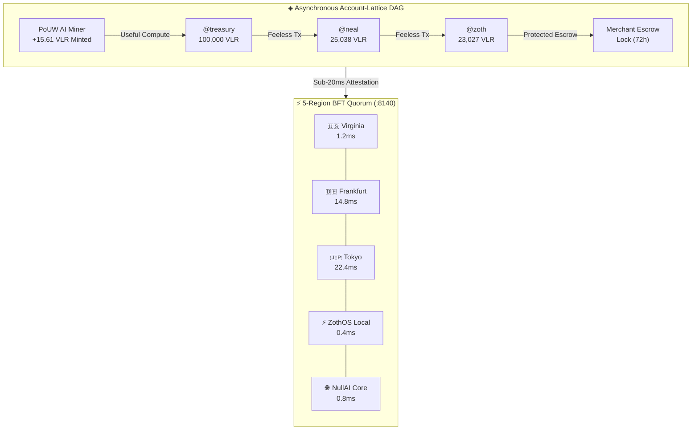

# ◈ {{ title }}

> [!info] Live Autonomous Telemetry
> Compiled directly from the active Vaelor Validator Node (`:8140`) via `@kepano/knap` structured template synthesis.

- **Protocol:** `{{ protocol }}` (Feeless Asynchronous Account-Lattice DAG)
- **Symbol:** `{{ symbol }}` (◈)
- **Chain ID:** `{{ chainId }}`
- **Total Blocks Minted:** `{{ totalBlocks }}`
- **Total Supply:** `{{ totalSupplyVlr }} VLR`
- **Total PoUW Minted:** `{{ totalPouwMintedVlr }} VLR`
- **Total Gas Saved:** `${{ totalGasSavedUsd }} USD` (100% Feeless transactions)
- **Active Accounts:** `{{ accountCount }}`
- **Consensus Health:** `{{ consensusStatus }}` (Quorum: {{ quorumSize }}, BFT Threshold: {{ bftThreshold }})

## Account-Lattice DAG Topology & Consensus

## Validator Mesh Registry (:8140)

| Flag | Validator Node | Region | Base Latency | Status | Uptime |
|:---:|:---|:---|:---:|:---:|:---:|

| {{ val.flag }} | {{ val.name }} | {{ val.region }} | {{ val.baseLatencyMs }} ms | 🟢 {{ val.status }} | {{ val.uptimePct }}% |


## Registered Account Micro-Chains

| Handle | Display Name | Balance (◈ VLR) | Height | Guardians | Status |
|:---|:---|:---:|:---:|:---|:---:|

| `{{ acc.handle }}` | {{ acc.displayName }} | {{ acc.balanceVlr }} VLR | {{ acc.blockHeight }} | {{ acc.guardians | join:", " }} | 🔒 Secured |


> [!tip] Proof-of-Useful-Work (PoUW)
> Vaelor miners mint tokens strictly by performing verified AI workloads, including Schema.org AEO syntheses, Core Web Vitals DOM audits, and entropy verifications.

## See Also

- [[Vaelor Network|Vaelor Network Canon]]
- [[Vaelor & Sovereign Economy.canvas|Vaelor & Sovereign Economy Canvas]]
- [[Zoth Autonomous Agents & Hermes Fleet.canvas|Hermes Fleet Canvas]]
- [[00 Home]]
